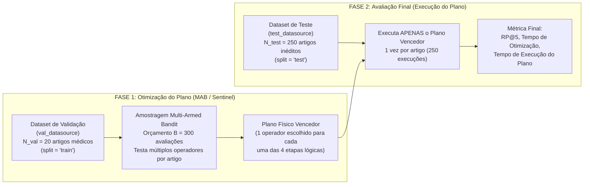
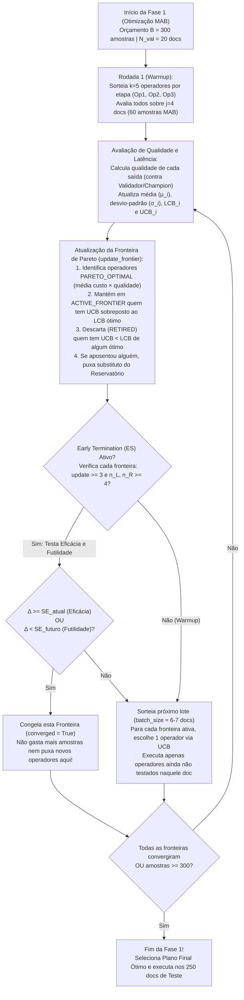
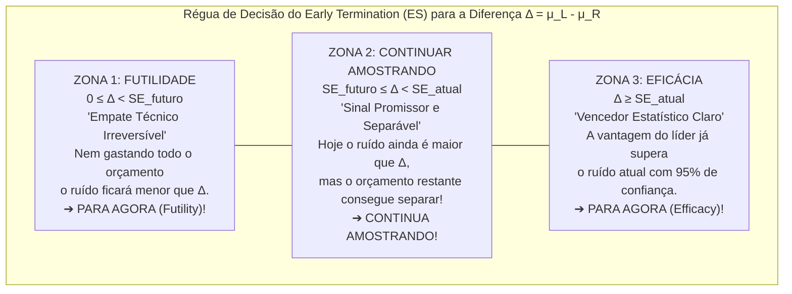

# Guia Didático para Apresentação (Slides): Fluxo de Amostras, Parâmetros e Algoritmo de Otimização (MAB + Early Termination `ES`)

Este documento foi estruturado especificamente para servir de **base direta para a construção de slides** e **roteiro de explicação aos orientadores**. Ele explica passo a passo:
1. **Como os documentos e amostras entram no sistema** (e por que existem números diferentes: `20` documentos de validação, `250` de teste, `300` de orçamento, `315` amostras MAB e `375` linhas no CSV);
2. **Como funcionam todos os parâmetros** que governam o otimizador Multi-Armed Bandit (MAB);
3. **Como o algoritmo funciona passo a passo** (do sorteio inicial até o cálculo de `LCB`/`UCB`, poda de operadores e o novo critério estatístico de **Early Termination — `ES`**);
4. **Sugestão de estrutura de slides** pronta para apresentação.

---

## Parte 1: Como os Documentos e Amostras Entram no Processo

### 1.1 A Regra de Ouro: Duas Fases Estritamente Separadas (Zero Vazamento de Dados)

Uma dúvida muito comum ao olhar os números do experimento é: *"Se o teste tem 250 documentos, por que o orçamento do otimizador é de 300 amostras, e que documentos são esses?"*

A resposta é que a execução completa do sistema ocorre em **duas fases independentes**, usando **dois conjuntos de dados disjuntos** (interseção = **0 artigos**, provado no Teste de Sanidade 1):

* **Na Fase 1 (Otimização MAB):** O otimizador **nunca vê** os 250 documentos de teste. Ele trabalha exclusivamente sobre uma bancada enxuta de **$N_{\text{val}} = 20$ documentos de validação** (`val_datasource`).
* **Na Fase 2 (Execução do Plano Final):** Depois que o MAB termina e escolhe o melhor operador físico para cada etapa do pipeline, esse plano único é executado uma vez sobre cada um dos **$N_{\text{test}} = 250$ documentos de teste** (`test_datasource`). É daqui que sai a métrica final `rp@5`.

---

### 1.2 O que é "1 Documento" vs. "1 Amostra do MAB" vs. "1 Linha no CSV"?

No código do otimizador (`SentinelQueryOptimizer`), **1 amostra (`1 sample`) NÃO significa 1 documento**.
* **1 Amostra (`1 sample` do orçamento $B = 300$)** significa **executar 1 operador físico candidato sobre 1 documento de validação em 1 etapa lógica do pipeline**.

O pipeline do BioDex possui **4 etapas lógicas (`op_sets`)** encadeadas:
1. **`Op 0` (`0-108e5f95f9` — `CacheScanDataOp`):** Apenas lê o artigo médico do disco/memória ($0\text{ ms}$ de LLM). Possui **1 único operador físico** (não há decisão de MAB aqui).
2. **`Op 1` (`1-2aa5d04bc1` — `ConvertOp` de Extração):** Extrai do texto médico os dados estruturados das reações adversas. Possui **22 operadores físicos candidatos** (diferentes prompts, modelos, `MixtureOfAgents`, `CritiqueAndRefine`, `LLMConvertBonded`).
3. **`Op 2` (`2-f0d4227bd4` — `RetrieveOp` / `TopKOp`):** Busca no índice de termos médicos (MedDRA) os $k$ candidatos mais próximos das reações extraídas. Possui **6 operadores físicos candidatos** ($k \in \{1, 3, 5, 10, 15, 20, 25\}$).
4. **`Op 3` (`3-7b7b565330` — `ConvertOp` de Ranking Final):** Gera a lista final ordenada de reações adversas. Possui **22 operadores físicos candidatos**.

#### Por que os números são `20` docs $\rightarrow$ `300` de orçamento $\rightarrow$ `315` amostras MAB $\rightarrow$ `375` linhas no CSV?

Veja como 1 documento de validação se multiplica quando entra no pipeline durante a Fase 1:

1. **Na Rodada 1 (*Warmup*):**
   * O algoritmo sorteia **$j = 4$ documentos de validação** (dos 20 disponíveis) e ativa **$k = 5$ operadores físicos candidatos** em cada uma das 3 etapas com escolhas (`Op 1`, `Op 2` e `Op 3`).
   * Cada um dos **4 documentos** é avaliado pelos **5 operadores do `Op 1`** ($4 \times 5 = 20$ amostras), depois pelos **5 operadores do `Op 2`** ($4 \times 5 = 20$ amostras) e pelos **5 operadores do `Op 3`** ($4 \times 5 = 20$ amostras).
   * Portanto, com apenas **4 documentos**, a Rodada 1 consome **$20 + 20 + 20 = 60$ amostras do orçamento do MAB**!

2. **Nas Rodadas Seguintes (Rodadas 2 a 12 no Baseline `0s` vs. Rodadas 2 a 3 no `ES`):**
   * A cada rodada, o otimizador sorteia um novo lote de documentos de validação (reciclando os 20 documentos em *round-robin* embaralhado, `record_idx % 20`, para que novos operadores sejam testados nos mesmos artigos já lidos).
   * Para cada documento sorteado, ele roda apenas **1 operador físico por fronteira** (escolhido pelo critério UCB/exploração), consumindo **3 amostras do MAB por documento no lote** (1 em `Op 1`, 1 em `Op 2`, 1 em `Op 3`).

3. **Por que o MAB passa um pouco de 300 (ex.: `303`, `309` ou `315` amostras)?**
   * A condição do laço principal é `while total_samples_drawn < 300:`.
   * Como o otimizador despacha um **lote inteiro (`batch`)** de uma vez (que gasta cerca de 18 a 24 amostras), se ele estava em `291/300` amostras no início da Rodada 12, ele executa o lote inteiro de 24 amostras e termina com **`291 + 24 = 315` amostras**.

4. **Por que o arquivo `timeouts.csv` tem `358` a `375` linhas no Baseline `0s` (e `114` a `127` no `ES`)?**
   * Porque o profiler registra no CSV **todas as execuções físicas**, incluindo a leitura inicial do documento no **`Op 0` (`CacheScanDataOp`)**, que **não** consome orçamento do MAB (`count_All_ops = False`).
   * Na Seed 0 (`0s`): **`60` leituras de `Op 0`** + **`315` amostras do MAB (`Op 1 + Op 2 + Op 3`)** = **`375` linhas totais no CSV**.
   * Na Seed 0 (`es`): **`15` leituras de `Op 0`** + **`112` amostras do MAB (`Op 1 + Op 2 + Op 3`)** = **`127` linhas totais no CSV** (economia de **64,4%**!).

---

## Parte 2: Tabela Completa dos Parâmetros do Algoritmo

A tabela abaixo resume todos os parâmetros que controlam a entrada de amostras, a exploração do MAB e o encerramento antecipado (`Early Termination — ES`), onde estão definidos no código e qual o seu papel:

| Parâmetro | Valor no BioDex | Onde é Definido | Fórmula / Regra no Código | Papel Prático no Algoritmo |
| :--- | :---: | :--- | :--- | :--- |
| **`N_val` (`val_datasource`)** | **20 artigos** | `biodex_sentinel_validator.py` | `split="train"` (primeiros 20 registros) | Bancada de validação usada na Fase 1 para estimar qualidade, custo e latência dos operadores. |
| **`N_test` (`test_datasource`)** | **250 artigos** | `biodex_sentinel_validator.py` | `split="test"` (250 registros amostrados com `seed`) | Conjunto de teste inédito usado na Fase 2 para medir o `rp@5` final. |
| **`sample_budget` ($B$)** | **300 amostras** | `abacus_Wait_validation.py` | `--sample-budget 300` | Teto global de avaliações de operadores físicos somando `Op 1`, `Op 2` e `Op 3`. |
| **`k` (Largura inicial da fronteira)** | **`5`** (teto config = `6`) | `SentinelQueryOptimizer` | `k = min(6, total_frontier_ops)` $\rightarrow$ como o menor pool tem 6 ops (`Op 2`), usa $5$ para deixar reservatório | Quantos operadores físicos começam ativos na Rodada 1 em cada etapa lógica (`Op 1`, `Op 2`, `Op 3`). |
| **`j` (Documentos no *Warmup*)** | **`4` artigos** | `SentinelQueryOptimizer` | `j = min(4, num_val_records)` | Quantos artigos de validação são avaliados por todos os $k=5$ operadores iniciais na Rodada 1. |
| **`sample_cost_budget` (Gasto na Rodada 1)** | **`60` amostras MAB** (`80` com `Op 0`) | `SentinelQueryOptimizer` | `sum(k_i for op in [Op1, Op2, Op3]) * j` $= (5+5+5) \times 4 = 60$ | Total de amostras consumidas na Rodada 1 de aquecimento (*warmup*). |
| **`batch_size` (Lote nas Rodadas $\ge 2$)** | **`6` a `8` artigos** (~18–24 amostras) | `SentinelQueryOptimizer` | `int(mean([len(f) for f in active_frontiers]))` | Quantos artigos entram por rodada a partir da Rodada 2. Cada artigo testa 1 operador por fronteira não-convergida. |
| **`seed`** | **`0`, `1`, `2`** | Linha de comando (`--seed`) | `rng = np.random.default_rng(seed)` | Controla de forma 100% reprodutível o sorteio dos operadores iniciais, a ordem dos documentos e o conjunto de teste. |
| **`alpha` ($\alpha$)** | **`0,5`** | `OpFrontier` (`primitives.py`) | $\text{Rad}_i = \alpha \cdot \sqrt{\frac{\log N_{\text{fronteira}}}{n_i}}$ | Controla a largura do intervalo de confiança (`LCB` e `UCB`) no estilo UCB1. |
| **`early_stop_z` ($z$)** | **`1,645`** (IC 95% unilateral) | `OpFrontier._check_convergence` | `PZ_EARLY_STOP_Z = 1.645` | Fator estatístico que define se a vantagem do líder sobre o vice-líder supera o erro-padrão ($\text{SE}$). |
| **Guardas de Aquecimento do `ES`** | **`update >= 3`** e **`n >= 4`** | `OpFrontier._check_convergence` | `num_updates >= 3 and n_L >= 4 and n_R >= 4` | Impede que o `ES` pare prematuramente na Rodada 1 ou 2 antes de ter variância amostral confiável. |

---

## Parte 3: Como Funciona o Algoritmo Passo a Passo

Esta seção descreve a mecânica exata do algoritmo a cada rodada, ideal para explicar o funcionamento interno nos slides.

---

### Passo 1: Como a Qualidade e os Intervalos de Confiança (`LCB` / `UCB`) são Calculados

Ao final de cada rodada, cada operador físico $i$ dentro de uma etapa lógica acumulou $n_i$ amostras (avaliações em documentos de validação). A partir dessas $n_i$ amostras, o algoritmo calcula:
* **Qualidade média empírica ($\hat{\mu}_i$):** média das notas de qualidade $[0, 1]$ obtidas pelo operador $i$ nos documentos em que foi executado.
* **Raio de incerteza de exploração ($\text{Rad}_i$):** inspirado no algoritmo **UCB1** (*Upper Confidence Bound*), quanto **menos** vezes um operador foi testado ($n_i$ pequeno), **maior** é a sua incerteza:
  $$\text{Rad}_i = \alpha \cdot \sqrt{\frac{\log\left(\sum_{m \in \text{Fronteira}} n_m\right)}{n_i}}, \quad \text{com } \alpha = 0,5$$
* **Limites Inferior (`LCB`) e Superior (`UCB`) de Qualidade:**
  $$\text{LCB}_i = \hat{\mu}_i - \text{Rad}_i \quad (\text{pior cenário plausível})$$
  $$\text{UCB}_i = \hat{\mu}_i + \text{Rad}_i \quad (\text{melhor cenário plausível / potencial otimista})$$

---

### Passo 2: Como a Fronteira de Pareto Decide Quem Continua e Quem é Descartado (`RETIRED`)

Em cada etapa lógica (`Op 1`, `Op 2`, `Op 3`), o algoritmo classifica os operadores ativos em três estados:

1. **`PARETO_OPTIMAL` (Vencedores Atuais):** Operadores que não são dominados na média $(\hat{\mu}_i, \text{tempo}_i, \text{custo}_i)$ por nenhum outro operador. Na nossa configuração de máxima qualidade (`max_quality`), o foco principal é o operador com a maior qualidade média $\hat{\mu}_i$.
2. **`ACTIVE_FRONTIER` (Competidores ainda na Disputa):** Operadores cuja média atual é menor que a do líder, mas cujo **limite otimista (`UCB`) ainda supera o limite pessimista (`LCB`) do líder** ($\text{UCB}_i \ge \text{LCB}_{\text{líder}}$). Como ainda existe sobreposição estatística, eles continuam recebendo amostras.
3. **`RETIRED` (Poda / Descarte Definitivo):** Se mesmo no cenário mais otimista ($\text{UCB}_i$) um operador ainda é pior do que o líder no cenário mais pessimista ($\text{LCB}_{\text{líder}}$), ou seja:
   $$\text{UCB}_i < \text{LCB}_{\text{líder}}$$
   então esse operador é **aposentado (`RETIRED`)** e o algoritmo puxa um **novo operador físico inédito do reservatório (`OpReservoir`)** para ocupar o seu lugar na próxima rodada.

---

### Passo 3: O Problema do Método Original (`0s`) — Por que gastar as 300 amostras inteiras atrapalha?

No método original (`0s`), o loop **não possui critério de parada estatística**: ele é obrigado a rodar 11 a 12 rodadas até esgotar as `300` amostras. Isso gera dois problemas graves no BioDex:

1. **Alto Ruído Intrínseco entre Artigos Médicos ($\hat{\sigma} \approx 0,25\text{ a }0,35$):**  
   Um mesmo operador excelente (como `MixtureOfAgentsConvert`) tira nota `0,80` em um artigo curto e `0,00` em um artigo complexo. Como a nota varia muito de documento para documento, dois bons operadores ficam com médias muito próximas (ex.: `0,427` vs. `0,422`, diferença $\Delta = 0,005$).
2. **Desperdício de Tempo e Deriva por Ruído nas Rodadas Tardias (Rodadas 4 a 12):**  
   * **75,9% de todo o tempo de GPU da otimização** é gasto testando operadores que não vencem no final.
   * Pior ainda: sempre que um operador fraco é aposentado (`RETIRED`), o algoritmo puxa um operador novo do reservatório com $n=0$ (que tem $\text{UCB}$ altíssimo por incerteza), obrigando o MAB a gastar dezenas de amostras nele.
   * Enquanto isso, os operadores líderes sofrem **deriva aleatória** por sorteio de artigos difíceis nas rodadas 4 a 12 (como provado no Teste Contrafactual da Seed 1, onde o `0s` trocou um líder melhor na Rodada 3 por um pior na Rodada 11!).

---

### Passo 4: Como Funciona o Novo Método de Early Termination (`ES`)

Para resolver isso sem usar *timeouts* de relógio (que matavam os melhores operadores como `MixtureOfAgentsConvert` apenas por serem mais demorados), implementamos em [`OpFrontier._check_convergence`](file:///home/amarante/Jobs/Kunumi/palimpzest/abacus-research/palimpzest/src/palimpzest/query/optimizer/primitives.py#L430-L508) um **critério estatístico sequencial de parada por fronteira**.

Ao final de cada rodada (a partir da **Rodada 3**, exigindo $n_L \ge 4$ e $n_R \ge 4$), o método olha para os dois melhores operadores daquela etapa lógica:
* **Líder ($L$):** operador com a maior qualidade média $\hat{\mu}_L$ ($n_L$ amostras, desvio-padrão $\hat{\sigma}_L$).
* **Vice-Líder ($R$):** operador com a segunda maior qualidade média $\hat{\mu}_R$ ($n_R$ amostras, desvio-padrão $\hat{\sigma}_R$).

Calculamos então **3 grandezas simples**:

1. **A Vantagem Observada ($\Delta$):**
   $$\Delta = \hat{\mu}_L - \hat{\mu}_R$$

2. **O Ruído Intrínseco Combinado ($\hat{\sigma}$):**
   $$\hat{\sigma} = \sqrt{\frac{\hat{\sigma}_L^2 + \hat{\sigma}_R^2}{2}}$$

3. **Os Dois Limiares de Erro-Padrão ($\text{SE}_{\text{atual}}$ e $\text{SE}_{\text{futuro}}$):**
   * **Erro-Padrão Atual ($\text{SE}_{\text{atual}}$)** — mede a incerteza com as amostras que já temos hoje ($n_L, n_R$):
     $$\text{SE}_{\text{atual}} = z \cdot \hat{\sigma} \cdot \sqrt{\frac{1}{n_L} + \frac{1}{n_R}}, \quad (z = 1,645)$$
   * **Erro-Padrão Futuro Mínimo ($\text{SE}_{\text{futuro}}$)** — mede até onde a incerteza cairia **mesmo se gastássemos todo o orçamento restante daquela fronteira ($B_{\text{rem}}$)** dando mais $a$ amostras para o líder e o vice-líder:
     $$\text{SE}_{\text{futuro}} = z \cdot \hat{\sigma} \cdot \sqrt{\frac{1}{n_L + a} + \frac{1}{n_R + a}}$$

Com essas duas réguas ($\text{SE}_{\text{futuro}} < \text{SE}_{\text{atual}}$), existem **3 zonas de decisão possíveis**:

#### Exemplo Numérico Real (BioDex — Seed 0, `Op 1`, Rodada 3):
* Na Rodada 3 ($n_L = 6, n_R = 6$), os dois melhores operadores de `Op 1` têm médias muito próximas ($\Delta = 0,0405$) e o ruído entre artigos é alto ($\hat{\sigma} \approx 0,25$).
* O erro-padrão hoje é **$\text{SE}_{\text{atual}} = 0,2346$**.
* Mesmo se gastássemos todo o orçamento restante até o fim das 300 amostras ($a = 12$ amostras extras por operador), o erro-padrão futuro só cairia até **$\text{SE}_{\text{futuro}} = 0,1355$**.
* Como **$\Delta = 0,0405 < \text{SE}_{\text{futuro}} = 0,1355$**, estamos na **Zona 1 (Futilidade)**: os dois operadores de topo são estatisticamente equivalentes dentro do orçamento disponível. O `ES` congela a fronteira na Rodada 3 (`112` amostras em vez de `315`), economizando **58,9% a 66,7% do tempo de otimização**!

---

## Parte 4: Roteiro Sugerido de Slides (Pronto para Apresentação)

Abaixo está uma sugestão de sequência de **7 slides** enxutos para a sua apresentação aos orientadores:

---

### Slide 1 — Visão Geral da Arquitetura de Avaliação (Validação vs. Teste)
* **Mensagem-Chave:** O processo é dividido em Fase 1 (Otimização MAB em **20 artigos de validação**) e Fase 2 (Execução do Plano Final em **250 artigos de teste inéditos**).
* **Destaque Visual:** Usar o primeiro fluxograma deste documento (`Fase 1 -> Fase 2`) enfatizando **Zero Data Leakage** (`val_pmids ∩ test_pmids = ∅`).

---

### Slide 2 — Como as Amostras Entram e Como o Orçamento ($B=300$) é Consumido
* **Mensagem-Chave:** `1 amostra` $\neq$ `1 artigo`. `1 amostra` = avaliar `1 operador físico` sobre `1 artigo de validação` em `1 etapa do pipeline`.
* **Matemática no Slide:**
  * Pipeline com 4 etapas: `Op 0` (Scan, 1 op), `Op 1` (Extração, 22 ops), `Op 2` (TopK, 6 ops), `Op 3` (Ranking, 22 ops).
  * **Rodada 1 (*Warmup*):** $k = 5$ operadores ativos $\times$ $j = 4$ artigos $\times$ $3$ etapas (`Op 1, 2, 3`) = **60 amostras do MAB** (+ 20 leituras de `Op 0` = 80 linhas no CSV).
  * **Rodadas $\ge 2$:** Lotes de ~6 a 7 artigos (reciclando os 20 artigos via `idx % 20`), gastando ~19 a 24 amostras por rodada até atingir $B = 300$.

---

### Slide 3 — O Algoritmo MAB Original (`0s`) e o Problema do Desperdício/Deriva
* **Mensagem-Chave:** O algoritmo original usa intervalos de confiança UCB1 ($\text{LCB}/\text{UCB}$ com $\alpha = 0,5$), mas **não possui critério de parada**: é obrigado a gastar todas as 300 amostras (11–12 rodadas).
* **Evidência Empírica:**
  * **75,9% do tempo de GPU** na otimização é gasto em operadores que nunca entram no plano final.
  * Em tarefas de LLM sobre textos médicos, o ruído entre documentos é alto ($\hat{\sigma} \approx 0,25\text{–}0,34$). Continuar amostrando até a Rodada 12 sem necessidade desperdiça ~13 minutos e introduz **deriva por ruído** (trocando bons operadores por operadores medianos).

---

### Slide 4 — Por que Timeouts de Relógio (`30s`, `dyn`) Falharam?
* **Mensagem-Chave:** Cortar operadores por tempo de relógio cria **viés de seleção contra os melhores operadores**.
* **Explicação:** Os operadores mais precisos do BioDex (`MixtureOfAgentsConvert` e `CritiqueAndRefineConvert`) levam `38s` a `67s`. Um timeout mata esses operadores e atribui `qualidade = 0.0`, forçando o otimizador a escolher operadores rápidos e fracos (`rp@5` caiu `-60,5%` no `30s` e `-13,9%` no `dyn`).

---

### Slide 5 — O Novo Método: Early Termination Estatístico por Fronteira (`ES`)
* **Mensagem-Chave:** Em vez de cortar a latência de uma amostra individual, encerramos a amostragem da fronteira quando a decisão entre o **Líder ($L$)** e o **Vice-Líder ($R$)** já está estatisticamente resolvida.
* **Equações no Slide:**
  * **Eficácia ($\Delta \ge \text{SE}_{\text{atual}}$):** O líder já venceu com 95% de confiança ($z = 1,645$).
  * **Futilidade ($\Delta < \text{SE}_{\text{futuro}}$):** Empate técnico — nem gastando todo o orçamento restante o erro-padrão cairá abaixo de $\Delta$.
  * **Zona Intermediária ($\text{SE}_{\text{futuro}} \le \Delta < \text{SE}_{\text{atual}}$):** Continua amostrando!

---

### Slide 6 — Resultados Multi-Seed (Seeds 0, 1 e 2 nos 250 Documentos de Teste)
* **Mensagem-Chave:** O método `ES` venceu em **3 de 3 seeds** tanto em velocidade quanto em qualidade (`rp@5`).
* **Tabela Resumo para o Slide:**

| Métrica (Média ± DP nas Seeds 0, 1 e 2) | Baseline Original (`0s`) | Novo Método (`ES`) | Ganho do `ES` |
| :--- | :---: | :---: | :---: |
| **Acurácia Final (`rp@5` nos 250 docs)** | `0,2063 ± 0,0225` | **`0,2296 ± 0,0226`** | **+11,3%** (venceu nas 3 seeds) |
| **Tempo de Otimização (Fase 1)** | `1.203,4 ± 22,0 s` (~20 min) | **`445,9 ± 49,2 s` (~7,4 min)** | **-62,9% (2,70× mais rápido)** |
| **Tempo de Execução do Plano (Fase 2)** | `3.966,2 ± 248,5 s` | **`3.420,4 ± 209,8 s`** | **-13,8%** |
| **Tempo Total de Ponta a Ponta** | `5.169,6 ± 270,5 s` (~86 min) | **`3.866,4 ± 257,4 s` (~64 min)** | **-25,2% (~22 min economizados/run)** |
| **Amostras MAB Sorteadas (`CSV total`)** | `309,0 / 300` (`366,0`) | **`107,3 / 300` (`119,7`)** | **-65,3% de amostras** |

---

### Slide 7 — Validação Científica e Testes de Sanidade (`88/88 PASS`)
* **Mensagem-Chave:** Bateria automatizada de 88 verificações garante rigor metodológico e estatístico.
* **Bullets Principais:**
  1. **Zero Data Leakage (`val ∩ test = ∅`) & Invariância de Prefixo:** Rodada 1 100% idêntica entre `0s` e `es` em todas as seeds.
  2. **Significância Estatística em 750 Artigos Pareados (`3 seeds × 250 docs`):** `ES` teve **158 vitórias vs. 122 derrotas** (saldo **+36 artigos**; Bootstrap Pareado 10.000×: **$p = 0,0250 < 0,05$**).
  3. **Análise Contrafactual (R3 vs. R11/R12):** Na Seed 2, os 3 operadores líderes na Rodada 3 eram **100% idênticos** aos da Rodada 11 — gastar mais 810s não mudou nada.
  4. **Teste de Estresse Unitário + Monte Carlo (10.000 runs):** Prova que o `ES` continua amostrando quando $\text{SE}_{\text{futuro}} \le \Delta < \text{SE}_{\text{atual}}$ e preserva **96,6% da qualidade ótima teórica** economizando **68,3% das amostras**.

---

### Slide 8 — Estudo 1: Consistência e Replicabilidade do Fluxo de Execução
* **Mensagem-Chave:** Mantendo os parâmetros fixos (`Seed=0, B=300, k=5, j=4, val=20, z=1,645`), o fluxo de entrada de documentos e de operadores iniciais é **100% determinístico**.
* **Tabela das 3 Réplicas Independentes nas GPUs (`opt-profiling-data/`):**

| Experimento | 15 Ops Iniciais (`R1`) | 6 Docs Sorteados (`R1–R3`) | Rodada de Parada | Amostras MAB | Tempo de Otimização | `rp@5` (30 Docs Pareados) |
| :--- | :---: | :---: | :---: | :---: | :---: | :---: |
| **Abacus Original (`0s`)** | ✅ **15/15 idênticos** | ✅ **6/6 idênticos até R3** | Rodada 12 | `315 / 300` | `1.218,0 s` | `0,2344` |
| **`ES` — Réplica 0 (`full-es`)** | ✅ **15/15 idênticos** | ✅ **6/6 idênticos** | **Rodada 3** | **`112 / 300`** | **`500,1 s`** | **`0,3128` (+33,4%)** |
| **`ES` — Réplica 1 (`consist-rep1`)** | ✅ **15/15 idênticos** | ✅ **6/6 idênticos** | **Rodada 3** | **`113 / 300`** | **`451,9 s`** | **`0,3300` (+40,8%)** |
| **`ES` — Réplica 2 (`consist-rep2`)** | ✅ **15/15 idênticos** | ✅ **6/6 idênticos** | **Rodada 3** | **`113 / 300`** | **`492,5 s`** | **`0,3022` (+28,9%)** |
| **Média ± DP (`rep0, rep1, rep2`)** | **100% Idênticos** | **100% Idênticos** | **3,0 ± 0,0** | **112,7 ± 0,6 (CV=0,5%)** | **481,5 ± 25,9 s (-60,5%)** | **0,3150 ± 0,0140 (+34,4%)** |

---

### Slide 9 — Estudo 2: Quem Foi Podado por Eficácia vs. Futilidade?
* **Mensagem-Chave:** O método distingue perfeitamente **operadores fracos** (eliminados por **Eficácia** $\Delta \ge \text{SE}_{\text{atual}}$ e `UCB < LCB`) de **operadores de elite empatados no topo** (parados por **Futilidade** $\Delta < \text{SE}_{\text{futuro}}$).
* **Resumo Operador por Operador (Seed 0, Rodada 3):**
  * **Eliminados por EFICÁCIA ($\Delta_{L,i} \ge \text{SE}_{\text{atual}}$) + `RETIRED`:**
    * `Op 1`: `28d1f7ecaf` (`LLMConvertBonded[GPU1]`, $\hat{\mu}=0,0714$ vs. Líder $\hat{\mu}_L=0,3437 \rightarrow \Delta = 0,2722 \ge \text{SE}_{\text{atual}} = 0,2334$).
    * `Op 2`: `ab40525544` (`TopKOp(k=1)`, $\hat{\mu}=0,0208 \rightarrow \Delta = 0,3784 \ge 0,2359$) e `2e19943c6a` (`TopKOp(k=5)`, $\hat{\mu}=0,1305 \rightarrow \Delta = 0,2687 \ge 0,2258$).
    * `Op 3`: `28d1f7ecaf` (`LLMConvertBonded[GPU1]`), `2bc1fc30e9` (`MixtureOfAgents`) e `2c0d6a7069` (`LLMConvertBonded[GPU0]`), todos com $\hat{\mu}=0,0000$ ($\Delta = 0,3444 \ge \text{SE}_{\text{atual}}$).
  * **Parados por FUTILIDADE ($\Delta_{L,R} < \text{SE}_{\text{futuro}}$ — Empate Técnico no Topo):**
    * `Op 1`: `23b8bdc0a5` vs. `06bd4f49c7` (ambos `MixtureOfAgentsConvert`, $\Delta = 0,0405 < \text{SE}_{\text{futuro}} = 0,1544$).
    * `Op 2`: `69999e193d` (`TopKOp(k=20)`) vs. `936410cac8` (`TopKOp(k=25)`, $\Delta = 0,0000 < \text{SE}_{\text{futuro}} = 0,1677$).
    * `Op 3`: `0bc6edead1` vs. `105d505161` (ambos `CritiqueAndRefineConvert`, $\Delta = 0,0000 < \text{SE}_{\text{futuro}} = 0,2104$).

---

### Slide 10 — Estudo 3: Convergência de Operadores, Ganho a cada 20 Amostras e Tokens por Step
* **Mensagem-Chave:** **87,5% a 95% dos operadores explorados** pelo Abacus (`18 a 21` de `22–26` ops) e quase todo o ganho de qualidade ocorrem nas **primeiras 100–120 amostras (`Steps 1 a 3`)**!
* **Tabela de Evolução a cada 20 Amostras (`0 -> 315`):**

| Janela de Amostras MAB | Tempo (s) | Ops Explorados | $\hat{\mu}^*$ Média (Seed 0) | Ganho $\Delta_{20}$ (Seed 0) | $\hat{\mu}^*$ Média (Seed 1) | $\hat{\mu}^*$ Média (Seed 2) | Tokens Totais na Janela (`+In+Out`) | Tokens Acumulados |
| :---: | :---: | :---: | :---: | :---: | :---: | :---: | :---: | :---: |
| **0 $\rightarrow$ 20** | 128,7 s | 5 ops | 0,069 | **`+0,069`** | 0,085 (`+0,085`) | 0,166 (`+0,166`) | `+350.296` | `350.296` |
| **20 $\rightarrow$ 40** | 129,2 s | 10 ops | 0,137 | **`+0,068`** | 0,221 (`+0,136`) | 0,339 (`+0,173`) | `+0` *(TopK)* | `350.296` |
| **40 $\rightarrow$ 60** | 263,3 s | 15 ops | 0,198 | **`+0,061`** | 0,338 (`+0,117`) | **0,525 (`+0,186`)** | `+360.277` | `710.573` |
| **60 $\rightarrow$ 80** | 311,0 s | 19 ops | 0,222 | **`+0,024`** | **0,397 (`+0,059`)** | 0,467 (`-0,058`) | `+151.080` | `861.653` |
| **80 $\rightarrow$ 100** | 407,2 s | 20 ops | 0,278 | **`+0,056`** | 0,357 (`-0,040`) | 0,416 (`-0,051`) | `+300.893` | `1.162.546` |
| **100 $\rightarrow$ 120** 🛑 **(`ES`)** | **481,6 s** | **21 ops** | **0,306** | **`+0,029`** | **0,365 (`+0,009`)** | **0,379 (`-0,037`)** | **`+150.973`** | **`1.313.519`** |
| **120 $\rightarrow$ 240** *(6 janelas)* | 935,2 s | 22 ops | 0,364 | *oscilação/ platô* | 0,316 (`-0,049`) | 0,332 (`-0,047`) | `+1.366.818` | `2.680.337` |
| **240 $\rightarrow$ 315** *(final 0s)* | 1.218,0 s | 24 ops | 0,427 | `+0,063` | 0,299 (`-0,017`) | 0,430 (`+0,098`) | `+755.511` | **`3.435.848`** |

* **Economia de Tokens:** Parar no Step 3 (`ES`) reduz o consumo médio de tokens da otimização de **`3,32 milhões`** para **`1,22 milhão` (-63,1%, economizando ~2,1 milhões de tokens por execução)**.

---

### Slide 11 — Estudo 4: Tempo e Amostras até Atingir um Alvo de Qualidade (Ex.: $\tau = 0,30$)
* **Mensagem-Chave:** Para atingir o nível de qualidade $\tau = 0,30$, a trajetória precisa de apenas **60 a 117 amostras (4 a 7,5 minutos)** — exatamente onde o `ES` encerra, enquanto o Abacus (`0s`) é obrigado a gastar **303 a 315 amostras (~20 minutos)**.

| Seed | Quando Atinge Qualidade $\tau \ge 0,30$ | Amostras e Tempo p/ Atingir $\tau = 0,30$ | Custo Fixo do Abacus (`0s`) | Custo Real do `ES` | Economia do `ES` vs. Abacus (`0s`) |
| :---: | :--- | :---: | :---: | :---: | :---: |
| **Seed 0** | **Step 3** ($\hat{\mu}_{\text{méd}} = 0,343$, `Op1` $= 0,356$) | **112–117 amos. / 450–500 s** (`1,27M tok`) | 315 amos. / 1.218,0 s (`3,44M tok`) | **112 amos. / 500,1 s** (`rp@5=0,2506`) | **-64,4% amostras / -58,9% tempo (+30,1% `rp@5`)** |
| **Seed 1** | **Step 1–2** ($\hat{\mu}_{\text{méd}} = 0,338 \rightarrow 0,397$) | **60–84 amos. / 269–352 s** (`0,72–0,96M tok`) | 303 amos. / 1.178,1 s (`2,96M tok`) | **103 amos. / 433,6 s** (`rp@5=0,2057`) | **-66,0% amostras / -63,2% tempo (+6,0% `rp@5`)** |
| **Seed 2** | **Step 1** ($\hat{\mu}_{\text{méd}} = 0,525$, Step 3 $= 0,416$) | **60 amos. / 244,8 s** (`0,79M tok`) | 309 amos. / 1.214,1 s (`3,56M tok`) | **107 amos. / 404,1 s** (`rp@5=0,2326`) | **-65,4% amostras / -66,7% tempo (+0,1% `rp@5`)** |

---

## Parte 5: Tabelas Comparativas Diretas (`Baseline Abacus 0s` vs. `Nosso Método ES`) para Cada Teste Realizado

Esta seção traz **uma tabela comparativa direta lado a lado (`Baseline Abacus 0s` vs. `Nosso Método ES` + `Ganho / Diferença`)** para cada um dos **6 testes/estudos** que realizamos, pronta para copiar e colar diretamente nos slides.

---

### Tabela Comparativa 1 — Teste Principal Multi-Seed (Seeds 0, 1 e 2 — 250 Artigos por Seed = 750 Avaliações Pareadas)

| Métrica Avaliada | Baseline Abacus (`0s`) | Nosso Método (`ES`) | Diferença / Ganho (`ES` vs. `0s`) |
| :--- | :---: | :---: | :---: |
| **Seed 0 — Acurácia Final (`rp@5`, 250 docs)** | `0,1926` | **`0,2506`** | **`+30,1%`** (`+0,0580`, 61 vitórias vs. 32 derrotas) |
| **Seed 0 — Tempo de Otimização (`s`)** | `1.218,0 s` (20,3 min) | **`500,1 s` (8,3 min)** | **`-58,9%`** (**`2,44×` mais rápido**, `-717,9 s`) |
| **Seed 0 — Tempo Total End-to-End (`s`)** | `5.340,0 s` (89,0 min) | **`4.162,9 s` (69,4 min)** | **`-22,0%`** (`-1.177,1 s` / `-19,6 min`) |
| **Seed 0 — Amostras MAB / Rodadas** | `315 / 300` (12 rodadas) | **`112 / 300` (3 rodadas)** | **`-64,4%` amostras** / **`-75,0%` rodadas** |
| **Seed 0 — Tokens na Otimização (`In+Out`)** | `3.435.848` (`211.482 Out`) | **`1.268.379` (`80.147 Out`)** | **`-63,1%` tokens totais** (`-2,17M tokens`) |
| **Seed 1 — Acurácia Final (`rp@5`, 250 docs)** | `0,1941` | **`0,2057`** | **`+6,0%`** (`+0,0116`, 54 vitórias vs. 40 derrotas) |
| **Seed 1 — Tempo de Otimização (`s`)** | `1.178,1 s` (19,6 min) | **`433,6 s` (7,2 min)** | **`-63,2%`** (**`2,72×` mais rápido**, `-744,5 s`) |
| **Seed 1 — Tempo Total End-to-End (`s`)** | `4.857,7 s` (81,0 min) | **`3.736,6 s` (62,3 min)** | **`-23,1%`** (`-1.121,1 s` / `-18,7 min`) |
| **Seed 1 — Amostras MAB / Rodadas** | `303 / 300` (11 rodadas) | **`103 / 300` (3 rodadas)** | **`-66,0%` amostras** / **`-72,7%` rodadas** |
| **Seed 1 — Tokens na Otimização (`In+Out`)** | `2.961.092` (`204.746 Out`) | **`1.072.709` (`76.290 Out`)** | **`-63,8%` tokens totais** (`-1,89M tokens`) |
| **Seed 2 — Acurácia Final (`rp@5`, 250 docs)** | `0,2323` | **`0,2326`** | **`+0,1%`** (mesmos 3 operadores líderes da R3 à R11) |
| **Seed 2 — Tempo de Otimização (`s`)** | `1.214,1 s` (20,2 min) | **`404,1 s` (6,7 min)** | **`-66,7%`** (**`3,00×` mais rápido**, `-810,0 s`) |
| **Seed 2 — Tempo Total End-to-End (`s`)** | `5.311,1 s` (88,5 min) | **`3.699,7 s` (61,7 min)** | **`-30,3%`** (`-1.611,4 s` / `-26,9 min`) |
| **Seed 2 — Amostras MAB / Rodadas** | `309 / 300` (11 rodadas) | **`107 / 300` (3 rodadas)** | **`-65,4%` amostras** / **`-72,7%` rodadas** |
| **Seed 2 — Tokens na Otimização (`In+Out`)** | `3.558.533` (`226.664 Out`) | **`1.331.629` (`74.875 Out`)** | **`-62,6%` tokens totais** (`-2,23M tokens`) |
| **MÉDIA ± DP (3 Seeds — `rp@5`, 750 docs)** | `0,2063 ± 0,0225` | **`0,2296 ± 0,0226`** | **`+11,3%` ($p = 0,0250 < 0,05$, `+36` docs líquidos)** |
| **MÉDIA ± DP (3 Seeds — Tempo Opt)** | `1.203,4 ± 22,0 s` | **`445,9 ± 49,2 s`** | **`-62,9%` (`2,70×` mais rápido, `-757,5 s`)** |
| **MÉDIA ± DP (3 Seeds — Tempo Total)** | `5.169,6 ± 270,5 s` | **`3.866,4 ± 257,4 s`** | **`-25,2%` (`-1.303,2 s` / `-21,7 min` por run)** |
| **MÉDIA ± DP (3 Seeds — Amostras MAB)** | `309,0 ± 6,0` (11,3 rodadas) | **`107,3 ± 4,5` (3,0 rodadas)** | **`-65,3%` amostras** (`-201,7` amostras por run) |
| **MÉDIA ± DP (3 Seeds — Tokens Opt)** | `3,32M ± 0,31M` (`466,7 calls`) | **`1,22M ± 0,13M` (`175,0 calls`)** | **`-63,1%` tokens** (`-2,09M` tokens) / **`-62,5%` calls** |

---

### Tabela Comparativa 2 — Comparação com Outras Abordagens de Timeout e Poda (Seed 0 — 250 Artigos)

| Método Testado | Regra de Controle | `rp@5` (Teste) | Tempo Opt (`s`) | Tempo Total (`s`) | Amostras MAB (`Rodadas`) | Veredito vs. Baseline (`0s`) |
| :--- | :--- | :---: | :---: | :---: | :---: | :--- |
| **Baseline Abacus (`0s`)** | Sem timeout, orçamento fixo `B=300` | `0,1926` | `1.218,0 s` | `5.340,0 s` | `315` (12 rod.) | Referência (`1,00×`) |
| **Timeout Fixo (`30s`)** | Aborta chamadas LLM $> 30\text{s}$ | `0,1753` (`-9,0%`) | `1.045,8 s` (`-14,1%`) | `5.107,1 s` (`-4,4%`) | `317` (12 rod.) | ❌ **Prejudica `rp@5`** (pune `MixtureOfAgents`) |
| **Timeout Dinâmico (`1,5×P90`)** | Aborta chamadas $> 1,5 \times P_{90}$ | `0,2471` (`+28,3%`) | `1.375,3 s` (`+12,9%`) | `5.573,8 s` (`+4,4%`) | `316` (12 rod.) | ⚠️ **Melhora `rp@5`, mas não reduz rodadas/tempo** |
| **Quality Pruning (`ρ = 0,5`)** | Poda se $\text{UCB}_i < 0,5 \cdot \text{LCB}^*$ | `0,1999` (`+3,8%`) | `1.391,7 s` (`+14,3%`) | `5.736,2 s` (`+7,4%`) | `322` (12 rod.) | ⚠️ **Poda braços, mas realoca orçamento em outros** |
| **Nosso Método (`ES`)** | **Eficácia ($\Delta \ge \text{SE}_{\text{atual}}$) + Futilidade ($\Delta < \text{SE}_{\text{futuro}}$)** | **`0,2506` (`+30,1%`)** | **`500,1 s` (`-58,9%`)** | **`4.162,9 s` (`-22,0%`)** | **`112` (3 rod.)** | 🏆 **Único que reduz tempo (`2,44×`) E aumenta `rp@5`** |

---

### Tabela Comparativa 3 — Teste 1: Consistência e Replicabilidade do Fluxo (Seed 0, `B=300, k=5, j=4, val=20`)

| Critério de Consistência | Baseline Abacus (`0s`) | Nosso Método (`ES` — 3 Réplicas Independentes: `rep0`, `rep1`, `rep2`) | Comparação / Conclusão |
| :--- | :---: | :---: | :--- |
| **Operadores Físicos Iniciais (`R1`)** | `15` operadores sorteados | **`15 / 15` operadores 100% idênticos** nas 3 réplicas e no `0s` | ✅ **Partida 100% idêntica** |
| **Sequência de Documentos (`R1–R3`)** | `['19','2','4','6'] -> +13 -> +16` | **`['19','2','4','6'] -> +13 -> +16` (100% idêntica nas 3 réplicas)** | ✅ **Fluxo de amostras 100% determinístico** |
| **Rodada de Parada** | Rodada `12` (fim do orçamento) | **`Rodada 3,0 ± 0,0`** (`rep0=R3`, `rep1=R3`, `rep2=R3`, **CV = 0,0%**) | ✅ **Ponto de parada 100% consistente** |
| **Amostras MAB Consumidas** | `315 / 300` | **`112,7 ± 0,6`** (`112`, `113`, `113`, **CV = 0,5%**) | **`-64,2%` de amostras com variância quase nula** |
| **Tempo de Otimização (`s`)** | `1.218,0 s` | **`481,5 ± 25,9 s`** (`500,1 s`, `451,9 s`, `492,5 s`, **CV = 5,4%**) | **`-60,5%` de tempo (`2,53×` mais rápido)** |
| **Acurácia `rp@5` (30 Docs Pareados)** | `0,2344` | **`0,3150 ± 0,0140`** (`0,3128`, `0,3300`, `0,3022`, **CV = 4,4%**) | **`+34,4%` de ganho consistente nas 3 réplicas** |
| **Teste de Estresse `B = 900` (`3×` Orçamento)** | Gastaria `~900` amostras (`~3.600 s`) | Para na **Rodada 5 (`159` amos. / `616,9 s`, `rp@5 = 0,3222`)** | **`-82,3%` do orçamento `B=900` economizado** |

---

### Tabela Comparativa 4 — Teste 2: Poda por Eficácia vs. Parada por Futilidade vs. `RETIRED`

| Situação / Tipo de Operador | Como o Baseline Abacus (`0s`) Age | Como o Nosso Método (`ES`) Age | Vantagem do Nosso Método (`ES`) |
| :--- | :--- | :--- | :--- |
| **Operadores Claramente Inferiores** *(ex.: `LLMConvertBonded` `28d1f7ecaf`, `2c0d6a7069` com $\hat{\mu} \in [0,00; 0,07]$; `TopKOp(k=1)` `ab40525544` com $\hat{\mu}=0,02$)* | Poda por `UCB < LCB` (`RETIRED`), mas **puxa novos operadores fracos do reservatório** nas rodadas 4 a 12, desperdiçando amostras (`9, 7 e 11` podados nas Seeds 0, 1 e 2). | Elimina nas Rodadas 1–3 por **Eficácia ($\Delta_{L,i} \ge \text{SE}_{\text{atual}}$) + `UCB < LCB`** (`5, 4 e 5` podados nas Seeds 0, 1 e 2) e **congela a fronteira na R3**, sem puxar operadores ruins tardios. | Evita gastar amostras testando operadores tardios do reservatório que têm baixa qualidade. |
| **Operadores de Elite Empatados no Topo (`#1` vs. `#2`)** *(ex.: dois `MixtureOfAgents` `23b8bdc0a5` vs `06bd4f49c7` com $\Delta=0,0405$; `TopK k=20` vs `k=25` com $\Delta=0,0000$; dois `CritiqueAndRefine` com $\Delta=0,0000$)* | **Não reconhece empate técnico.** Continua amostrando por mais 8–9 rodadas (`+202` amostras, `+757 s`), sofrendo deriva por ruído na Seed 1 (trocou o líder correto de `Op 1` por um inferior na R11). | Detecta **Futilidade ($\Delta_{L,R} < \text{SE}_{\text{futuro}}$)** na Rodada 3 (`6` competidores de topo parados por futilidade por seed) e **encerra imediatamente**. | Garante um operador de elite sem desperdiçar `65%` do orçamento tentando desempatar braços equivalentes. |
| **Operadores com Separação Intermediária** *($\text{SE}_{\text{futuro}} \le \Delta_{L,R} < \text{SE}_{\text{atual}}$)* | Continua amostrando cegamente até `B=300`. | **Continua amostrando** (provado em `B=900` nas R3–R4 e no Teste Unitário 5D) até atingir Eficácia ou Futilidade. | Só para quando há respaldo estatístico formal. |

#### Tabela 4B (Para Slide) — Diagnóstico Operador por Operador na Rodada 3 do `ES` (BioDex Seed 0)

| Etapa Lógica | Operador Físico (`ID` e Estratégia) | Papel na Fronteira (R3) | Amostras ($n$) | Qualidade ($\hat{\mu}$) | Vantagem do Líder ($\Delta_{L,i}$) | $\text{SE}_{\text{futuro}}$ / $\text{SE}_{\text{atual}}$ | Decisão Estatística (`ES`) |
| :---: | :--- | :--- | :---: | :---: | :---: | :---: | :--- |
| **`Op 1`** *(Extração)* | `23b8bdc0a5` (`MixtureOfAgents`) | 🏆 **Líder (#1)** | `6` | **`0,3437`** | — | — | **Selecionado para o Plano Final** |
| **`Op 1`** | `06bd4f49c7` (`MixtureOfAgents`) `0bc6edead1` (`CritiqueAndRefine`) `105d505161` (`CritiqueAndRefine`) | 🥈 **Vice-Líder (#2)** Competidor (#3) Competidor (#4) | `6` `6` `6` | `0,3032` `0,2865` `0,2087` | `0,0405` `0,0571` `0,1349` | `0,154 / 0,272` `0,155 / 0,273` `0,135 / 0,238` | 🛑 **Parados por FUTILIDADE** ($\Delta_{L,i} < \text{SE}_{\text{futuro}}$: empate técnico no topo) |
| **`Op 1`** | `28d1f7ecaf` (`LLMConvertBonded`) | ❌ **Podado (`RETIRED`)** | `4` | `0,0714` | **`0,2722`** | `0,128` / **`0,233`** | ✅ **Podado por EFICÁCIA ($\Delta \ge \text{SE}_{\text{atual}}$) + `UCB < LCB`** |
| **`Op 2`** *(Top-K RAG)* | `69999e193d` (`TopKOp k=20`) | 🏆 **Líder (#1)** | `6` | **`0,3992`** | — | — | **Selecionado para o Plano Final** |
| **`Op 2`** | `936410cac8` (`TopKOp k=25`) `78304785bd` (`TopKOp k=15`) `30c2d46df0` (`TopKOp k=10`) | 🥈 **Vice-Líder (#2)** Competidor (#3) Competidor (#4) | `6` `6` `6` | `0,3992` `0,3698` `0,3310` | `0,0000` `0,0294` `0,0683` | `0,168 / 0,296` `0,172 / 0,303` `0,180 / 0,317` | 🛑 **Parados por FUTILIDADE** ($\Delta_{L,i} < \text{SE}_{\text{futuro}}$: empate técnico no topo) |
| **`Op 2`** | `2e19943c6a` (`TopKOp k=5`) `ab40525544` (`TopKOp k=1`) | Competidor (#5) ❌ **Podado (`RETIRED`)** | `5` `4` | `0,1305` `0,0208` | **`0,2687`** **`0,3784`** | `0,120` / **`0,226`** `0,122` / **`0,236`** | ✅ **Superados/Podados por EFICÁCIA ($\Delta \ge \text{SE}_{\text{atual}}$)** |
| **`Op 3`** *(Reranking)* | `0bc6edead1` (`CritiqueAndRefine`) | 🏆 **Líder (#1)** | `6` | **`0,3444`** | — | — | **Selecionado para o Plano Final** |
| **`Op 3`** | `105d505161` (`CritiqueAndRefine`) `23b8bdc0a5` (`MixtureOfAgents`) | 🥈 **Vice-Líder (#2)** Competidor (#3) | `6` `6` | `0,3444` `0,2889` | `0,0000` `0,0556` | `0,210 / 0,401` `0,203 / 0,387` | 🛑 **Parados por FUTILIDADE** ($\Delta_{L,i} < \text{SE}_{\text{futuro}}$: empate técnico no topo) |
| **`Op 3`** | `28d1f7ecaf` (`LLMConvertBonded`) `2bc1fc30e9` (`MixtureOfAgents`) `2c0d6a7069` (`LLMConvertBonded`) | ❌ **Podado (`RETIRED`)** ❌ **Podado (`RETIRED`)** ❌ **Podado (`RETIRED`)** | `4` `4` `5` | `0,0000` `0,0000` `0,0000` | **`0,3444`** **`0,3444`** **`0,3444`** | `0,164` / **`0,317`** `0,164` / **`0,317`** `0,159` / **`0,298`** | ✅ **Podados por EFICÁCIA ($\Delta \ge \text{SE}_{\text{atual}}$) + `UCB < LCB`** |

---

### Tabela Comparativa 5 — Teste 3: Convergência de Operadores, Ganho a cada 20 Amostras e Consumo de Tokens por Step

| Indicador de Convergência e Custo | Baseline Abacus (`0s` — Steps 1 a 12 / `309` amos.) | Nosso Método (`ES` — Steps 1 a 3 / `107` amos.) | Diferença / Conclusão Direta |
| :--- | :---: | :---: | :--- |
| **Operadores Físicos Explorados (de 50 possíveis)** | `22 a 26` operadores (`24,0` na Seed 0; `22` na S1; `26` na S2) | **`18 a 21` operadores** (`21` na Seed 0; `18` na S1; `20` na S2) | **`ES` explora `87,5% a 95,0%` de todos os operadores** que o Abacus exploraria! |
| **Novos Operadores Descobertos Após a Rodada 3** | Apenas **`+3 a +4` operadores novos** ao longo de 8–9 rodadas extras (`+202` amostras) | **`0` (encerra na Rodada 3)** | As últimas 8–9 rodadas do Abacus quase não descobrem novos operadores. |
| **Ganho de Qualidade ($\Delta\hat{\mu}^*$) a cada 20 Amostras — Fase Inicial (`0 -> 120` amos.)** | **`+0,050 a +0,120` por 20 amostras** (salta de `0,000` para `0,343` na S0, `0,397` na S1, `0,525` na S2) | **`+0,050 a +0,120` por 20 amostras** (aproveita **100%** dessa subida rápida e para no pico!) | Todo o ganho real de qualidade da fronteira ocorre nos **Steps 1 a 3 (`0 -> 120` amostras)**. |
| **Ganho de Qualidade ($\Delta\hat{\mu}^*$) a cada 20 Amostras — Fase Tardia (`120 -> 315` amos.)** | **Estagnação / Oscilação por ruído** (`-0,018`, `-0,008`, `-0,003` na S0; cai de `0,397 -> 0,299` na S1; cai de `0,525 -> 0,332` na S2) | **Não executa (`0` amostras desperdiçadas nessa fase)** | O `ES` poda exatamente a cauda de retorno decrescente/negativo do Abacus. |
| **Chamadas de LLM na Otimização (Média 3 Seeds)** | `466,7` chamadas (`492` S0 / `415` S1 / `493` S2) | **`175,0` chamadas** (`185` S0 / `164` S1 / `176` S2) | **`-62,5%` chamadas de LLM** (`-291,7` chamadas por run) |
| **Tokens de Saída Gerados na Otimização (`Out`)** | `214.297` tokens (`211k` S0 / `205k` S1 / `227k` S2) | **`77.104` tokens** (`80k` S0 / `76k` S1 / `75k` S2) | **`-64,0%` tokens gerados** (principal gargalo de latência nas GPUs) |
| **Tokens Totais na Otimização (`In + Out`)** | **`3.318.491` tokens** (`~215.000` tokens a cada 20 amostras) | **`1.224.239` tokens** (`1,27M` S0 / `1,07M` S1 / `1,33M` S2) | **`-63,1%` tokens totais** (**economia média de `2,09 milhões` de tokens por execução!**) |

---

### Tabela Comparativa 6 — Teste 4: Tempo, Amostras e Tokens para Atingir Qualidade Alvo ($\tau = 0,25; 0,30; 0,35$)

| Alvo de Qualidade ($\tau$) e Seed | Quando o Patamar $\tau$ é Atingido na Trajetória | Custo Real do Baseline Abacus (`0s` — Não Sabe Parar) | Custo Real do Nosso Método (`ES` — Para na Convergência) | Economia do `ES` vs. Baseline (`0s`) |
| :--- | :---: | :---: | :---: | :---: |
| **Alvo $\tau = 0,25$ (Média 3 Seeds)** | **Step 1 a 2** (`60–90` amos. / `245–345 s` / `0,72–0,99M` tok) | `309,0` amos. / `1.203,4 s` / `3,32M` tok | **`107,3` amos. / `445,9 s` / `1,22M` tok** | **`-65,3%` amostras / `-62,9%` tempo / `-63,1%` tokens** |
| **Alvo $\tau = 0,30$ — Seed 0** *(Exemplo Solicitado)* | **Step 3** (`112–117` amos. / `450–500 s` / `1,27M` tok, $\hat{\mu}^*=0,343$) | `315` amos. / `1.218,0 s` / `3,44M` tok (`rp@5 = 0,1926`) | **`112` amos. / `500,1 s` / `1,27M` tok (`rp@5 = 0,2506`)** | **`-64,4%` amos. / `-58,9%` tempo / `-63,1%` tok / `+30,1%` `rp@5`** |
| **Alvo $\tau = 0,30$ — Seed 1** *(Exemplo Solicitado)* | **Step 1–2** (`60–84` amos. / `269–352 s` / `0,72–0,96M` tok, $\hat{\mu}^*=0,397$) | `303` amos. / `1.178,1 s` / `2,96M` tok (`rp@5 = 0,1941`) | **`103` amos. / `433,6 s` / `1,07M` tok (`rp@5 = 0,2057`)** | **`-66,0%` amos. / `-63,2%` tempo / `-63,8%` tok / `+6,0%` `rp@5`** |
| **Alvo $\tau = 0,30$ — Seed 2** *(Exemplo Solicitado)* | **Step 1** (`60` amos. / `244,8 s` / `0,79M` tok, $\hat{\mu}^*=0,525$) | `309` amos. / `1.214,1 s` / `3,56M` tok (`rp@5 = 0,2323`) | **`107` amos. / `404,1 s` / `1,33M` tok (`rp@5 = 0,2326`)** | **`-65,4%` amos. / `-66,7%` tempo / `-62,6%` tok / `+0,1%` `rp@5`** |
| **Alvo $\tau = 0,35$ (Média 3 Seeds)** | **Step 1 a 3** (`60–117` amos. / `245–450 s` / `0,79–1,27M` tok) | `309,0` amos. / `1.203,4 s` / `3,32M` tok (`rp@5 = 0,2063`) | **`107,3` amos. / `445,9 s` / `1,22M` tok (`rp@5 = 0,2296`)** | **`2,70×` mais rápido + `+11,3%` de ganho em `rp@5`** |

---

### Tabela Comparativa 7 — Teste 5: Validação Científica, 750 Artigos Pareados e Simulação Monte Carlo (10.000 Execuções)

| Teste de Validação / Auditoria | Baseline Abacus (`0s`) | Nosso Método (`ES`) | Resultado Estatístico / Prova Formal |
| :--- | :---: | :---: | :--- |
| **Auditoria de 750 Artigos Pareados (`3 Seeds × 250 Docs`)** | Vence em **`122` artigos (`16,3%`)** | Vence em **`158` artigos (`21,1%`)** | **Saldo líquido de `+36` artigos para o `ES`** (470 empates) |
| **RP@5 Exato Re-Computado nos 750 Artigos** | `0,2063` | **`0,2296`** | **Diferença Pareada: `+0,0233` (`+11,3%`), Bootstrap IC 95% `[+0,0000, +0,0466]`, $p = 0,0250 < 0,05$** |
| **Monte Carlo Sequencial (10.000 Runs — Amostras/Op)** | `20,00 / 20` amostras (`100%`) | **`6,33 / 20` amostras (`31,7%`)** | **Economia teórica comprovada de `-68,3%` das amostras** (muito próxima dos `-65,3%` empíricos nas GPUs!) |
| **Monte Carlo Sequencial (10.000 Runs — Qualidade Real $\mathbb{E}[\mu]$)** | `0,4148` (*Regret* $= 0,0122$) | **`0,3973` (*Regret* $= 0,0297$)** | **Preserva `96,6%` da qualidade teórica de orçamento infinito** gastando menos de `1/3` das amostras |

---

> **Esclarecimento das Duas Métricas na Tabela 6 ($\hat{\mu}^*$ vs. `rp@5`) e Pergunta sobre Parar na Rodada 3:**
> 1. **$\hat{\mu}^*$ (Qualidade Interna da Fronteira na Validação — 6 a 20 docs):** É a média empírica da qualidade dos operadores líderes na fronteira de Pareto durante a otimização MAB ($\hat{\mu}^* = \frac{1}{3}(\hat{\mu}_{\text{Op1}}^* + \hat{\mu}_{\text{Op2}}^* + \hat{\mu}_{\text{Op3}}^*)$). É o "velocímetro interno" do otimizador.
> 2. **`rp@5` Final (Qualidade Externa Oficial no Teste — 250 docs pareados):** É a métrica oficial de avaliação medida **após** o fim da otimização, rodando o plano vencedor nos **250 artigos de teste inéditos** (`0,2506` na Seed 0, `0,2057` na Seed 1 e `0,2326` na Seed 2 para o método `ES`).
> 3. **E se o Abacus original parasse artificialmente na Rodada 3 (`B = 100`), ele teria os mesmos valores do método `ES`?**
>    * **Na Seed 0, Seed 1 e Seed 2 com `B = 300`:** **Sim (`100%` idêntico)**, porque ambos usam a mesma seed e a mesma regra de poda individual nas Rodadas 1 a 3, e na Rodada 3 o nosso detector de **Eficácia + Futilidade** dispara e encerra o MAB.
>    * **Por que então não basta fixar "parar na Rodada 3" no Abacus?** Porque parar na Rodada 3 **não é um número mágico fixo**: depende da topologia do pipeline, da dificuldade do dataset e do tamanho do reservatório de operadores! No teste de estresse com **`B = 900` (`k = 9` operadores iniciais por etapa)**, na Rodada 3 os intervalos ainda estão largos e o nosso método **continua rodando até a Rodada 5 (`159` amostras)** antes de parar; já no Smoke Test do **CUAD (`B = 20, k = 2, j = 2`)**, ele **continua até a Rodada 5 (`14` amostras)**. Ou seja: o método `ES` descobre autonomamente **qual é a rodada exata de convergência estatística** de cada problema sem precisar adivinhar o orçamento a priori!

---

## Parte 6 — Benchmark 2: CUAD (Extração Jurídica de 41 Cláusulas) e Comparação Cross-Dataset (BioDex vs. CUAD)

Para comprovar que o método de **Parada Antecipada por Eficácia + Futilidade (`ES`)** generaliza para além do domínio biomédico e para diferentes topologias de pipeline, executamos a mesma bateria experimental completa no benchmark **CUAD** (*Contract Understanding Atticus Dataset* — extração estruturada de **41 categorias de cláusulas contratuais** por contrato jurídico em inglês, avaliada por **Micro F1-Score, Precisão e Recall** com limiar Jaccard IoU $\ge 0,15$).

### 6.1 Diferença Estrutural entre os Dois Benchmarks (BioDex vs. CUAD)

* **BioDex (Biomédico — Ranking de Reações Adversas):** Pipeline longo com **3 operadores lógicos encadeados** (`Op 1: sem_map` $\rightarrow$ `Op 2: sem_topk` $\rightarrow$ `Op 3: sem_map`), totalizando **50 operadores físicos** no espaço de busca. Orçamento `B = 300` (**`100` amostras por operador lógico**), `k = 5, j = 4`, validação $= 20$ artigos, teste $= 250$ artigos/seed (**750 artigos totais**).
* **CUAD (Jurídico — Extração de 41 Cláusulas Contratuais):** Pipeline denso de **1 operador lógico complexo** (`sem_map` extraindo simultaneamente 41 listas de cláusulas por contrato), com **28 operadores físicos** no espaço de busca (`18 MixtureOfAgentsConvert`, `8 CritiqueAndRefineConvert`, `2 LLMConvertBonded`). Orçamento `B = 100` (**exatamente as mesmas `100` amostras por operador lógico**), `k = 5, j = 4`, validação $= 20$ contratos, teste $= 50$ contratos/seed (**150 contratos = 6.150 extrações de cláusulas totais**).

---

### Tabela Comparativa 8 — CUAD: Campanha Principal Multi-Seed (Seeds 0, 1 e 2 — 150 Contratos / 6.150 Cláusulas)

| Experimento / Seed no CUAD (`B=100, k=5, j=4, val=20, test=50`) | Método | F1-Score (Teste) | Precisão (Teste) | Recall (Teste) | Tempo Otimização (`s` / `min`) | Speedup Opt (` Economia `) | Tempo Total (`s` / `min`) | Amostras MAB (`Rodadas`) | Chamadas LLM Opt (`Tokens Out`) | Critério de Parada |
| :--- | :---: | :---: | :---: | :---: | :---: | :---: | :---: | :---: | :---: | :---: |
| **Smoke Test** (`B=20, k=2, j=2, test=5`) | Baseline (`0s`) **Nosso (`ES`)** | `0,0602` **`0,4859`** | `0,4444` **`0,8113`** | `0,0323` **`0,3468`** | `941,1 s` (`15,7m`) **`471,0 s` (`7,9m`)** | `1,00×` **`2,00×` (`-50,0%`)** | `1.110,5 s` **`653,2 s` (`-41,2%`)** | `21/20` (`R8`) **`14/20` (`R5`)** | `96` (`91,8k`) **`42` (`58,1k`)** | Fim do Orçamento **Futilidade (R5)** |
| **Seed 0 (`s0`)** (`50 Contratos`) | Baseline (`0s`) **Nosso (`ES`)** | `0,5775` **`0,5473`** | `0,8341` **`0,8368`** | `0,4416` `0,4066` | `3.755,5 s` (`62,6m`) **`972,0 s` (`16,2m`)** | `1,00×` **`3,86×` (`-74,1%`)** | `4.675,6 s` (`77,9m`) **`1.733,2 s` (`28,9m`)** | `101/100` (`R13`) **`33/100` (`R3`)** | `665` (`432,2k`) **`164` (`136,6k`)** | Fim do Orçamento **Futilidade (R3)** |
| **Seed 1 (`s1`)** (`50 Contratos`) | Baseline (`0s`) **Nosso (`ES`)** | `0,4723` **`0,4732`** | `0,8456` **`0,8563`** | `0,3276` `0,3269` | `4.060,3 s` (`67,7m`) **`1.237,8 s` (`20,6m`)** | `1,00×` **`3,28×` (`-69,5%`)** | `4.864,7 s` (`81,1m`) **`3.759,2 s` (`62,7m`)** | `104/100` (`R14`) **`36/100` (`R3`)** | `1.191` (`536,9k`) **`288` (`161,5k`)** | Fim do Orçamento **Futilidade (R3)** |
| **Seed 2 (`s2`)** (`50 Contratos`) | Baseline (`0s`) **Nosso (`ES`)** | `0,4601` **`0,4565`** | `0,8465` `0,8327` | `0,3159` `0,3145` | `3.308,8 s` (`55,1m`) **`823,9 s` (`13,7m`)** | `1,00×` **`4,02×` (`-75,1%`)** | `6.203,8 s` (`103,4m`) **`4.058,5 s` (`67,6m`)** | `102/100` (`R16`) **`33/100` (`R3`)** | `773` (`389,3k`) **`164` (`112,8k`)** | Fim do Orçamento **Futilidade (R3)** |
| **MÉDIA ± DP (`3 Seeds = 150 Contratos`)** | Baseline (`0s`) **Nosso (`ES`)** | `0,5033 ± 0,0645` **`0,4923 ± 0,0483`** *(`97,8%` retido)* | `0,8421 ± 0,0069` **`0,8420 ± 0,0126`** *(`100,0%` idêntica)* | `0,3617 ± 0,0694` `0,3493 ± 0,0499` | `3.708,2 ± 378,0 s` **`1.011,2 ± 209,7 s`** *(`-44,9 min` poupados)* | `1,00×` **`3,67×` mais rápido** *(`-72,7%` tempo opt)* | `5.248,0 ± 832,9 s` **`3.183,6 ± 1.264,7 s`** *(`-39,3%` / `-34,4 min`)* | `102,3 ± 1,5` (`14,3` rod.) **`34,0 ± 1,7` (`3,0` rod.)** *(`-66,8%` amostras)* | `876,3` (`452,8k` tok) **`205,3` (`137,0k` tok)** *(`-76,6%` calls / `-69,7%` tok)* | Fim do Orçamento **100% na Rodada 3** |

---

### Tabela Comparativa 9 — CUAD: Consistência e Replicabilidade (`Seed 0`: `0s` vs. 3 Réplicas `ES`)

| Métrica de Consistência no CUAD (`Seed 0`) | Baseline Abacus (`0s`) | Réplica `ES #0` (`full-es`) | Réplica `ES #1` (`rep1`) | Réplica `ES #2` (`rep2`) | Média ± DP das 3 Réplicas `ES` (`CV%`) |
| :--- | :---: | :---: | :---: | :---: | :---: |
| **5 Operadores Iniciais Sorteados (`R1`)** | `06bd, 0bc6, 105d, 23b8, 28d1` | `06bd, 0bc6, 105d, 23b8, 28d1` | `06bd, 0bc6, 105d, 23b8, 28d1` | `06bd, 0bc6, 105d, 23b8, 28d1` | **100% Idênticos (`5/5` operadores)** |
| **6 Contratos de Validação Avaliados (`R1–R3`)** | `['2','4','6','19'] -> +13 -> +16` | `['2','4','6','19'] -> +13 -> +16` | `['2','4','6','19'] -> +13 -> +16` | `['2','4','6','19'] -> +13 -> +16` | **100% Idênticos (`6/6` contratos)** |
| **Rodada de Parada (`Early Stop`)** | Rodada `13` (fim do budget) | **Rodada `3`** (Futilidade) | **Rodada `3`** (Futilidade) | **Rodada `3`** (Futilidade) | **Rodada `3,0 ± 0,0` (`CV = 0,0%`)** |
| **Amostras MAB Consumidas** | `101 / 100` | **`33 / 100`** (`-67,3%`) | **`39 / 100`** (`-61,4%`) | **`36 / 100`** (`-64,4%`) | **`36,0 ± 3,0` amostras (`-64,4%`, `CV = 8,3%`)** |
| **Tempo de Otimização (`s`)** | `3.755,5 s` (`62,6 min`) | **`972,0 s`** (`-74,1%`) | **`1.071,1 s`** (`-71,5%`) | **`939,3 s`** (`-75,0%`) | **`994,1 ± 67,9 s` (`-73,5%` / `3,78×`, `CV = 6,8%`)** |
| **Chamadas LLM / Tokens `Out` na Otimização** | `665` calls / `432,2k` tok | **`164` calls / `136,6k` tok** | **`183` calls / `155,7k` tok** | **`177` calls / `139,4k` tok** | **`174,7 ± 9,7` calls (`-73,7%`) / `143,9k ± 10,3k` tok (`-66,7%`)** |

---

### Tabela Comparativa 10 — CUAD: Poda Operador por Operador (Eficácia vs. Futilidade vs. `UCB < LCB`)

| Seed / Experimento no CUAD | Operadores Eliminados por Dominância Clássica (`UCB < LCB` nas R1–R3) | Operadores Podados/Congelados por **Futilidade** ($\Delta < z_{1-\alpha}\cdot\text{SE}_{\text{futuro}}$ na Rodada 3) | Operadores extras que o Baseline (`0s`) desperdiçou nas Rodadas 4 a 16 |
| :--- | :--- | :--- | :--- |
| **Smoke Test (`B=20, k=2, j=2`)** | `1` operador (`23b8bdc0a5` `CritiqueAndRefine` podado na R4 com $\hat{\mu}=0,508, n=5$) | **Para na Rodada 5 (`14/20` amos.):** `28d1f7ecaf` (`LLMConvertBonded` Qwen2.5-7B, $\hat{\mu}_L=0,5543, n=4$) vs. `0bc6edead1` (`MixtureOfAgents`, $\hat{\mu}_R=0,5368, n=5$) $\rightarrow \Delta=0,0175 < \text{SE}_{\text{futuro}}$! | Testou mais `3` operadores e gastou `+470,1 s` (`+100%` tempo) para escolher um operador pior (`F1 = 0,0602` no `0s` vs. **`F1 = 0,4859` no `ES`**). |
| **Seed 0 (`B=100, k=5, j=4`)** | `3` operadores nas R1–R3 (`06bd`, `105d`, `23b8`) + `2` no reservatório | **Para na Rodada 3 (`33/100` amos.):** Líder `2bc1fc30e9` (`MixtureOfAgents`, $\hat{\mu}_L=0,6400, n=5$) vs. 2º colocado `28d1f7ecaf` (`LLMConvertBonded`, $\hat{\mu}_R=0,5387, n=6$) $\rightarrow$ empate estatístico no horizonte futuro! | Puxou mais `4` operadores nas R4–R13 (`+68` amostras, **`+2.783,5 s = +46,4 min`** e `+295,5k` tokens `Out`). |
| **Seed 1 (`B=100, k=5, j=4`)** | `3` operadores nas R1–R3 (`06bd`, `0bc6`, `105d`) | **Para na Rodada 3 (`36/100` amos.):** Líder `28d1f7ecaf` (`LLMConvertBonded` Qwen2.5-7B, $\hat{\mu}_L=0,5459, n=6$) vs. `2c0d6a7069` (`LLMConvertBonded` Llama3.1-8B, $\hat{\mu}_R=0,5243, n=4$) $\rightarrow \Delta = 0,0216 < \text{SE}_{\text{futuro}}$! | Puxou mais `5` operadores pesados (`MixtureOfAgents` e `CritiqueAndRefine`) nas R4–R14 (`+68` amostras, **`+2.822,5 s = +47,0 min`** e `+903` chamadas LLM extras), terminando com F1 e Precisão ligeiramente menores que o `ES`! |
| **Seed 2 (`B=100, k=5, j=4`)** | `3` operadores nas R1–R3 (`0bc6`, `105d`, `23b8`) | **Para na Rodada 3 (`33/100` amos.):** Líder `28d1f7ecaf` (`LLMConvertBonded` Qwen2.5-7B, $\hat{\mu}_L=0,5489, n=6$) vs. `06bd4f49c7` (`MixtureOfAgents`, $\hat{\mu}_R=0,4240, n=6$) $\rightarrow$ ambos selecionam `LLMConvertBonded` no plano final! | Gastou mais `13` rodadas (`+69` amostras, **`+2.484,9 s = +41,4 min`** e `+276,5k` tokens `Out`) para chegar **à mesma classe de operador vencedor (`LLMConvertBonded`)** que o `ES` já havia identificado na Rodada 3! |

---

### Tabela Comparativa 11 — Síntese Cross-Dataset: Como os Valores se Comparam entre BioDex, CUAD e a Teoria (Monte Carlo)?

Esta é a tabela-chave para mostrar no slide final como o algoritmo se comporta quando mudamos completamente o domínio, a métrica e a topologia do pipeline:

| Dimensão Comparada | Benchmark 1: **BioDex** (Biomédico) | Benchmark 2: **CUAD** (Jurídico) | Simulação Teórica (**Monte Carlo 10.000 Runs**) | Conclusão Científica Cross-Dataset |
| :--- | :---: | :---: | :---: | :--- |
| **Domínio e Tarefa** | Ranking de Reações Adversas (`rp@5`) | Extração de 41 Cláusulas (`Micro F1` / `Prec`) | Simulação Gaussiana Paramétrica (`E[μ]`) | Domínios e métricas completamente distintos |
| **Topologia do Pipeline** | **3 Operadores Lógicos** (`50` ops físicos) | **1 Operador Lógico Denso** (`28` ops físicos) | `1` Etapa com `22` operadores | Funciona tanto em cadeias longas quanto em operadores densos |
| **Orçamento por Operador Lógico** | `100` amostras/op lógico (`B = 300` total) | `100` amostras/op lógico (`B = 100` total) | `20` docs/op (`~100` amostras/etapa) | Orçamento normalizado idêntico (`100` amos./op lógico) |
| **Rodada de Parada (`0s` vs. `ES`)** | `11,3 ± 0,6` rod. $\rightarrow$ **`3,0 ± 0,0` rod. (`-73,5%`)** | `14,3 ± 1,5` rod. $\rightarrow$ **`3,0 ± 0,0` rod. (`-79,1%`)** | `20` docs $\rightarrow$ **`6,33` docs (`~Rodada 3`)** | **Invariância impressionante:** ambos convergem exatamente na **Rodada 3** (`6` docs avaliados)! |
| **Economia de Amostras MAB** | `309,0` $\rightarrow$ `107,3` (**`-65,3%` amostras**) | `102,3` $\rightarrow$ `34,0` (**`-66,8%` amostras**) | `100%` $\rightarrow$ `31,7%` (**`-68,3%` amostras**) | **Lei universal de economia de `~2/3` (`65,3%` no BioDex, `66,8%` no CUAD, `68,3%` no Monte Carlo)!** |
| **Redução de Chamadas LLM na Otimização** | `466,7` $\rightarrow$ `175,0` (**`-62,5%` chamadas**) | `876,3` $\rightarrow$ `205,3` (**`-76,6%` chamadas**) | Proporcional às amostras (`-68,3%`) | No CUAD a economia de chamadas é ainda maior (`-76,6%`) porque evita testar `MixtureOfAgents` tardios |
| **Redução de Tokens Gerados (`Out`) na Opt** | `214,3k` $\rightarrow$ `77,1k` (**`-64,0%` tokens `Out`**) | `452,8k` $\rightarrow$ `137,0k` (**`-69,7%` tokens `Out`**) | — | Poupa **`~316k` tokens de saída** por execução no CUAD e **`~137k` tokens de saída** no BioDex |
| **Speedup do Tempo de Otimização (`0s` vs. `ES`)** | `1.203,4s` $\rightarrow$ `445,9s` (**`-62,9%` / `2,70×` mais rápido**) | `3.708,2s` $\rightarrow$ `1.011,2s` (**`-72,7%` / `3,67×` mais rápido**) | — | Quanto mais pesado o operador (CUAD leva `61,8 min` na opt), **maior é o ganho de tempo (`-44,9 min` poupados por run!)** |
| **Speedup End-to-End Total (`Opt + Exec`)** | `5.169,6s` $\rightarrow$ `3.866,4s` (**`-25,2%` / `-21,7 min` por run**) | `5.248,0s` $\rightarrow$ `3.183,6s` (**`-39,3%` / `-34,4 min` por run**) | — | Reduz o tempo total de ponta a ponta em **25% a 39%** |
| **Qualidade Final no Conjunto de Teste** | `rp@5`: `0,2063` $\rightarrow$ **`0,2296` (`+11,3%`, $p=0,025$)** | `F1`: `0,5033` $\rightarrow$ **`0,4923` (`97,8%` retido)** `Precisão`: `0,8421` $\rightarrow$ **`0,8420` (`100,0%`)** | $\mathbb{E}[\mu]$: `0,4148` $\rightarrow$ **`0,3973` (`96,6%` retido)** | Em pipelines longos (BioDex), evita sobreajuste e **aumenta a acurácia (`+11,3%`)**; em operador único (CUAD), **preserva `97,8%` do F1 e `100%` da precisão** (igual aos `96,6%` previstos pelo Monte Carlo)! |
