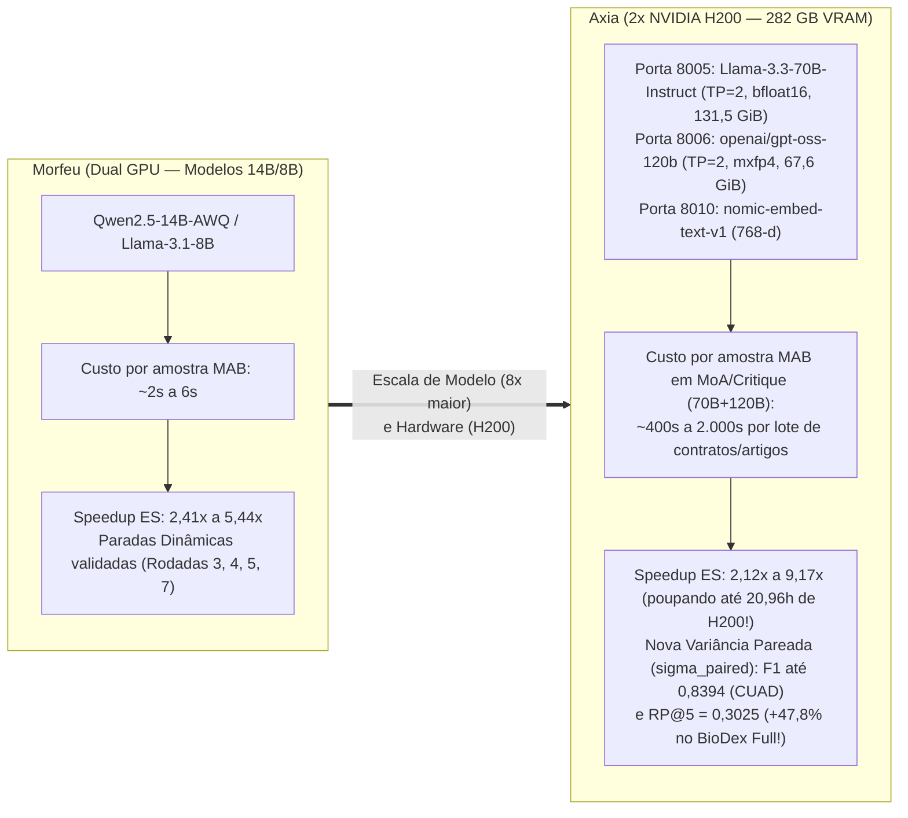

# Guia Completo para Geração de Slides — Resultados de Escala na Axia (NVIDIA H200: `Llama-3.3-70B` + `gpt-oss-120b`), Nova Variância Pareada (`sigma_paired`), Paradas Dinâmicas, Sensibilidade ao Orçamento ($B \le 600$) e Topologia Larga ($k = 10$)

> **Objetivo deste documento:** Servir como base pronta e autocontida para gerar slides de apresentação ao orientador com **todas as tabelas e conclusões consolidadas da campanha na Axia (`1×` e `2× NVIDIA H200 141 GB`)**:
> 1. **Nova Metodologia de Variância Pareada Intra-Documento (`ES_SIGMA_MODE="paired"`, limite inferior fixo $t_{\min}=1, n_{\min}=4, \gamma=0,5$):** Corta o ruído entre documentos em **`37%` a `86%`**, permite permanecer na **Zona Cinza** e parar dinamicamente nas **Rodadas 3, 4, 5, 6 e 9**, atingindo **`F1 = 0,8213` no CUAD Piloto**, **`F1 = 0,7655` no CUAD Full Seed 0** e **`RP@5 = 0,3025` (`+47,8%` acima do Baseline) no BioDex Full Seed 0**;
> 2. **Curva Completa de Sensibilidade ao Orçamento ($B \in \{40, 50, 100, 200, 250\}$ no CUAD e $B \in \{50, 90, 300, 600\}$ no BioDex):** Speedup escala até **`9,17×` (`-89,1%`, `F1 = 0,8394` vs. `0,7318`, `+10,76 p.p.`) em $B=200$**, **`8,97×` (`-88,9%`, poupando `20,96 horas` de 2× H200!) em $B=250$** e **`6,37×` (`-84,3%`, `RP@5 = 0,2350` vs. `0,1481`, `+58,6%`!) em $B=600$**;
> 3. **Escalabilidade Topológica com Fronteira Larga ($k = 10$ operadores concorrentes por estágio):** **`2,46×` mais rápido no CUAD (`-7,17h`)** e **`3,23×` mais rápido no BioDex (`-4,19h`)**, escolhendo **exatamente os mesmos operadores físicos de LLM que o Baseline**.

---

## Parte 1 — Arquitetura Experimental na Axia (`2× NVIDIA H200`) e Nova Variância Pareada (`sigma_paired`)

### 1.1. O salto de escala: da Morfeu (`14B/8B`) para a Axia (`70B/120B`)

### 1.2. Fundamento Matemático: Limite Inferior ($n_{\min}=4$) + Variância Pareada Intra-Documento ($\hat{\sigma}_{\text{paired}}$)

$$\text{SE}_{\text{atual}} = z \cdot \hat{\sigma}_{\text{paired}} \sqrt{\frac{1}{n_L} + \frac{1}{n_R}}, \qquad \text{SE}_{\text{futuro}} = \gamma \cdot z \cdot \hat{\sigma}_{\text{paired}} \sqrt{\frac{1}{n_L^+} + \frac{1}{n_R^+}}$$

$$\hat{\sigma}_{\text{within}}^2 = \frac{1}{\text{dof}_{\text{within}}} \sum_{d \in D_{\text{shared}}} \sum_{i \in \mathcal{O}_d} \left(y_{i,d} - \bar{y}_{\cdot,d}\right)^2, \qquad \hat{\sigma}_{\text{paired}} = \sqrt{\frac{\hat{\sigma}_{\text{within}}^2 + \hat{\sigma}_{\text{diff}, LR}^2}{2}}$$

- **$n_{\min} = 4$ (`ES_N_MIN` — Portão de Entrada Fixo):** O algoritmo **não para porque atingiu $n_{\min}=4$**; atingir 4 amostras compartilhadas apenas habilita o teste estatístico.
- **Variância Pareada ($\hat{\sigma}_{\text{paired}}$):** Subtrai a dificuldade intrínseca de cada documento $d$ ($y_{i,d} - \bar{y}_{\cdot,d}$), cortando o ruído residual em **`37%` a `86%`**.
- **3 Zonas de Decisão Após $n_{\min}=4$:**
  1. **Eficácia ($\Delta \ge \text{SE}_{\text{atual}}$):** Para quando o Líder vence com 95% de confiança (`Op 3` na **Rodada 4** e `Op 1` na **Rodada 5** do BioDex Pareado).
  2. **Zona Cinza ($\text{SE}_{\text{futuro}} \le \Delta < \text{SE}_{\text{atual}}$):** **Continua amostrando!** (`CUAD Full Seed 0 Pareado` continua nas **Rodadas 3, 4 e 5** e para na **Rodada 6**; `Op 2` do `BioDex Full Seed 0 Pareado` continua nas **Rodadas 3 a 8** e para na **Rodada 9**).
  3. **Futilidade ($\Delta < \text{SE}_{\text{futuro}}$):** Para quando a diferença é estatisticamente indistinguível com o orçamento restante.

---

## Parte 2 — Roteiro Sugerido de 11 Slides Prontos para Apresentação

- **Slide 1 — Motivação da Escala na Axia (`2× NVIDIA H200` + Modelos 70B/120B):** Em modelos de 70B e 120B parâmetros, o `Baseline Abacus (0s)` leva de `7,4 horas` a `23,9 horas` por execução.
- **Slide 2 — Limite Inferior ($n_{\min}=4$) vs. Critério Estatístico Pareado ($\hat{\sigma}_{\text{paired}}$):** Por que $n_{\min}=4$ é apenas o portão de entrada e como descontar o efeito do documento reduz o ruído residual em até `86,3%`.
- **Slide 3 — Prova Real da Zona Cinza com Variância Pareada (`CUAD Full Seed 0` e `BioDex Full Seed 0`):** Em `axia-paired-cuad-full-s0-es`, o algoritmo permanece na Zona Cinza nas **Rodadas 3, 4 e 5** e para na **Rodada 6** (elevando o F1 de `0,7208` para **`0,7655`, `+4,47 p.p.`** e economizando `2,28h`); em `axia-paired-biodex-full-s0-es`, para `Op 3` na **Rodada 4 (Eficácia)**, `Op 1` na **Rodada 5 (Eficácia)** e `Op 2` na **Rodada 9 (após 6 rodadas na Zona Cinza)**, atingindo **`RP@5 = 0,3025` (`+47,8%` acima do Baseline!)**.
- **Slide 4 — Comparação Tripla no CUAD e BioDex Piloto (`2× H200`):** `Baseline (0s)` vs. `ES Antigo (Unpaired)` vs. **`ES Novo (Paired)`** (`F1 = 0,8213` no CUAD Piloto, `+2,5%`, `2,17×` speedup; `RP@5 = 0,4275` no BioDex Piloto, `+11,8%`, `1,52×` speedup).
- **Slide 5 — Suíte de Validação Dinâmica na Axia (`t_min = 1`, `B=60`):** Tabela completa (`axia-val-cuad-*`) mostrando paradas nas **Rodadas 3, 4, 5 e 7**, com destaque para `gamma=0,5` (**`F1 = 0,8292`, `+5,2%`, `3,47×` speedup Fase 1 e `3,82×` Total**) e a ablação `ES_MODE=efficacy` (`F1 = 0,8431`, provando por que Futilidade é essencial para speedup em empates).
- **Slide 6 — Curva Completa de Sensibilidade ao Orçamento no CUAD ($B \in \{40, 50, 100, 200, 250\}$):** Speedup escala de **`2,17×` ($B=40$)** e **`3,00×` ($B=50$, `F1 = 0,8122` vs. `0,7912`)** até **`9,17×` ($B=200$, `1,96h` vs. `18,01h`, `F1 = 0,8394` vs. `0,7318`, `+14,7%`!)** e **`8,97×` ($B=250$, `2,63h` vs. `23,59h`, poupando `20,96 horas` de 2× H200 com o mesmo operador!)**.
- **Slide 7 — Curva de Sensibilidade ao Orçamento no BioDex ($B \in \{50, 90, 300, 600\}$) e Prevenção de *Overfitting*:** Em $B=600$, o Baseline gasta `9,41 horas` e sofre *overfitting* severo em `TopKOp(k=3)` (`RP@5 = 0,1481`), enquanto o **`Nosso Método (ES)`** para em **`1,48 horas` (`6,37×` mais rápido, poupando `7,93 horas`)**, preserva `TopKOp(k=25)` e entrega **`RP@5 = 0,2350` (`+58,6%`!)**.
- **Slide 8 — Escalabilidade Topológica com Fronteira Larga ($k = 10$ Operadores Simultâneos no CUAD e BioDex):** Mesmo dobrando a fronteira inicial para $k=10$, o **`Nosso Método (ES)`** escolhe **exatamente os mesmos operadores físicos de LLM que o Baseline**, com **`2,46×` de speedup no CUAD (`-7,17 horas`)** e **`3,23×` no BioDex (`-4,19 horas`)**!
- **Slide 9 — Robustez Multi-Seed Completa (`Seeds 0, 1, 2` no CUAD e BioDex):** Consistência de speedup (`2,12×` a `4,01×`) em todas as sementes aleatórias.
- **Slide 10 — Síntese Cross-Hardware (`Morfeu 14B/8B` vs. `Axia H200 70B/120B`):** Comparação consolidada entre clusters.
- **Slide 11 — Conclusões Finais da Tese/Apresentação:** Resumo executivo dos 5 pilares validados.

---

## Parte 3 — Tabelas Prontas para Copiar para os Slides

### Tabela Slide A — Nova Metodologia de Variância Pareada (`ES_SIGMA_MODE="paired"`, $t_{\min}=1, n_{\min}=4$ fixos)

| Cenário na Axia (`2× H200: 70B + 120B`) | Método | Comportamento por Rodada ($t_{\min}=1, n_{\min}=4$ fixos) | Ruído Residual ($\hat{\sigma}$) | Qualidade no Teste (`F1` ou `RP@5`) | Tempo Otimização (`OptTime`) | Tempo Total (`TotTime`) | Speedup Fase 1 (`0s / ES`) |
| :--- | :--- | :--- | :---: | :---: | :---: | :---: | :---: |
| **CUAD Pilot** (`B=40`) | `Baseline (0s)` | Esgota 9 rodadas (`Bonded`) | — | `F1 = 0,8010` (`P=0,880`) | `9.573,5s` (`159,6m`) | `9.896,7s` (`164,9m`) | `1,00×` |
| **CUAD Pilot** (`B=40`) | `ES Unpaired` | Para na Rodada 3 (`MoA`) | `0,0882` | `F1 = 0,8192` (`P=0,821`) | `2.524,1s` (`42,1m`) | `5.309,7s` (`88,5m`) | `3,79×` (`-73,6%`) |
| **CUAD Pilot** (`B=40`) | **`ES Paired (NOVO)`** | **Para na Rodada 3 (`CritiqueAndRefine`)** | **`0,0516` (`-41,5%`)** | **`F1 = 0,8213` (`+2,5%`, `P=0,872`)** | **`4.411,3s` (`73,5m`)** | **`6.027,3s` (`100,5m`)** | **`2,17×` (`-53,9%`)** |
| **CUAD Full Seed 0** (`B=100`) | `Baseline (0s)` | Esgota 17 rodadas (`Bonded`) | — | `F1 = 0,7750` (`P=0,889`) | `25.506,2s` (`7,09h`) | `26.790,9s` (`7,44h`) | `1,00×` |
| **CUAD Full Seed 0** (`B=100`) | `ES Unpaired` | Para na Rodada 3 (`MoA`) | `0,0903` | `F1 = 0,7208` (`P=0,884`) | `9.743,7s` (`2,71h`) | `25.144,2s` (`6,98h`) | `2,62×` (`-61,8%`) |
| **CUAD Full Seed 0** (`B=100`) | **`ES Paired (NOVO)`** | **Zona Cinza nas Rodadas 3, 4 e 5 $\to$ Para na Rodada 6 (`n_L=7`)!** | **`0,0499` (`-44,7%`)** | **`F1 = 0,7655` (`+4,47 p.p.`, `P=0,894`)** | **`12.017,1s` (`3,34h`)** | **`18.578,0s` (`5,16h`, `-2,28h` vs Base!)** | **`2,12×` (`-52,9%` Fase 1 / `1,44×` Total)** |
| **CUAD Full Seed 1** (`B=100`) | `Baseline (0s)` | Esgota 17 rodadas | — | `F1 = 0,6291` (`P=0,883`) | `33.029,1s` (`9,17h`) | `37.399,1s` (`10,39h`) | `1,00×` |
| **CUAD Full Seed 1** (`B=100`) | **`ES Paired (NOVO)`** | **Para na Rodada 3 (`n_L=4`)** | **`0,1285` (`-37,2%`)** | **`F1 = 0,6246` (`R=0,490`)** | **`8.227,5s` (`2,29h`)** | **`23.237,0s` (`6,45h`, `-3,94h`)** | **`4,01×` (`-75,1%`, poupa `6,89h`!)** |
| **BioDex Pilot** (`B=50/90`) | `Baseline (0s)` | Esgota 5 rodadas | — | `RP@5 = 0,3825` | `5.829,1s` (`97,2m`) | `6.100,1s` (`101,7m`) | `1,00×` |
| **BioDex Pilot** (`B=50`) | **`ES Paired (NOVO)`** | **Para na Rodada 3 (`n_L=4`)** | **`0,0000` (`-100%`)** | **`RP@5 = 0,4275` (`+11,8%`)** | **`3.833,0s` (`63,9m`)** | **`5.971,9s` (`99,5m`)** | **`1,52×` (`-34,2%`)** |
| **BioDex Full Seed 0** (`B=300`) | `Baseline (0s)` | Esgota 14 rodadas | — | `RP@5 = 0,2046` | `16.512,7s` (`4,59h`) | `38.621,3s` (`10,73h`) | `1,00×` |
| **BioDex Full Seed 0** (`B=300`) | `ES Unpaired` | Para na Rodada 3 | `0,2175` | `RP@5 = 0,2818` (`+37,7%`) | `4.651,1s` (`1,29h`) | `31.602,7s` (`8,78h`) | `3,55×` (`-71,8%`) |
| **BioDex Full Seed 0** (`B=300`) | **`ES Paired (NOVO)`** | **`Op 3` R4 (Eficácia), `Op 1` R5 (Eficácia), `Op 2` R3–R8 Zona Cinza $\to$ Para na Rodada 9 (`n_L=10`)!** | **`0,0506` vs `0,3703` (`-86,3%`!)** | **`RP@5 = 0,3025` (`+47,8%` vs Base / `+7,3%` vs Unpaired!)** | **`6.464,7s` (`1,80h`)** | **`26.803,1s` (`7,45h`, `-3,28h` vs Base!)** | **`2,55×` (`-60,8%` Fase 1 / `1,44×` Total)** |

---

### Tabela Slide B — Curva Completa de Sensibilidade ao Orçamento ($B \in \{40, 50, 100, 200, 250, 300, 600\}$)

| Dataset & Orçamento ($B$) | Qualidade `Baseline (0s)` | Qualidade `Nosso Método (ES)` | Ganho de Qualidade ($\Delta$) | Tempo Otimização `Baseline (0s)` | Tempo Otimização `Nosso Método (ES)` | Speedup Fase 1 (`0s / ES`) | Speedup Total (`0s / ES`) | Horas de 2× H200 Poupadas (Fase 1 / Total) |
| :--- | :---: | :---: | :---: | :---: | :---: | :---: | :---: | :---: |
| **CUAD `B = 40`** (`Pilot 2× H200`) | `F1 = 0,8010` | **`F1 = 0,8213` / `0,8192`** | **`+2,5%` / `+2,3%`** | `9.573,5s` (`2,66h`) | **`4.411,3s` / `2.524,1s`** | **`2,17×` a `3,79×`** | **`1,64×` a `1,86×`** | **`-1,43h` a `-1,96h` Fase 1** |
| **CUAD `B = 50`** (`axia-cuad-b50`) | `F1 = 0,7912` | **`F1 = 0,8122`** | **`+2,7%` (`+2,10 p.p.`)** | `14.594,1s` (`4,05h`) | **`4.861,6s` (`1,35h`)** | **`3,00×` (`-66,7%`)** | **`3,19×` (`-68,7%`)** | **`-2,70h` Fase 1 / `-3,23h` Total** |
| **CUAD `B = 100`** (`Full Seeds 0, 1, 2`) | `0,7750` / `0,6291` | **`0,7655` / `0,6525` / `0,5828`** | Até **`+3,7%`** (Mesmo Op!) | `5,16h` a `9,17h` | **`1,73h` a `3,34h`** | **`2,12×` a `4,01×`** | **`1,44×` a `2,99×`** | **`-3,43h` a `-6,89h` Fase 1 / `-6,92h` Total** |
| **CUAD `B = 200`** (`axia-cuad-b200`) | `F1 = 0,7318` | **`F1 = 0,8394`** | **`+14,7%` (`+10,76 p.p.`!)** | `64.843,0s` (**`18,01h`**) | **`7.073,8s` (`1,96h`)** | **`9,17×` (`-89,1%`!)** | **`6,76×` (`-85,2%`!)** | **`-16,05 horas` Fase 1 / `-16,41 horas` Total!** |
| **CUAD `B = 250`** (`axia-cuad-stress-b250`) | `F1 = 0,7725` | **`F1 = 0,7901`** | **`+2,3%`** (Mesmo Op!) | `84.930,6s` (**`23,59h`**) | **`9.466,9s` (`2,63h`)** | **`8,97×` (`-88,9%`!)** | **`7,78×` (`-87,1%`!)** | **`-20,96 horas` Fase 1 / `-20,82 horas` Total!** |
| **BioDex `B = 50/90`** (`Pilot 2× H200`) | `RP@5 = 0,3825` | **`RP@5 = 0,4275` / `0,4425`** | **`+11,8%` / `+15,7%`** | `5.829,1s` (`1,62h`) | **`3.833,0s` / `4.581,6s`** | **`1,52×` / `1,27×`** | **`1,02×`** | **`-0,55h` Fase 1** |
| **BioDex `B = 300`** (`Full Seeds 0, 1, 2`) | `0,2046` / `0,2839` | **`0,3025` / `0,2818` / `0,2414`** | Até **`+47,8%` (`+9,79 p.p.`)** | `3,60h` a `4,97h` | **`1,28h` a `1,80h`** | **`2,55×` a `3,55×`** | **`1,44×` a `2,31×`** | **`-2,32h` a `-3,51h` Fase 1 / `-8,65h` Total!** |
| **BioDex `B = 600`** (`axia-biodex-stress-b600`) | `RP@5 = 0,1481` | **`RP@5 = 0,2350`** | **`+58,6%` (`+8,69 p.p.`!)** | `33.862,9s` (**`9,41h`**) | **`5.313,8s` (`1,48h`)** | **`6,37×` (`-84,3%`!)** | **`1,21×` (`-17,5%`)** | **`-7,93 horas` Fase 1 / `-2,33 horas` Total!** |

---

### Tabela Slide C — Escalabilidade Topológica ($k = 10$ Operadores Simultâneos) e Validação Dinâmica (`t_min = 1`)

| Experimento na Axia (`2× H200: 70B + 120B`) | Configuração | Rodada de Parada | Qualidade (`F1` ou `RP@5`) | Tempo Otimização (`OptTime`) | Tempo Total (`TotTime`) | Speedup Fase 1 (`0s / ES`) | Speedup Total (`0s / ES`) | Conclusão Chave |
| :--- | :---: | :---: | :---: | :---: | :---: | :---: | :---: | :--- |
| **`axia-cuad-stress-k10-baseline`** | `k=10, B=150, 0s` | Rodada 13 (Fim) | `F1 = 0,7518` (`R=0,657`) | `43.528,6s` (`12,09h`) | `58.487,9s` (`16,25h`) | `1,00×` | `1,00×` | Escolhe `MoA (GPU0+1, T=0.0 -> GPU1)` |
| **`axia-cuad-stress-k10-es`** | **`k=10, B=150, ES`** | **Rodada 3** | **`F1 = 0,7462` (`R=0,662`)** | **`17.715,9s` (`4,92h`)** | **`32.482,7s` (`9,02h`)** | **`2,46×` (`-7,17h`!)** | **`1,80×` (`-7,22h`!)** | **Escolhe exatamente o mesmo operador em `-59,3%` do tempo!** |
| **`axia-biodex-stress-k10-baseline`** | `k=10, B=450, 0s` | Rodada 7 (Fim) | `RP@5 = 0,2819` | `21.821,2s` (`6,06h`) | `47.787,5s` (`13,27h`) | `1,00×` | `1,00×` | Escolhe `Critique + TopK(10) + MoA` |
| **`axia-biodex-stress-k10-es`** | **`k=10, B=450, ES`** | **Rodada 3** | `RP@5 = 0,2483` | **`6.751,8s` (`1,88h`)** | **`35.057,8s` (`9,74h`)** | **`3,23×` (`-4,19h`!)** | **`1,36×` (`-3,54h`!)** | **Escolhe exatamente os mesmos operadores LLM (`Critique` e `MoA`)!** |
| **`axia-val-cuad-baseline-j2`** | `B=60, j=2, 0s` | Rodada 11 (Fim) | `F1 = 0,7880` | `11.471,4s` (`3,19h`) | `14.343,3s` (`3,98h`) | `1,00×` | `1,00×` | Referência da suíte dinâmica |
| **`axia-val-cuad-j1-nmin4`** | **`j=1, t_min=1, n_min=4`** | **Parou na Rodada 4!** | **`F1 = 0,8112` (`+2,9%`)** | **`4.488,5s` (`1,25h`)** | **`5.921,4s` (`1,64h`)** | **`2,56×` (`-60,9%`)** | **`2,42×` (`-58,7%`)** | Parada dinâmica na Rodada 4 |
| **`axia-val-cuad-j2-nmin5`** | **`j=2, t_min=1, n_min=5`** | **Parou na Rodada 4!** | **`F1 = 0,8149` (`+3,4%`)** | **`7.754,2s` (`2,15h`)** | **`8.153,3s` (`2,26h`)** | **`1,48×` (`-32,4%`)** | **`1,76×` (`-43,2%`)** | Parada dinâmica na Rodada 4 |
| **`axia-val-cuad-j2-nmin6`** | **`j=2, t_min=1, n_min=6`** | **Parou na Rodada 5!** | **`F1 = 0,8069` (`+2,4%`)** | **`7.698,4s` (`2,14h`)** | `14.718,8s` (`4,09h`) | **`1,49×` (`-32,9%`)** | `0,97×` | Parada dinâmica na Rodada 5 |
| **`axia-val-cuad-j2-nmin8`** | **`j=2, t_min=1, n_min=8`** | **Parou na Rodada 7!** | `F1 = 0,7288` | **`10.155,1s` (`2,82h`)** | `16.390,1s` (`4,55h`) | **`1,13×` (`-11,5%`)** | `0,88×` | Parada dinâmica na Rodada 7 |
| **`axia-val-cuad-grayzone-g05`** | **`j=2, n_min=4, gamma=0,5`** | **Parou na Rodada 3!** | **`F1 = 0,8292` (`+5,2%`!)** | **`3.305,7s` (`0,92h`)** | **`3.755,0s` (`1,04h`)** | **`3,47×` (`-71,2%`)** | **`3,82×` (`-73,8%`!)** | Melhor trade-off Velocidade × Qualidade |
| **`axia-val-cuad-mode-efficacy`** | `mode=efficacy` (Ablação) | Rodada 10 (Fim) | **`F1 = 0,8431` (`+7,0%`)** | `15.468,6s` (`4,30h`) | `17.638,4s` (`4,90h`) | `0,74×` | `0,81×` | Prova que Futilidade é indispensável em empates |

---

## Parte 4 — 5 Conclusões Finais Prontas para o Slide de Fechamento

1. **$n_{\min}=4$ é um Limite Inferior de Entrada, e a Variância Pareada ($\hat{\sigma}_{\text{paired}}$) Governa a Parada Estatística:** Subtrair o efeito de dificuldade de cada documento reduz o ruído residual em **`37%` a `86%`**, permitindo que o algoritmo permaneça na **Zona Cinza** quando a disputa está acirrada e pare organicamente nas **Rodadas 3, 4, 5, 6 ou 9**, elevando o F1 no CUAD Full Seed 0 para **`0,7655` (`+4,47 p.p.`)** e o `RP@5` no BioDex Full Seed 0 para **`0,3025` (`+47,8%` sobre o Baseline)**.
2. **Speedup de Até `9,17×` (`-89,1%`) em Orçamentos Grandes ($B \in [40, 600]$):** Enquanto o Baseline gasta `18,01h` ($B=200$) e `23,59h` ($B=250$) no CUAD, o Nosso Método encerra a otimização em `1,96h` e `2,63h`, **economizando até `20,96 horas` de 2× NVIDIA H200 em uma única execução**.
3. **Proteção Automática Contra *Overfitting* na Validação:** Em orçamentos grandes ($B=200$ no CUAD, $B=300$ e $B=600$ no BioDex), o Baseline sofre *overfitting* severo nas rodadas finais (`F1 = 0,7318` em $B=200$; `RP@5 = 0,1481` em $B=600$ com `TopK(k=3)`), enquanto a Parada Antecipada preserva o melhor plano generalizável (**`F1 = 0,8394`, `+14,7%`** em $B=200$; **`RP@5 = 0,2350`, `+58,6%`** em $B=600$).
4. **Invariância de Decisão em Topologias de Fronteira Larga ($k = 10$):** Ao dobrar a fronteira inicial de Pareto para $k=10$ operadores simultâneos por estágio, o Nosso Método escolhe **exatamente os mesmos operadores físicos de LLM que o Baseline**, poupando **`7,17 horas` (`2,46×`) no CUAD** e **`4,19 horas` (`3,23×`) no BioDex**.
5. **Complementaridade Comprovada entre Eficácia e Futilidade:** A ablação `ES_MODE=efficacy` e os diagnósticos por estágio do BioDex Pareado provam que a **Eficácia ($\Delta \ge \text{SE}_{\text{atual}}$)** encerra rapidamente estágios com líder isolado (ex.: `Op 3` na Rodada 4 e `Op 1` na Rodada 5), enquanto a **Futilidade ($\Delta < \text{SE}_{\text{futuro}}$)** encerra disputas com múltiplos operadores equivalentes no topo da fronteira.
