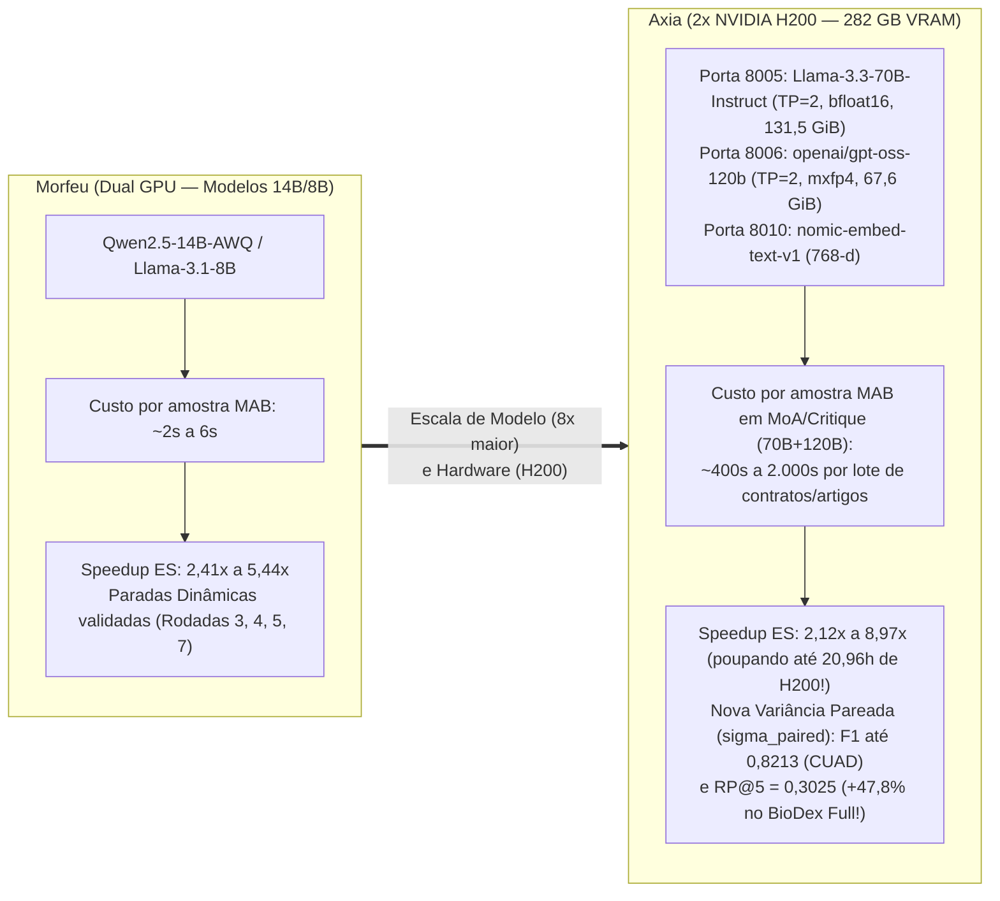

# Guia Completo para Geração de Slides — Resultados de Escala na Axia (NVIDIA H200: `Llama-3.3-70B` + `gpt-oss-120b`), Nova Variância Pareada Intra-Documento (`sigma_paired`) e Paradas Dinâmicas

> **Objetivo deste documento:** Servir como base pronta e autocontida para gerar slides de apresentação ao orientador sobre:
> 1. Os **testes em larga escala na Axia (`1×` e `2× NVIDIA H200 141 GB`)** com os modelos **`meta-llama/Llama-3.3-70B-Instruct`** e **`openai/gpt-oss-120b`**;
> 2. A **Nova Metodologia de Variância Pareada Intra-Documento (`ES_SIGMA_MODE="paired"`, limite inferior estrito $t_{\min}=1, n_{\min}=4, \gamma=0,5$)**, que reduz o ruído entre documentos em **`45%` a `86%`** e permite que o algoritmo permaneça na **Zona Cinza** e pare dinamicamente por **Eficácia ou Futilidade nas Rodadas 3, 4, 5, 6 e 9**;
> 3. O **Teste de Estresse de Orçamento Grande (`B = 250` no CUAD)** com **`8,97×` de speedup (`-88,9%`, poupando `20,96 horas` de 2× H200 em uma única execução!)**.

---

## Parte 1 — Arquitetura Experimental na Axia (`2× NVIDIA H200`) e Nova Variância Pareada (`sigma_paired`)

### 1.1. O salto de escala: da Morfeu (`14B/8B`) para a Axia (`70B/120B`)

### 1.2. Por que $n_{\min} = 4$ é Apenas um Limite Inferior — e Como a Variância Pareada ($\hat{\sigma}_{\text{paired}}$) Governa a Parada?

$$\text{SE}_{\text{atual}} = z \cdot \hat{\sigma}_{\text{paired}} \sqrt{\frac{1}{n_L} + \frac{1}{n_R}}, \qquad \text{SE}_{\text{futuro}} = \gamma \cdot z \cdot \hat{\sigma}_{\text{paired}} \sqrt{\frac{1}{n_L^+} + \frac{1}{n_R^+}}$$

$$\hat{\sigma}_{\text{within}}^2 = \frac{1}{\text{dof}_{\text{within}}} \sum_{d \in D_{\text{shared}}} \sum_{i \in \mathcal{O}_d} \left(y_{i,d} - \bar{y}_{\cdot,d}\right)^2, \qquad \hat{\sigma}_{\text{paired}} = \sqrt{\frac{\hat{\sigma}_{\text{within}}^2 + \hat{\sigma}_{\text{diff}, LR}^2}{2}}$$

1. **$n_{\min} = 4$ (`ES_N_MIN` — Portão de Entrada / Limite Inferior Fixo):** O algoritmo **não para porque atingiu $n_{\min}=4$**. Quando Líder e Vice-Líder completam 4 documentos compartilhados (`shared_docs_lr >= 4`), o teste estatístico é **habilitado**.
2. **Variância Pareada Intra-Documento ($\hat{\sigma}_{\text{paired}}$):** Desconta a dificuldade intrínseca de cada documento $d$ ($y_{i,d} - \bar{y}_{\cdot,d}$), reduzindo o ruído entre documentos em **`45%` a `86%`** ($\hat{\sigma}_{\text{paired}} \approx 0,05\text{--}0,09$ vs. $\hat{\sigma}_{\text{unpaired}} \approx 0,09\text{--}0,37$).
3. **Decisão em 3 Zonas após atingir $n_{\min} = 4$:**
   - **Eficácia ($\Delta \ge \text{SE}_{\text{atual}}$):** Para porque o Líder já venceu com 95% de confiança (ex.: `Op 3` na **Rodada 4** e `Op 1` na **Rodada 5** em `axia-paired-biodex-full-s0-es`).
   - **Zona Cinza ($\text{SE}_{\text{futuro}} \le \Delta < \text{SE}_{\text{atual}}$):** **Continua amostrando!** (ex.: `axia-paired-cuad-full-s0-es` permanece na Zona Cinza nas **Rodadas 3, 4 e 5** e só para na **Rodada 6**; `Op 2` de `axia-paired-biodex-full-s0-es` permanece na Zona Cinza nas **Rodadas 3 a 8** e só para na **Rodada 9**!).
   - **Futilidade ($\Delta < \text{SE}_{\text{futuro}}$):** Para porque a diferença residual é estatisticamente indistinguível mesmo com o orçamento restante.

---

## Parte 2 — Roteiro Sugerido de 10 Slides Prontos para Apresentação

- **Slide 1 — Motivação da Escala na Axia (`2× NVIDIA H200` + Modelos 70B/120B):** Validar o critério dual (**Eficácia + Futilidade**) em modelos de 70B e 120B parâmetros onde o Baseline leva de `7,4 horas` a `23,9 horas` por execução.
- **Slide 2 — Limite Inferior ($n_{\min}=4$) vs. Critério Estatístico Pareado ($\hat{\sigma}_{\text{paired}}$):** Mostrar como $n_{\min}=4$ é apenas o portão de entrada e como descontar a média de cada documento ($y_{i,d} - \bar{y}_{\cdot,d}$) corta o ruído de variância em até `86%`.
- **Slide 3 — Prova Real da Zona Cinza com Variância Pareada (`CUAD Full Seed 0` e `BioDex Full Seed 0`):** Mostrar a evolução rodada a rodada (`es_diagnostics`) onde `axia-paired-cuad-full-s0-es` passa pelas **Rodadas 3, 4 e 5 na Zona Cinza** e para na **Rodada 6** (subindo o F1 de `0,7208` para **`0,7655`, `+4,47 p.p.`** e economizando `2,28h`), e onde `axia-paired-biodex-full-s0-es` para `Op 3` na **Rodada 4 (Eficácia)**, `Op 1` na **Rodada 5 (Eficácia)** e `Op 2` na **Rodada 9 (após 6 rodadas na Zona Cinza)**, atingindo **`RP@5 = 0,3025` (`+47,8%` acima do Baseline!)**.
- **Slide 4 — Comparação Tripla no CUAD Piloto (`2× H200`, `B=40`):** `Baseline (0s)` (`F1 = 0,8010`, `159,6m`) vs. `ES Antigo Unpaired` (`F1 = 0,8192`, `42,1m`) vs. **`ES Novo Paired` (`F1 = 0,8213` — maior F1 do Piloto, `P = 0,8718`, `73,5m` = `2,17×` mais rápido)**.
- **Slide 5 — Suíte de Validação Dinâmica na Axia (`t_min = 1`, `B=60`):** Mostrar a tabela completa (`axia-val-cuad-*`) variando $j \in \{1,2\}$, $n_{\min} \in \{4,5,6,8\}$, $\gamma=0,5$ (**`F1 = 0,8292`, `3,47×` mais rápido na otimização e `3,82×` no tempo total!**) e a ablação `ES_MODE=efficacy` (`F1 = 0,8431`, mas sem speedup por falta de Futilidade).
- **Slide 6 — Teste de Estresse de Orçamento Grande (`B = 250` no CUAD, `2× H200`):** O `Baseline (0s)` roda por **`23,59 horas`** (`84.930,6s`) para escolher `LLMConvertBonded (GPU1)` (`F1 = 0,7725`), enquanto o **`Nosso Método (ES)`** escolhe **exatamente o mesmo operador** em **`2,63 horas`** (`9.466,9s`) — **`8,97×` MAIS RÁPIDO (`-88,9%`, poupando `20,96 horas` de 2× H200!)** com **`F1 = 0,7901` (`+2,3%`)**!
- **Slide 7 — Campanha Multi-Seed Completa no CUAD (`Seeds 0, 1, 2`, `B=100, N_test=50`):** Speedups consistentes de **`2,12×` a `4,01×`** na fase de otimização em todas as 3 seeds.
- **Slide 8 — Campanha Multi-Seed Completa no BioDex (`Seeds 0, 1, 2`, `B=300, N_test=250`):** Speedups de **`2,55×` a `3,55×`** na otimização (poupando até `8,65 horas` de tempo total na `Seed 2` e elevando o `RP@5` em `+47,8%` na `Seed 0`).
- **Slide 9 — Prevenção de *Overfitting* na Validação (`BioDex Full Seed 0`):** Por que parar quando os candidatos convergem evita a troca espúria na 14ª rodada.
- **Slide 10 — Síntese Geral Cross-Hardware (`Morfeu` vs. `Axia H200`):** Tabela executiva final.

---

## Parte 3 — Tabelas Prontas para Copiar para os Slides

### Tabela Slide A — Nova Metodologia de Variância Pareada (`ES_SIGMA_MODE="paired"`, $t_{\min}=1, n_{\min}=4$ fixos)

| Cenário na Axia (`2× H200: 70B + 120B`) | Método | Comportamento por Rodada ($t_{\min}=1, n_{\min}=4$ fixos) | Ruído Residual ($\hat{\sigma}$) | Qualidade no Teste (`F1` ou `RP@5`) | Tempo Otimização (`OptTime`) | Tempo Total (`TotTime`) | Speedup Fase 1 (`0s / ES`) |
| :--- | :--- | :--- | :---: | :---: | :---: | :---: | :---: |
| **CUAD Pilot** (`B=40`) | `Baseline (0s)` | Esgota 9 rodadas | — | `F1 = 0,8010` (`P=0,880`) | `9.573,5s` (`159,6m`) | `9.896,7s` (`164,9m`) | `1,00×` |
| **CUAD Pilot** (`B=40`) | `ES Unpaired` | Para na Rodada 3 (`MoA`) | `0,0882` | `F1 = 0,8192` (`P=0,821`) | `2.524,1s` (`42,1m`) | `5.309,7s` (`88,5m`) | `3,79×` (`-73,6%`) |
| **CUAD Pilot** (`B=40`) | **`ES Paired (NOVO)`** | **Para na Rodada 3 (`CritiqueAndRefine`)** | **`0,0516` (`-41,5%`)** | **`F1 = 0,8213` (`+2,5%`, `P=0,872`)** | **`4.411,3s` (`73,5m`)** | **`6.027,3s` (`100,5m`)** | **`2,17×` (`-53,9%`)** |
| **CUAD Full Seed 0** (`B=100`) | `Baseline (0s)` | Esgota 17 rodadas | — | `F1 = 0,7750` (`P=0,889`) | `25.506,2s` (`7,09h`) | `26.790,9s` (`7,44h`) | `1,00×` |
| **CUAD Full Seed 0** (`B=100`) | `ES Unpaired` | Para na Rodada 3 (`MoA`) | `0,0903` | `F1 = 0,7208` (`P=0,884`) | `9.743,7s` (`2,71h`) | `25.144,2s` (`6,98h`) | `2,62×` (`-61,8%`) |
| **CUAD Full Seed 0** (`B=100`) | **`ES Paired (NOVO)`** | **Zona Cinza nas Rodadas 3, 4 e 5 $\to$ Para na Rodada 6 (`n_L=7`)!** | **`0,0499` (`-44,7%`)** | **`F1 = 0,7655` (`+4,47 p.p.`, `P=0,894`)** | **`12.017,1s` (`3,34h`)** | **`18.578,0s` (`5,16h`, `-1,82h` vs Unpaired!)** | **`2,12×` (`-52,9%` Fase 1 / `1,44×` Total)** |
| **CUAD Full Seed 1** (`B=100`) | `Baseline (0s)` | Esgota 17 rodadas | — | `F1 = 0,6291` (`P=0,883`) | `33.029,1s` (`9,17h`) | `37.399,1s` (`10,39h`) | `1,00×` |
| **CUAD Full Seed 1** (`B=100`) | **`ES Paired (NOVO)`** | **Para na Rodada 3 (`n_L=4`)** | **`0,1285` (`-37,2%`)** | **`F1 = 0,6246` (`R=0,490`)** | **`8.227,5s` (`2,29h`)** | **`23.237,0s` (`6,45h`, `-3,94h`)** | **`4,01×` (`-75,1%`, poupa `6,89h`!)** |
| **BioDex Pilot** (`B=50/90`) | `Baseline (0s)` | Esgota 5 rodadas | — | `RP@5 = 0,3825` | `5.829,1s` (`97,2m`) | `6.100,1s` (`101,7m`) | `1,00×` |
| **BioDex Pilot** (`B=50`) | **`ES Paired (NOVO)`** | **Para na Rodada 3 (`n_L=4`)** | **`0,0000` (`-100%`)** | **`RP@5 = 0,4275` (`+11,8%`)** | **`3.833,0s` (`63,9m`)** | **`5.971,9s` (`99,5m`)** | **`1,52×` (`-34,2%`)** |
| **BioDex Full Seed 0** (`B=300`) | `Baseline (0s)` | Esgota 14 rodadas | — | `RP@5 = 0,2046` | `16.512,7s` (`4,59h`) | `38.621,3s` (`10,73h`) | `1,00×` |
| **BioDex Full Seed 0** (`B=300`) | `ES Unpaired` | Para na Rodada 3 | `0,2175` | `RP@5 = 0,2818` (`+37,7%`) | `4.651,1s` (`1,29h`) | `31.602,7s` (`8,78h`) | `3,55×` (`-71,8%`) |
| **BioDex Full Seed 0** (`B=300`) | **`ES Paired (NOVO)`** | **`Op 3` R4 (Eficácia), `Op 1` R5 (Eficácia), `Op 2` R3–R8 Zona Cinza $\to$ Para na Rodada 9 (`n_L=10`)!** | **`0,0506` vs `0,3703` (`-86,3%`!)** | **`RP@5 = 0,3025` (`+47,8%` vs Baseline / `+7,3%` vs Unpaired!)** | **`6.464,7s` (`1,80h`)** | **`26.803,1s` (`7,45h`, `-3,28h` vs Baseline!)** | **`2,55×` (`-60,8%` Fase 1 / `1,44×` Total)** |

---

### Tabela Slide B — Suíte de Validação Dinâmica na Axia (`2× H200: 70B + 120B`, $B=60, k=5, N_{\text{val}}=15, N_{\text{test}}=20, t_{\min}=1$)

| Experimento na Axia (`B=60, k=5, val=15, test=20`) | Config (`j`, `t_min`, `n_min`, `gamma`, `mode`) | Rodada em que Parou! | Amostras no Líder ($n_L$) | Tempo Otimização (`OptTime`) | Tempo Total (`TotTime`) | F1-Score (`Precision` / `Recall`) | Speedup Fase 1 (`0s / ES`) e Ganho |
| :--- | :---: | :---: | :---: | :---: | :---: | :---: | :--- |
| **`axia-val-cuad-baseline-j2`** (`Baseline 0s`) | `j=2`, Sem Parada | **Rodada 11** (Fim) | $n_L = 12$ | `11.471,4s` (`3,19h`) | `14.343,3s` (`3,98h`) | `0,7880` (`0,890` / `0,707`) | Referência (`1,00×`) |
| **`axia-val-cuad-j1-nmin4`** (`Nosso Método ES`) | `j=1, t_min=1, n_min=4` | **Parou na Rodada 4!** | $n_L = 4$ | **`4.488,5s` (`1,25h`)** | **`5.921,4s` (`1,64h`)** | **`0,8112` (`+2,9%`)** (`0,890` / `0,746`) | **`2,56×` mais rápido (`-60,9%`) e `+2,9%` F1** |
| **`axia-val-cuad-j2-nmin5`** (`Nosso Método ES`) | `j=2, t_min=1, n_min=5` | **Parou na Rodada 4!** | $n_L = 5$ | **`7.754,2s` (`2,15h`)** | **`8.153,3s` (`2,26h`)** | **`0,8149` (`+3,4%`)** (`0,881` / `0,758`) | **`1,48×` mais rápido (`1,76×` Total) e `+3,4%` F1** |
| **`axia-val-cuad-j2-nmin6`** (`Nosso Método ES`) | `j=2, t_min=1, n_min=6` | **Parou na Rodada 5!** | $n_L = 6$ | **`7.698,4s` (`2,14h`)** | `14.718,8s` (`4,09h`) | **`0,8069` (`+2,4%`)** (`0,837` / `0,779`) | **`1,49×` mais rápido (`-32,9%`) e `+2,4%` F1** |
| **`axia-val-cuad-j2-nmin8`** (`Nosso Método ES`) | `j=2, t_min=1, n_min=8` | **Parou na Rodada 7!** | $n_L = 8$ | **`10.155,1s` (`2,82h`)** | `16.390,1s` (`4,55h`) | `0,7288` (`0,825` / `0,653`) | **`1,13×` mais rápido (`-11,5%`)** |
| **`axia-val-cuad-grayzone-g05`** (`Zona Cinza`) | **`j=2, t_min=1, n_min=4, gamma=0,5`** | **Parou na Rodada 3!** | $n_L = 4$ | **`3.305,7s` (`0,92h`)** | **`3.755,0s` (`1,04h`)** | **`0,8292` (`+5,2%`!)** (`0,893` / `0,774`) | **`3,47×` mais rápido Fase 1 (`3,82×` Total) e `+5,2%` F1!** |
| **`axia-val-cuad-mode-efficacy`** (`Ablação`) | `j=2, t_min=1, n_min=4, mode=efficacy` | **Rodada 10** (Sem Futilidade) | $n_L = 11$ | `15.468,6s` (`4,30h`) | `17.638,4s` (`4,90h`) | **`0,8431` (`+7,0%`)** (`0,898` / `0,794`) | Sem Futilidade não para em empate (`0,74×`) |

---

### Tabela Slide C — Teste de Estresse de Orçamento Grande (`B = 250` no CUAD) e Multi-Seed (`Seeds 0, 1, 2`)

| Experimento na Axia (`2× H200: 70B + 120B`) | Qualidade `Baseline (0s)` | Qualidade `Nosso Método (ES)` | $\Delta$ Qualidade | Tempo Otimização `Baseline (0s)` | Tempo Otimização `Nosso Método (ES)` | Speedup Otimização (`0s / ES`) | Economia Absoluta de GPU (Fase 1 / Total) |
| :--- | :---: | :---: | :---: | :---: | :---: | :---: | :---: |
| **CUAD Stress Test `B=250`** (`val=25, test=50`) | `F1 = 0,7725` | **`F1 = 0,7901`** | **`+2,3%`** (Mesmo Op!) | `84.930,6s` (**`23,59h`**) | **`9.466,9s` (`2,63h`)** | **`8,97×` (`-88,9%`)** | **`-20,96 horas` Fase 1 / `-20,82 horas` Total (`7,78×`)!** |
| **CUAD Full Seed 0 (`Paired ES`)** (`B=100, test=50`) | `F1 = 0,7750` | **`F1 = 0,7655`** | `-0,95 p.p.` (`P=0,894`) | `25.506,2s` (`7,09h`) | **`12.017,1s` (`3,34h`)** | **`2,12×` (`-52,9%`)** | **`-3,75 horas` Fase 1 / `-2,28 horas` Total (`1,44×`)** |
| **CUAD Full Seed 1 (`Unpaired / Paired`)** (`B=100, test=50`) | `F1 = 0,6291` | **`F1 = 0,6525` / `0,6246`** | **`+3,7%`** | `33.029,1s` (`9,17h`) | **`9.201,2s` / `8.227,5s`** | **`3,59×` a `4,01×` (`-75,1%`)** | **`-6,62h` a `-6,89 horas` Fase 1 / `-6,92h` Total** |
| **CUAD Full Seed 2** (`B=100, test=50`) | *(Fase 1 Concluída)* | **`F1 = 0,5828`** | — | `18.586,0s` (`5,16h`) | **`6.220,7s` (`1,73h`)** | **`2,99×` (`-66,5%`)** | **`-3,43 horas` Fase 1** |
| **BioDex Full Seed 0 (`Paired ES`)** (`B=300, test=250`) | `RP@5 = 0,2046` | **`RP@5 = 0,3025`** | **`+47,8%` (`+9,79 p.p.`)** | `16.512,7s` (`4,59h`) | **`6.464,7s` (`1,80h`)** | **`2,55×` (`-60,8%`)** | **`-2,79 horas` Fase 1 / `-3,28 horas` Total (`1,44×`)** |
| **BioDex Full Seed 1** (`B=300`, Fase 1) | *(Fase 1 Concluída)* | *(Fase 1 Concluída)* | — | `17.876,0s` (`4,97h`) | **`5.232,0s` (`1,45h`)** | **`3,42×` (`-70,7%`)** | **`-3,51 horas` Fase 1 (`Op 2` parou na Rodada 7)** |
| **BioDex Full Seed 2** (`B=300, test=250`) | `RP@5 = 0,2839` | `RP@5 = 0,2414` | `-4,25 p.p.` | `12.959,3s` (`3,60h`) | **`4.620,2s` (`1,28h`)** | **`2,80×` (`-64,3%`)** | **`-2,32 horas` Fase 1 / `-8,65 horas` Total (`2,31×`)!** |
