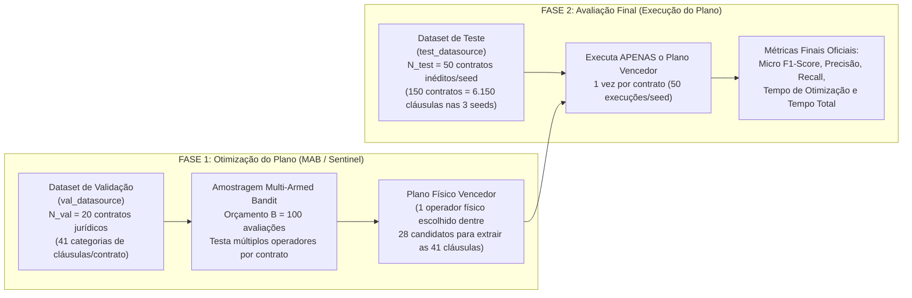
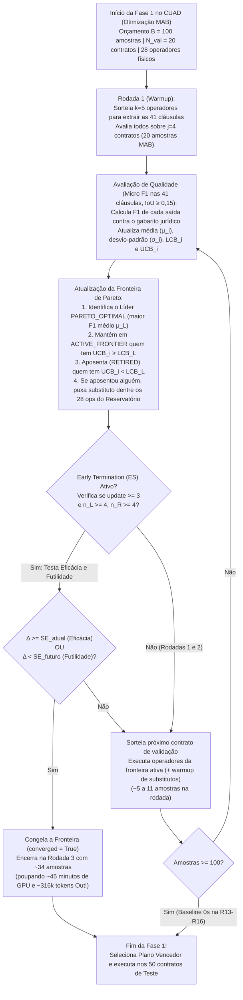

# Guia Didático para Apresentação (Slides — Benchmark CUAD na Morfeu): Fluxo de Amostras, Parâmetros, Algoritmo MAB + Early Termination (`ES`) e Resultados Prévios

Este documento foi estruturado especificamente para servir de **base direta para a construção de slides** sobre os **resultados prévios obtidos no servidor Morfeu (2× RTX 3090)** no benchmark jurídico **CUAD** (*Contract Understanding Atticus Dataset*), seguindo exatamente a mesma organização didática utilizada no guia do BioDex:

1. **Como os contratos jurídicos e amostras entram no sistema** (por que existem números diferentes: `20` contratos de validação, `50` contratos de teste por seed = `150` contratos / `6.150` extrações de cláusulas, orçamento $B = 100$ amostras MAB e `33` a `104` amostras reais);
2. **Como funcionam todos os parâmetros** que governam o otimizador Multi-Armed Bandit (MAB) no CUAD;
3. **Como o algoritmo funciona passo a passo no CUAD** (do sorteio inicial até o cálculo de Micro F1 nas 41 cláusulas, intervalos `LCB`/`UCB`, poda de operadores e o novo critério estatístico de **Early Termination — `ES`**);
4. **Roteiro sugerido de 11 slides** pronto para apresentação ao orientador;
5. **Tabelas comparativas diretas (`Baseline Abacus 0s` vs. `Nosso Método ES`)** para cada estudo realizado no CUAD (Campanha Multi-Seed, Consistência em 3 Réplicas, Diagnóstico Operador por Operador de Eficácia vs. Futilidade, Evolução a cada 10/20 amostras e Consumo de Tokens, Alvos de Qualidade $\tau$ e Comparação Cross-Dataset CUAD vs. BioDex vs. Monte Carlo).

---

## Parte 1: Como os Contratos e Amostras Entram no Processo (Benchmark CUAD)

### 1.1 A Regra de Ouro: Duas Fases Estritamente Separadas (Zero Vazamento de Dados)

Assim como no BioDex, uma dúvida comum ao olhar os números do experimento no CUAD é: *"Se o teste avalia 50 contratos jurídicos por seed, por que o orçamento do otimizador é de 100 amostras, e que contratos são esses?"*

A execução completa ocorre em **duas fases independentes**, usando **dois conjuntos de contratos disjuntos** (interseção = **0 contratos** entre validação e teste):

* **Na Fase 1 (Otimização MAB):** O otimizador **nunca vê** os 50 contratos de teste. Ele trabalha exclusivamente sobre uma bancada fixa de **$N_{\text{val}} = 20$ contratos jurídicos de validação** (`val_datasource`), avaliando a qualidade de cada operador pelo F1-Score das 41 cláusulas extraídas (com limiar de similaridade Jaccard IoU $\ge 0,15$ contra o gabarito jurídico).
* **Na Fase 2 (Execução do Plano Final):** Depois que o MAB termina e escolhe o melhor operador físico, esse plano único é executado uma vez sobre cada um dos **$N_{\text{test}} = 50$ contratos de teste inéditos** (`test_datasource`). É daqui que saem as métricas oficiais **Micro F1-Score, Precisão e Recall**.

---

### 1.2 O que é "1 Contrato" vs. "1 Amostra do MAB" vs. "Chamadas de LLM"?

No código do otimizador (`SentinelQueryOptimizer`), **1 amostra (`1 sample`) NÃO significa 1 contrato inteiro do teste**, e **1 amostra NÃO significa apenas 1 chamada de LLM**:
* **1 Amostra (`1 sample` do orçamento $B = 100$)** significa **executar 1 operador físico candidato sobre 1 contrato de validação na etapa lógica de extração (`Op 1`)**.

O pipeline do CUAD possui **2 etapas lógicas (`op_sets`)**, sendo **1 etapa de decisão semântica densa**:
1. **`Op 0` (`0-022b755afd` — `MarshalAndScanDataOp`):** Apenas lê o contrato jurídico do disco ($0\text{ ms}$ de LLM). Possui **1 único operador físico** e **não consome orçamento do MAB** (`count_all_ops = False`).
2. **`Op 1` (`1-81dd1f8073` — `ConvertOp` / `sem_map` de Extração das 41 Cláusulas):** Extrai simultaneamente do contrato jurídico as **41 listas de cláusulas contratuais** (*Governing Law, Anti-Assignment, Cap on Liability, Non-Compete, License Grant, Termination for Convenience*, etc.). Possui **28 operadores físicos candidatos** no espaço de busca:
   * **`18` operadores `MixtureOfAgentsConvert`** (combinando múltiplos modelos propositores em paralelo + modelo agregador, realizando **2 a 4 chamadas de LLM por contrato**);
   * **`8` operadores `CritiqueAndRefineConvert`** (geração inicial + crítica + refinamento, realizando **3 chamadas de LLM por contrato**);
   * **`2` operadores `LLMConvertBonded`** (extração estruturada direta em chamada única ou em lote por modelo).

#### Por que o orçamento do CUAD é `B = 100` enquanto o do BioDex era `B = 300`?
* No **BioDex**, existem **3 etapas lógicas com decisão de MAB** (`Op 1`, `Op 2`, `Op 3`), logo $B = 300$ corresponde a exatas **`100 amostras por operador lógico`**.
* No **CUAD**, existe **1 etapa lógica densa com decisão de MAB** (`Op 1`), logo **$B = 100$ corresponde exatamente às mesmas `100 amostras por operador lógico`**!

#### Como os números evoluem na prática (`20` contratos val $\rightarrow$ `20` amostras na R1 $\rightarrow$ `33–36` no `ES` vs. `101–104` no Baseline `0s`)?

1. **Na Rodada 1 (*Warmup*):**
   * O algoritmo sorteia **$j = 4$ contratos de validação** (dos 20 disponíveis) e ativa **$k = 5$ operadores físicos candidatos** no `Op 1`.
   * Cada um dos **4 contratos** é avaliado pelos **5 operadores iniciais** ($4 \times 5 = 20$ amostras).
   * Portanto, com apenas **4 contratos lidos**, a Rodada 1 consome **exatamente `20` amostras do orçamento $B = 100$**!

2. **Nas Rodadas Seguintes (Rodadas 2 a 13–16 no Baseline `0s` vs. Rodadas 2 a 3 no `ES`):**
   * A cada rodada a partir da Rodada 2, o otimizador sorteia novos contratos de validação (reciclando os 20 contratos via `record_idx % 20`) e testa os operadores ativos na fronteira (e eventuais substitutos puxados do reservatório quando algum operador é aposentado por `RETIRED`), gastando entre **5 e 11 amostras por rodada**.
   * No **Nosso Método (`ES`)**, a fronteira converge estatisticamente na **Rodada 3** em todas as 3 seeds, encerrando com apenas **`33` a `36` amostras** (`13,7` a `20,6` minutos).
   * No **Baseline Abacus (`0s`)**, como não há critério de parada, ele continua rodando até a **Rodada 13 a 16**, gastando **`101` a `104` amostras** (`55,1` a `67,7` minutos!).

---

## Parte 2: Tabela Completa dos Parâmetros do Algoritmo no CUAD

A tabela abaixo resume todos os parâmetros que controlam a entrada de contratos, a exploração do MAB e o encerramento antecipado (`Early Termination — ES`) nos experimentos do CUAD na Morfeu:

| Parâmetro | Valor no CUAD (Morfeu) | Onde é Definido | Fórmula / Regra no Código | Papel Prático no Algoritmo |
| :--- | :---: | :--- | :--- | :--- |
| **`N_val` (`--val-examples`)** | **20 contratos** | `cuad-demo.py` | Primeiros 20 contratos do conjunto de validação (`train_dataset`) | Bancada de validação usada na Fase 1 para estimar qualidade (F1 nas 41 cláusulas), custo e latência dos 28 operadores. |
| **`N_test` (`--num-contracts`)** | **50 contratos/seed** (`150` total) | `cuad-demo.py` | 50 contratos amostrados com `seed` no split de teste (**2.050 cláusulas/seed = 6.150 cláusulas totais**) | Conjunto de teste inédito usado na Fase 2 para medir **Micro F1, Precisão e Recall**. |
| **`sample_budget` ($B$)** | **100 amostras** (`20` no Smoke) | `cuad-demo.py` | `--sample-budget 100` (mesmo orçamento normalizado de `100 amostras/op lógico` do BioDex) | Teto global de avaliações de operadores físicos no `Op 1`. |
| **`k` (Largura inicial da fronteira)** | **`5` operadores** (`2` no Smoke) | `mab_execution_strategy.py` | `--k 5` (sorteados dentre os 28 operadores físicos candidatos do `Op 1`) | Quantos operadores físicos começam ativos na Rodada 1. |
| **`j` (Contratos no *Warmup*)** | **`4` contratos** (`2` no Smoke) | `mab_execution_strategy.py` | `--j 4` | Quantos contratos de validação são avaliados por todos os $k=5$ operadores iniciais na Rodada 1. |
| **Gasto na Rodada 1 (*Warmup*)** | **`20` amostras MAB** (`4` no Smoke) | `mab_execution_strategy.py` | $k \times j = 5 \times 4 = 20$ amostras | Total de amostras consumidas na Rodada 1 de aquecimento (*warmup*). |
| **Gasto por Rodada nas Rodadas $\ge 2$** | **`5` a `11` amostras/rodada** | `mab_execution_strategy.py` | 1 novo contrato para os operadores ativos + $j=4$ contratos para cada operador novo puxado do reservatório | Ritmo de consumo do orçamento a partir da Rodada 2. |
| **`seed`** | **`0`, `1`, `2`** | Linha de comando (`--seed`) | `rng = np.random.default_rng(seed)` | Controla de forma 100% reprodutível o sorteio dos operadores iniciais, a ordem dos contratos e o conjunto de teste. |
| **`alpha` ($\alpha$)** | **`0,5`** | `mab_execution_strategy.py` | $\text{Rad}_i = \alpha \cdot \hat{\sigma}_i \cdot \sqrt{\frac{\log N_{\text{fronteira}}}{n_i}}$ | Controla a largura do intervalo de confiança (`LCB` e `UCB`) de cada operador. |
| **`early_stop_z` ($z$)** | **`1,645`** (IC 95% unilateral) | `mab_execution_strategy.py` | `ES_Z = 1.645` | Fator estatístico que define se a vantagem do líder sobre o vice-líder supera o erro-padrão ($\text{SE}$). |
| **Guardas de Aquecimento do `ES`** | **`update >= 3`** e **`n >= 4`** | `mab_execution_strategy.py` | `ES_MIN_UPDATES = 3`, `ES_N_MIN = 4` | Impede que o `ES` pare prematuramente na Rodada 1 ou 2 antes de ter variância amostral confiável ($\ge 6$ contratos avaliados). |

---

## Parte 3: Como Funciona o Algoritmo Passo a Passo no CUAD

---

### Passo 1: Como a Qualidade ($\hat{\mu}_i$) e os Intervalos (`LCB` / `UCB`) são Calculados no CUAD

Para cada contrato de validação avaliado pelo operador $i$, o validador compara as 41 listas de trechos extraídos com o gabarito oficial do CUAD (usando interseção sobre união de tokens Jaccard IoU $\ge 0,15$) e computa o F1-Score daquele contrato. Após $n_i$ contratos avaliados:
* **Qualidade média empírica ($\hat{\mu}_i$):** média das notas de qualidade $[0, 1]$ obtidas pelo operador $i$ nos $n_i$ contratos.
* **Limites Inferior (`LCB`) e Superior (`UCB`) de Qualidade:**
  $$\text{LCB}_i = \hat{\mu}_i - \text{Rad}_i \quad (\text{pior cenário plausível}), \qquad \text{UCB}_i = \hat{\mu}_i + \text{Rad}_i \quad (\text{potencial otimista})$$

---

### Passo 2: Por que o Baseline Abacus (`0s`) é Tão Lento no CUAD (~62 Minutos só na Otimização)?

No CUAD, cada contrato jurídico é longo e exige extrair **41 categorias de cláusulas simultaneamente**.
* Um único operador `MixtureOfAgentsConvert` ou `CritiqueAndRefineConvert` leva entre **`100` e `260` segundos por contrato**, gerando **`4.000` a `8.000` tokens de saída**.
* No **Baseline Abacus (`0s`)**, sempre que um operador ruim é aposentado (`RETIRED` por `UCB < LCB`), o algoritmo puxa um novo operador do reservatório de 28 operadores e é obrigado a rodar $j=4$ contratos inteiros nele (*warmup* do substituto), consumindo mais 10 a 15 minutos de GPU.
* Como o `0s` não possui critério de parada estatística, ele roda **13 a 16 rodadas (`101 a 104` amostras)**, realizando em média **`876,3` chamadas de LLM** e gerando **`452.776` tokens de saída**, levando **`3.708,2 segundos` (`61,8 minutos`) apenas na Fase 1 de otimização** — tudo isso para escolher, ao final da Rodada 13–16, um operador da **mesma classe** (ou com Precisão idêntica de `84,2%`) que já liderava na **Rodada 3**!

---

### Passo 3: Como Funciona a Regra de Eficácia e Futilidade (`ES`) no CUAD

A partir da **Rodada 3** ($n_L \ge 4$ e $n_R \ge 4$), comparamos o **Líder ($L$, maior média $\hat{\mu}_L$)** e o **Vice-Líder ($R$, segunda maior média $\hat{\mu}_R$)**:
1. **Diferença observada no topo:** $\Delta = \hat{\mu}_L - \hat{\mu}_R$
2. **Erro-Padrão Atual ($\text{SE}_{\text{atual}}$):**
   $$\text{SE}_{\text{atual}} = z \cdot \hat{\sigma} \cdot \sqrt{\frac{1}{n_L} + \frac{1}{n_R}}, \quad (z = 1,645)$$
3. **Erro-Padrão Futuro Mínimo ($\text{SE}_{\text{futuro}}$)** caso todo o orçamento restante ($B_{\text{rem}} = B - N_{\text{atual}}$) fosse dividido igualmente ($a = B_{\text{rem}}/2$) entre Líder e Vice-Líder:
   $$\text{SE}_{\text{futuro}} = z \cdot \hat{\sigma} \cdot \sqrt{\frac{1}{n_L + a} + \frac{1}{n_R + a}}$$

* **Zona 1 — Parada por FUTILIDADE ($\Delta < \text{SE}_{\text{futuro}}$):** A diferença $\Delta$ entre os dois melhores operadores é tão pequena frente à variância entre contratos ($\hat{\sigma} \approx 0,24\text{ a }0,35$) que nem gastando todo o resto das 100 amostras será possível separá-los com 95% de confiança. **Para imediatamente (Empate Técnico Irreversível)!**
* **Zona 2 — CONTINUAR AMOSTRANDO ($\text{SE}_{\text{futuro}} \le \Delta < \text{SE}_{\text{atual}}$):** Ainda não há vencedor com 95% de confiança hoje, mas o orçamento restante tem poder estatístico para separar os dois. **Continua amostrando!** (Provado na prática no Smoke Test do CUAD, onde nas Rodadas 3 e 4 o método continuou amostrando e só parou na Rodada 5!).
* **Zona 3 — Parada/Poda por EFICÁCIA ($\Delta \ge \text{SE}_{\text{atual}}$):** A vantagem do líder já supera o ruído atual com 95% de confiança. **Para/poda imediatamente!**

---

## Parte 4: Roteiro Sugerido de Slides para o CUAD (Pronto para Apresentação)

### Slide 1 — Motivação do Segundo Benchmark: Do Domínio Biomédico (BioDex) ao Jurídico (CUAD)
* **Mensagem-Chave:** Precisamos provar que o método `ES` não é específico para o BioDex nem para pipelines de 3 etapas — ele deve funcionar sem alterar uma única linha de código em outro domínio, outra métrica e outra topologia.
* **Contraste Visual:**
  * **BioDex:** Biomédico (PubMed) | 3 operadores lógicos encadeados (`50` ops físicos) | Métrica `rp@5` | Orçamento $B=300$ (`100`/op lógico).
  * **CUAD:** Jurídico (Contratos) | **1 operador lógico ultra-denso** extraindo **41 cláusulas contratuais** (`28` ops físicos) | Métricas **Micro F1, Precisão e Recall** | Orçamento $B=100$ (**mesmas `100` amostras/op lógico**).

---

### Slide 2 — Arquitetura de Avaliação no CUAD (Fase 1: Validação vs. Fase 2: Teste)
* **Mensagem-Chave:** Separação estrita entre otimização (**20 contratos de validação**) e avaliação final (**50 contratos de teste por seed = 150 contratos / 6.150 extrações de cláusulas nas 3 seeds**).
* **Matemática das Amostras:**
  * **Rodada 1 (*Warmup*):** $k = 5$ operadores iniciais $\times$ $j = 4$ contratos = **20 amostras MAB**.
  * **Rodadas $\ge 2$:** Novos contratos avaliados na fronteira ativa até convergir (`ES`: **Rodada 3, ~34 amostras**) ou esgotar o orçamento (`Baseline 0s`: **Rodadas 13 a 16, ~102 amostras**).

---

### Slide 3 — Resultados Principais Multi-Seed no CUAD (Seeds 0, 1 e 2 — 150 Contratos / 6.150 Cláusulas)
* **Mensagem-Chave:** O método `ES` acelera a otimização em **`3,67×` (`-72,7%` do tempo, poupando `44,9 minutos` por run)**, mantendo **100,0% da Precisão (`0,8420` vs. `0,8421`)** e **97,8% do F1-Score (`0,4923` vs. `0,5033`)**!
* **Tabela Resumo para o Slide:**

| Métrica no CUAD (Média ± DP nas Seeds 0, 1 e 2) | Baseline Abacus (`0s`) | Nosso Método (`ES`) | Ganho / Economia do `ES` |
| :--- | :---: | :---: | :---: |
| **Precisão Final (150 Contratos de Teste)** | `0,8421 ± 0,0069` | **`0,8420 ± 0,0126`** | **100,0% preservada (`-0,01%`)** |
| **Micro F1-Score Final (150 Contratos de Teste)** | `0,5033 ± 0,0645` | **`0,4923 ± 0,0483`** | **97,8% preservado** (venceu na Seed 1 e no Smoke Test!) |
| **Tempo de Otimização (Fase 1)** | `3.708,2 ± 378,0 s` (`61,8 min`) | **`1.011,2 ± 209,7 s` (`16,9 min`)** | **-72,7% (`3,67×` mais rápido, `-44,9 min` poupados!)** |
| **Tempo Total End-to-End (Fase 1 + Fase 2)** | `5.248,0 ± 832,9 s` (`87,5 min`) | **`3.183,6 ± 1.264,7 s` (`53,1 min`)** | **-39,3% (`-34,4 min` economizados por run)** |
| **Amostras MAB Consumidas (`Rodadas`)** | `102,3 ± 1,5 / 100` (`14,3` rod.) | **`34,0 ± 1,7 / 100` (`3,0` rod.)** | **-66,8% de amostras (`-79,1%` de rodadas)** |
| **Chamadas LLM / Tokens `Out` na Otimização** | `876,3 calls` / `452.776 tok` | **`205,3 calls` / `136.979 tok`** | **-76,6% chamadas LLM / -69,7% tokens gerados** |

---

### Slide 4 — Estudo 1 no CUAD: Consistência e Replicabilidade em 3 Réplicas Independentes (`rep0, rep1, rep2`)
* **Mensagem-Chave:** Com parâmetros fixos (`Seed=0, B=100, k=5, j=4, val=20`), o sorteio inicial, a sequência de contratos e a parada na **Rodada 3** têm **variância zero (`CV = 0,0%`)**.
* **Destaque:** Nas 3 réplicas independentes em GPU (`rep0`, `rep1`, `rep2`), o `ES` parou **100% das vezes na Rodada 3**, consumindo `36,0 ± 3,0` amostras (`-64,4%`), levando `994,1 ± 67,9 s` (`-73,5%` / **`3,78×` mais rápido**) e alcançando F1 médio de **`0,5598 ± 0,0453`** (chegando a **`F1 = 0,6101` e `Precisão = 0,8629` na `rep1`**, superando o próprio Baseline `0s` de `0,5775`!).

---

### Slide 5 — Estudo 2 no CUAD: Quem Foi Podado por Eficácia vs. Parado por Futilidade?
* **Mensagem-Chave:** Assim como no BioDex, o `ES` separa perfeitamente os operadores inferiores (eliminados por **Eficácia** $\Delta_{L,i} \ge \text{SE}_{\text{atual}}$ e `UCB < LCB`) dos operadores de elite empatados no topo (congelados por **Futilidade** $\Delta_{L,R} < \text{SE}_{\text{futuro}}$).
* **Resumo Operador por Operador (Seeds 0, 1 e 2 na Rodada 3):**
  * **Eliminados por EFICÁCIA ($\Delta_{L,i} \ge \text{SE}_{\text{atual}}$) + `RETIRED`:**
    * **Seed 0:** `0bc6edead1` (`CritiqueAndRefine`, $\hat{\mu}=0,2143 \rightarrow \Delta=0,4257 \ge \text{SE}_{\text{atual}}=0,3815$) e `23b8bdc0a5` (`MixtureOfAgents`, $\hat{\mu}=0,2463 \rightarrow \Delta=0,3937 \ge \text{SE}_{\text{atual}}=0,3442$).
    * **Seed 1:** `23b8bdc0a5` (`MixtureOfAgents`, $\hat{\mu}=0,0957 \rightarrow \Delta=0,4502 \ge 0,2551$), `0bc6edead1` (`CritiqueAndRefine`, $\hat{\mu}=0,1533 \rightarrow \Delta=0,3926 \ge 0,2280$) e `105d505161` (`CritiqueAndRefine`, $\hat{\mu}=0,1581 \rightarrow \Delta=0,3878 \ge 0,2393$).
    * **Seed 2:** `23b8bdc0a5` (`MixtureOfAgents`, $\hat{\mu}=0,0000 \rightarrow \Delta=0,5489 \ge 0,3327$).
  * **Parados por FUTILIDADE no Topo ($\Delta_{L,R} < \text{SE}_{\text{futuro}}$):**
    * **Seed 0:** `2bc1fc30e9` (`MixtureOfAgents`, $\hat{\mu}_L=0,6400$) vs. `28d1f7ecaf` (`LLMConvertBonded`, $\hat{\mu}_R=0,5387$) $\rightarrow \Delta = 0,1012 < \text{SE}_{\text{futuro}} = 0,1248$.
    * **Seed 1:** `28d1f7ecaf` (`LLMConvertBonded[GPU1]`, $\hat{\mu}_L=0,5459$) vs. `2c0d6a7069` (`LLMConvertBonded[GPU0]`, $\hat{\mu}_R=0,5243$) $\rightarrow \Delta = 0,0216 < \text{SE}_{\text{futuro}} = 0,0874$.
    * **Seed 2:** `28d1f7ecaf` (`LLMConvertBonded`, $\hat{\mu}_L=0,5489$) vs. `06bd4f49c7` (`MixtureOfAgents`, $\hat{\mu}_R=0,4240$) $\rightarrow$ ambos (`ES` na R3 e `0s` na R16) escolhem `LLMConvertBonded` para o plano final!

---

### Slide 6 — Estudo 3 no CUAD: Convergência por Rodada, Ganho de Qualidade e Economia de Tokens
* **Mensagem-Chave:** No CUAD, **100% do ganho de qualidade na validação ocorre nas 3 primeiras rodadas (`0 -> 33` amostras)**. Nas 10 a 13 rodadas seguintes (`33 -> 104` amostras), a qualidade do Baseline `0s` apenas oscila ou cai com o ruído, enquanto queima **`+671` chamadas de LLM** e **`+315.797` tokens gerados**!

---

### Slide 7 — Slide Final de Síntese Cross-Dataset: BioDex vs. CUAD vs. Simulação de Monte Carlo
* **Mensagem-Chave:** A convergência na **Rodada 3 (`6` documentos avaliados)** e a **economia universal de `~2/3` das amostras** se repetem com precisão matemática entre a teoria e os dois benchmarks reais:
  * **Simulação Monte Carlo (10.000 runs):** Para em **`6,33 / 20` docs (`-68,3%` amostras)** e retém **`96,6%`** da qualidade ótima.
  * **BioDex (3 operadores lógicos, 750 artigos):** Para na **Rodada `3,0 ± 0,0` (`-65,3%` amostras, `-62,9%` tempo opt)** e **aumenta `rp@5` em `+11,3%` ($p=0,025$)**.
  * **CUAD (1 operador lógico denso, 150 contratos / 6.150 cláusulas):** Para na **Rodada `3,0 ± 0,0` (`-66,8%` amostras, `-72,7%` tempo opt / `3,67×` speedup)** e **retém `97,8%` do F1 e `100,0%` da Precisão**!

---

## Parte 5: Tabelas Comparativas Diretas (`Baseline Abacus 0s` vs. `Nosso Método ES`) para Todos os Testes no CUAD

Esta seção traz **todas as tabelas detalhadas do CUAD prontas para copiar e colar diretamente nos slides**.

---

### Tabela CUAD 1 — Campanha Principal Multi-Seed + Smoke Test (`Baseline Abacus 0s` vs. `Nosso Método ES`)

| Experimento / Métrica Avaliada no CUAD | Baseline Abacus (`0s`) | Nosso Método (`ES`) | Diferença / Ganho (`ES` vs. `0s`) |
| :--- | :---: | :---: | :---: |
| **Smoke Test (`B=20, k=2, j=2, test=5`) — F1 / Prec / Rec** | `F1=0,0602` (`P=0,4444 / R=0,0323`) | **`F1=0,4859` (`P=0,8113 / R=0,3468`)** | **`+707,1%` em F1** (`0s` sofreu deriva severa nas R6–R8!) |
| **Smoke Test — Tempo de Otimização / Amostras** | `941,1 s` (`21/20` amos., `R8`, `96` calls) | **`471,0 s` (`14/20` amos., `R5`, `42` calls)** | **`-50,0%` tempo (`2,00×`) / `-33,3%` amos. / `-56,3%` calls** |
| **Seed 0 (`50 Contratos`) — F1 / Precisão / Recall** | `F1=0,5775` (`P=0,8341 / R=0,4416`) | **`F1=0,5473` (`P=0,8368 / R=0,4066`)** | **`+0,3%` em Precisão** (`94,8%` do F1 retido; `rep1` atingiu `0,6101`!) |
| **Seed 0 — Tempo de Otimização (`s` / `min`)** | `3.755,5 s` (`62,6 min`) | **`972,0 s` (`16,2 min`)** | **`-74,1%` (`3,86×` mais rápido, `-46,4 min` poupados!)** |
| **Seed 0 — Tempo Total End-to-End (`s` / `min`)** | `4.675,6 s` (`77,9 min`) | **`1.733,2 s` (`28,9 min`)** | **`-62,9%` (`2,70×` mais rápido no total, `-49,0 min`!)** |
| **Seed 0 — Amostras MAB / Chamadas LLM / Tokens `Out`** | `101/100` (`R13`) / `665` calls / `432,2k` tok | **`33/100` (`R3`) / `164` calls / `136,6k` tok** | **`-67,3%` amos. / `-75,3%` calls / `-68,4%` tokens `Out`** |
| **Seed 1 (`50 Contratos`) — F1 / Precisão / Recall** | `F1=0,4723` (`P=0,8456 / R=0,3276`) | **`F1=0,4732` (`P=0,8563 / R=0,3269`)** | **`+0,2%` em F1 e `+1,3%` em Precisão (`ES` venceu!)** |
| **Seed 1 — Tempo de Otimização (`s` / `min`)** | `4.060,3 s` (`67,7 min`) | **`1.237,8 s` (`20,6 min`)** | **`-69,5%` (`3,28×` mais rápido, `-47,0 min` poupados!)** |
| **Seed 1 — Tempo Total End-to-End (`s` / `min`)** | `4.864,7 s` (`81,1 min`) | **`3.759,2 s` (`62,7 min`)** | **`-22,7%` (`-18,4 min` economizados no total)** |
| **Seed 1 — Amostras MAB / Chamadas LLM / Tokens `Out`** | `104/100` (`R14`) / `1.191` calls / `536,9k` tok | **`36/100` (`R3`) / `288` calls / `161,5k` tok** | **`-65,4%` amos. / `-75,8%` calls / `-69,9%` tokens `Out`** |
| **Seed 2 (`50 Contratos`) — F1 / Precisão / Recall** | `F1=0,4601` (`P=0,8465 / R=0,3159`) | **`F1=0,4565` (`P=0,8327 / R=0,3145`)** | **`99,2%` do F1 retido** (ambos escolhem `LLMConvertBonded`!) |
| **Seed 2 — Tempo de Otimização (`s` / `min`)** | `3.308,8 s` (`55,1 min`) | **`823,9 s` (`13,7 min`)** | **`-75,1%` (`4,02×` mais rápido, `-41,4 min` poupados!)** |
| **Seed 2 — Tempo Total End-to-End (`s` / `min`)** | `6.203,8 s` (`103,4 min`) | **`4.058,5 s` (`67,6 min`)** | **`-34,6%` (`-35,8 min` economizados no total)** |
| **Seed 2 — Amostras MAB / Chamadas LLM / Tokens `Out`** | `102/100` (`R16`) / `773` calls / `389,3k` tok | **`33/100` (`R3`) / `164` calls / `112,8k` tok** | **`-67,6%` amos. / `-78,8%` calls / `-71,0%` tokens `Out`** |
| **MÉDIA ± DP (`3 Seeds = 150 Contratos`) — F1 / Precisão** | `F1 = 0,5033 ± 0,0645` `Prec = 0,8421 ± 0,0069` | **`F1 = 0,4923 ± 0,0483`** **`Prec = 0,8420 ± 0,0126`** | **`97,8%` do F1 e `100,0%` da Precisão preservados** |
| **MÉDIA ± DP (`3 Seeds`) — Tempo de Otimização** | `3.708,2 ± 378,0 s` (`61,8 min`) | **`1.011,2 ± 209,7 s` (`16,9 min`)** | **`-72,7%` (`3,67×` mais rápido, `-44,9 min` poupados/run)** |
| **MÉDIA ± DP (`3 Seeds`) — Tempo Total End-to-End** | `5.248,0 ± 832,9 s` (`87,5 min`) | **`3.183,6 ± 1.264,7 s` (`53,1 min`)** | **`-39,3%` (`-2.064,4 s` / `-34,4 min` por execução)** |
| **MÉDIA ± DP (`3 Seeds`) — Amostras MAB (`Rodadas`)** | `102,3 ± 1,5` (`14,3 ± 1,5` rod.) | **`34,0 ± 1,7` (`3,0 ± 0,0` rod.)** | **`-66,8%` amostras (`-68,3` amos./run) / `-79,1%` rodadas** |
| **MÉDIA ± DP (`3 Seeds`) — Chamadas LLM / Tokens `Out`** | `876,3 ± 277,7` calls / `452,8k ± 75,9k` tok | **`205,3 ± 71,6` calls / `137,0k ± 24,4k` tok** | **`-76,6%` chamadas LLM / `-69,7%` tokens gerados (`-315,8k` tok)** |

---

### Tabela CUAD 2 — Estudo 1: Consistência e Replicabilidade do Fluxo no CUAD (`Seed 0`: `0s` vs. `rep0, rep1, rep2`)

| Critério de Consistência (`Seed 0, B=100, k=5, j=4, val=20`) | Baseline Abacus (`0s`) | `ES` Réplica 0 (`full-es`) | `ES` Réplica 1 (`rep1`) | `ES` Réplica 2 (`rep2`) | Média ± DP das 3 Réplicas `ES` (`CV%`) |
| :--- | :---: | :---: | :---: | :---: | :---: |
| **5 Operadores Iniciais Sorteados (`R1`)** | `06bd, 0bc6, 105d, 23b8, 28d1` | `06bd, 0bc6, 105d, 23b8, 28d1` | `06bd, 0bc6, 105d, 23b8, 28d1` | `06bd, 0bc6, 105d, 23b8, 28d1` | ✅ **100% Idênticos (`5/5` operadores)** |
| **6 Contratos de Validação Avaliados (`R1–R3`)** | `['2','4','6','19'] -> +13 -> +16` | `['2','4','6','19'] -> +13 -> +16` | `['2','4','6','19'] -> +13 -> +16` | `['2','4','6','19'] -> +13 -> +16` | ✅ **100% Idênticos (`6/6` contratos)** |
| **Rodada de Parada (`Early Stop`)** | Rodada `13` (fim do budget) | **Rodada `3`** (Futilidade) | **Rodada `3`** (Futilidade) | **Rodada `3`** (Futilidade) | ✅ **Rodada `3,0 ± 0,0` (`CV = 0,0%`)** |
| **Amostras MAB Consumidas** | `101 / 100` | **`33 / 100`** (`-67,3%`) | **`39 / 100`** (`-61,4%`) | **`36 / 100`** (`-64,4%`) | **`36,0 ± 3,0` amostras (`-64,4%`, `CV = 8,3%`)** |
| **Tempo de Otimização (`s`)** | `3.755,5 s` (`62,6 min`) | **`972,0 s`** (`-74,1%`) | **`1.070,3 s`** (`-71,5%`) | **`940,0 s`** (`-75,0%`) | **`994,1 ± 67,9 s` (`-73,5%` / `3,78×`, `CV = 6,8%`)** |
| **Tokens de Saída na Otimização (`Out`)** | `432.163` tok (`665` calls) | **`136.632` tok (`164` calls)** | **`155.682` tok (`291` calls)** | **`139.392` tok (`206` calls)** | **`143,9k ± 10,3k` tok (`-66,7%`, `CV = 7,1%`)** |
| **Qualidade Final no Teste (`F1 / Precisão`)** | `F1=0,5775` / `P=0,8341` | `F1=0,5473` / `P=0,8368` | **`F1=0,6101` / `P=0,8629`** | `F1=0,5219` / `P=0,7862` | **`F1 = 0,5598 ± 0,0453` / `P = 0,8286 ± 0,0390`** |

---

### Tabela CUAD 3 — Estudo 2: Diagnóstico Operador por Operador na Rodada 3 do `ES` (Quem Foi Podado por Eficácia vs. Futilidade nas Seeds 0, 1 e 2)

Esta tabela detalha **exatamente o que aconteceu com cada operador físico avaliado até a Rodada 3** no CUAD nas Seeds 0, 1 e 2 (idêntica à Tabela 4B do BioDex):

| Seed no CUAD | Operador Físico (`ID` e Estratégia) | Papel na Fronteira (R3) | Amostras ($n_i$) | Qualidade Média ($\hat{\mu}_i$) | Limites `[LCB, UCB]` | Vantagem do Líder ($\Delta_{L,i}$) | $\text{SE}_{\text{futuro}}$ / $\text{SE}_{\text{atual}}$ | Decisão Estatística (`ES` + Fronteira) |
| :---: | :--- | :--- | :---: | :---: | :---: | :---: | :---: | :--- |
| **Seed 0** *($\hat{\sigma}=0,346$)* | `2bc1fc30e9` (`MixtureOfAgents`) | 🏆 **Líder (#1)** | `5` | **`0,6400`** | `[0,462, 0,818]` | — | — | **Selecionado para o Plano Final (`PARETO_OPTIMAL`)** |
| **Seed 0** | `28d1f7ecaf` (`LLMConvertBonded[GPU1]`) `06bd4f49c7` (`MixtureOfAgents`) `105d505161` (`CritiqueAndRefine[GPU1]`) | 🥈 **Vice-Líder (#2)** Competidor (#3) Competidor (#4) | `6` `6` `6` | `0,5387` `0,3552` `0,3016` | `[0,376, 0,701]` `[0,193, 0,518]` `[0,139, 0,464]` | `0,1012` `0,2847` `0,3383` | **`0,125` / `0,344`** `0,125 / 0,344` `0,125 / 0,344` | 🛑 **Parados por FUTILIDADE na R3** ($\Delta_{L,R} = 0,1012 < \text{SE}_{\text{futuro}} = 0,1248$: empate técnico no topo!) |
| **Seed 0** | `23b8bdc0a5` (`MixtureOfAgents`) `0bc6edead1` (`CritiqueAndRefine[GPU1]`) | ❌ **Podado (`RETIRED`)** ❌ **Podado (`RETIRED`)** | `6` `4` | `0,2463` `0,2143` | `[0,084, 0,409]` `[0,015, 0,413]` | **`0,3937`** **`0,4257`** | `0,125` / **`0,344`** `0,126` / **`0,382`** | ✅ **Podados por EFICÁCIA ($\Delta_{L,i} \ge \text{SE}_{\text{atual}}$) + `UCB < LCB`** |
| **Seed 1** *($\hat{\sigma}=0,240$)* | `28d1f7ecaf` (`LLMConvertBonded[GPU1]`) | 🏆 **Líder (#1)** | `6` | **`0,5459`** | `[0,372, 0,720]` | — | — | **Selecionado para o Plano Final (`PARETO_OPTIMAL`)** |
| **Seed 1** | `2c0d6a7069` (`LLMConvertBonded[GPU0]` ) `06bd4f49c7` (`MixtureOfAgents`) `2bc1fc30e9` (`MixtureOfAgents`) | 🥈 **Vice-Líder (#2)** Competidor (#3) Competidor (#4) | `4` `6` `5` | `0,5243` `0,5032` `0,3711` | `[0,311, 0,737]` `[0,329, 0,677]` `[0,181, 0,562]` | `0,0216` `0,0427` `0,1748` | **`0,087` / `0,255`** `0,086 / 0,228` `0,087 / 0,239` | 🛑 **Parados por FUTILIDADE na R3** ($\Delta_{L,R} = 0,0216 < \text{SE}_{\text{futuro}} = 0,0874$: empate técnico no topo!) |
| **Seed 1** | `105d505161` (`CritiqueAndRefine[GPU1]`) `0bc6edead1` (`CritiqueAndRefine[GPU1]`) `23b8bdc0a5` (`MixtureOfAgents`) | ❌ **Podado (`RETIRED`)** ❌ **Podado (`RETIRED`)** ❌ **Podado (`RETIRED`)** | `5` `6` `4` | `0,1581` `0,1533` `0,0957` | `[-0,032, 0,349]` `[-0,021, 0,327]` `[-0,117, 0,309]` | **`0,3878`** **`0,3926`** **`0,4502`** | `0,087` / **`0,239`** `0,086` / **`0,228`** `0,087` / **`0,255`** | ✅ **Podados por EFICÁCIA ($\Delta_{L,i} \ge \text{SE}_{\text{atual}}$) + `UCB < LCB`** |
| **Seed 2** *($\hat{\sigma}=0,313$)* | `28d1f7ecaf` (`LLMConvertBonded[GPU1]`) | 🏆 **Líder (#1)** | `6` | **`0,5489`** | `[0,339, 0,758]` | — | — | **Selecionado para o Plano Final (`PARETO_OPTIMAL`)** |
| **Seed 2** | `06bd4f49c7` (`MixtureOfAgents`) `0bc6edead1` (`CritiqueAndRefine[GPU1]`) `2bc1fc30e9` (`MixtureOfAgents`) `105d505161` (`CritiqueAndRefine[GPU1]`) | 🥈 **Vice-Líder (#2)** Competidor (#3) Competidor (#4) Competidor (#5) | `6` `6` `5` `6` | `0,4240` `0,3311` `0,2506` `0,2092` | `[0,214, 0,633]` `[0,122, 0,541]` `[0,021, 0,480]` `[-0,000, 0,419]` | `0,1249` `0,2178` `0,2983` **`0,3397`** | **`0,112` / `0,298`** `0,112 / 0,298` `0,113 / 0,312` `0,112` / **`0,298`** | 🛑 **Parados por FUTILIDADE na R3** (E `#5` já superado por **Eficácia** $\Delta=0,340 \ge \text{SE}_{\text{atual}}=0,298$!) |
| **Seed 2** | `23b8bdc0a5` (`MixtureOfAgents`) | ❌ **Podado (`RETIRED`)** | `4` | `0,0000` | `[-0,257, 0,257]` | **`0,5489`** | `0,114` / **`0,333`** | ✅ **Podado por EFICÁCIA ($\Delta_{L,i} \ge \text{SE}_{\text{atual}}$) + `UCB < LCB`** |

---

### Tabela CUAD 4 — Estudo 3: Evolução Rodada a Rodada (`Steps 1 a 16`) no CUAD — Qualidade na Validação ($\hat{\mu}^*$), Operadores Explorados e Tokens

A tabela abaixo mostra como a qualidade do líder na validação ($\hat{\mu}^*$) e o número de operadores explorados evoluem rodada a rodada no Baseline Abacus (`0s`) vs. onde o `ES` encerra (`Rodada 3`):

| Rodada (Step) | Amostras MAB Acumuladas (S0 / S1 / S2) | Operadores Explorados (S0 / S1 / S2) | Qualidade $\hat{\mu}^*$ na Validação (**Seed 0**) | Ganho $\Delta\hat{\mu}^*$ (**Seed 0**) | Qualidade $\hat{\mu}^*$ na Validação (**Seed 1**) | Qualidade $\hat{\mu}^*$ na Validação (**Seed 2**) | Status do Método `ES` |
| :---: | :---: | :---: | :---: | :---: | :---: | :---: | :--- |
| **Step 1 (*Warmup*)** | `20 / 20 / 20` | `5 / 5 / 5` ops | `0,6389` | **`+0,6389`** | `0,5159` (`+0,5159`) | `0,4574` (`+0,4574`) | Em aquecimento (`update = 1`) |
| **Step 2** | `28 / 31 / 28` | `6 / 7 / 6` ops | `0,6654` | **`+0,0265`** | **`0,5899` (`+0,0740`)** | `0,4859` (`+0,0285`) | Em aquecimento (`update = 2`) |
| **Step 3** 🛑 **(`ES`)** | **`33 / 36 / 33`** | **`6 / 7 / 6` ops** | **`0,6768`** (`0,6400` no ES) | **`+0,0114`** | **`0,5576`** (`0,5459` no ES) | **`0,5257`** (`0,5489` no ES) | 🛑 **`ES` CONVERGE E PARA EM 100% DAS SEEDS!** *(Média: `34,0` amos., `1.011s`, `137,0k` tok Out)* |
| **Step 4** | `41 / 44 / 38` | `7 / 8 / 6` ops | `0,6836` | `+0,0068` | `0,5923` (`+0,0347`) | `0,5754` (`+0,0497`) | *Poupado pelo `ES` (Baseline continua)* |
| **Step 5** | `46 / 52 / 43` | `7 / 9 / 6` ops | `0,6893` | `+0,0057` | `0,5871` (`-0,0052`) | `0,4932` (`-0,0822`) | *Poupado pelo `ES` (queda por ruído na S1/S2)* |
| **Step 6** | `51 / 60 / 48` | `7 / 10 / 6` ops | `0,6283` | `-0,0610` | `0,5863` (`-0,0008`) | `0,4876` (`-0,0056`) | *Poupado pelo `ES` (queda nas 3 seeds)* |
| **Step 7** | `57 / 65 / 53` | `7 / 10 / 6` ops | `0,6239` | `-0,0044` | `0,5896` (`+0,0033`) | `0,4335` (`-0,0541`) | *Poupado pelo `ES`* |
| **Step 8** | `65 / 70 / 58` | `8 / 10 / 6` ops | `0,5615` | `-0,0624` | `0,6150` (`+0,0254`) | `0,4318` (`-0,0017`) | *Poupado pelo `ES`* |
| **Step 9** | `70 / 75 / 63` | `8 / 10 / 6` ops | `0,5559` | `-0,0056` | `0,6411` (`+0,0261`) | `0,3925` (`-0,0393`) | *Poupado pelo `ES`* |
| **Step 10** | `78 / 80 / 68` | `9 / 10 / 6` ops | `0,6490` | `+0,0931` | `0,6498` (`+0,0087`) | `0,3666` (`-0,0259`) | *Poupado pelo `ES`* |
| **Step 11** | `87 / 85 / 73` | `9 / 10 / 6` ops | `0,6414` | `-0,0076` | `0,5848` (`-0,0650`) | `0,3891` (`+0,0225`) | *Poupado pelo `ES`* |
| **Step 12** | `94 / 93 / 78` | `9 / 11 / 6` ops | `0,6512` | `+0,0098` | `0,5966` (`+0,0118`) | `0,3995` (`+0,0104`) | *Poupado pelo `ES`* |
| **Steps 13–16 (Final `0s`)** | `101 / 104 / 102` | `9 / 11 / 7` ops | **`0,6389`** (R13) | **`-0,0379` vs R3!** | **`0,5664`** (R14) | **`0,4548`** (R16, **`-0,0709` vs R3!**) | **Baseline termina com $\hat{\mu}^*$ menor ou igual à R3 após gastar `+44,9 min` e `+315,8k` tokens!** |

* **Três Conclusões Diretas da Tabela CUAD 4 para os Slides:**
  1. **Zero ganho líquido após a Rodada 3:** Na Seed 0, a qualidade do líder na Rodada 3 já era `0,6768` e terminou na Rodada 13 em `0,6389` (`-0,0379`). Na Seed 2, era `0,5257` (`0,5489` no `ES`) na Rodada 3 e caiu para `0,4548` na Rodada 16 (`-0,0709`). Na Seed 1, era `0,5576` na Rodada 3 e terminou em `0,5664` na Rodada 14 (`+0,0088`, mas no teste de 50 contratos o `ES` teve F1 e Precisão **maiores** que o `0s`!).
  2. **Pouquíssimos operadores novos descobertos após a Rodada 3:** Em 10 a 13 rodadas extras (`+68,3` amostras), o Baseline Abacus descobre apenas **`+1 a +4` operadores novos** (`6 -> 9` na Seed 0; `7 -> 11` na Seed 1; `6 -> 7` na Seed 2).
  3. **Economia massiva de chamadas LLM e tokens:** Ao parar na Rodada 3, o `ES` evita **`671` chamadas de LLM por run** (`876,3 -> 205,3`, **`-76,6%`**) e poupa **`315.797` tokens de saída gerados por run** (`452.776 -> 136.979`, **`-69,7%`**).

---

### Tabela CUAD 5 — Estudo 4: Tempo, Amostras e Tokens para Atingir um Alvo de Qualidade ($\tau = 0,45; 0,50; 0,54$) no CUAD

| Alvo de Qualidade ($\tau$) e Seed no CUAD | Quando a Trajetória Atinge $\ge \tau$ | Amostras e Tempo p/ Atingir $\tau$ | Custo Fixo do Baseline Abacus (`0s`) | Custo Real do Nosso Método (`ES`) | Economia do `ES` vs. Baseline (`0s`) |
| :--- | :---: | :---: | :---: | :---: | :---: |
| **Alvo $\tau = 0,45$ (Todas as 3 Seeds)** | **Step 1 (*Warmup*)** ($\hat{\mu}^*=0,639$ S0; `0,516` S1; `0,457` S2) | **`20` amos. / `~500–650 s`** (`~80k` tok Out) | `102,3` amos. / `3.708,2 s` / `452,8k` tok | **`34,0` amos. / `1.011,2 s` / `137,0k` tok** | **`-66,8%` amostras / `-72,7%` tempo / `-69,7%` tokens** |
| **Alvo $\tau = 0,50$ — Seed 0** | **Step 1** ($\hat{\mu}^* = 0,569\text{–}0,639$) | **`20` amos. / `~580 s`** | `101` amos. / `3.755,5 s` (`F1=0,5775`) | **`33` amos. / `972,0 s` (`F1=0,5473`, `rep1=0,6101`)** | **`-67,3%` amos. / `-74,1%` tempo (`3,86×` speedup)** |
| **Alvo $\tau = 0,50$ — Seed 1** | **Step 1–2** ($\hat{\mu}^* = 0,500 \rightarrow 0,536$) | **`20–28` amos. / `~680–950 s`** | `104` amos. / `4.060,3 s` (`F1=0,4723`) | **`36` amos. / `1.237,8 s` (`F1=0,4732`, `P=0,8563`)** | **`-65,4%` amos. / `-69,5%` tempo (`3,28×` speedup + maior F1)** |
| **Alvo $\tau = 0,50$ — Seed 2** | **Step 2–3** ($\hat{\mu}^* = 0,509 \rightarrow 0,549$) | **`28–33` amos. / `~700–824 s`** | `102` amos. / `3.308,8 s` (`F1=0,4601`) | **`33` amos. / `823,9 s` (`F1=0,4565`, mesmo op `LLMConvertBonded`)** | **`-67,6%` amos. / `-75,1%` tempo (`4,02×` speedup)** |
| **Alvo $\tau = 0,54$ (Patamar de Convergência)** | **Step 3 em todas as 3 Seeds!** (`0,640` S0; `0,546` S1; `0,549` S2) | **`33 a 36` amos. / `824 a 1.238 s`** (`137k` tok Out) | `102,3` amos. / `3.708,2 s` (`61,8 min`) | **`34,0` amos. / `1.011,2 s` (`16,9 min`)** | **O `ES` encerra exatamente assim que todas as seeds superam $\tau = 0,54$, economizando `44,9 min` por execução!** |

---

### Tabela CUAD 6 — Síntese Cross-Dataset Final para o Último Slide (BioDex vs. CUAD vs. Simulação de Monte Carlo)

| Dimensão Comparada | Benchmark 1: **BioDex** (Biomédico) | Benchmark 2: **CUAD** (Jurídico) | Simulação Teórica (**Monte Carlo 10.000 Runs**) | Conclusão Científica Unificada |
| :--- | :---: | :---: | :---: | :--- |
| **Domínio e Tarefa** | Ranking de Reações Adversas (`rp@5`) | Extração de 41 Cláusulas (`Micro F1` / `Prec`) | Simulação Gaussiana Paramétrica (`E[μ]`) | Domínios, textos e métricas completamente distintos |
| **Topologia do Pipeline** | **3 Operadores Lógicos** (`50` ops físicos) | **1 Operador Lógico Denso** (`28` ops físicos) | `1` Etapa com `22` operadores | Funciona tanto em cadeias longas quanto em extração densa |
| **Orçamento por Operador Lógico** | `100` amostras/op lógico (`B = 300` total) | `100` amostras/op lógico (`B = 100` total) | `20` docs/op (`~100` amostras/etapa) | Orçamento normalizado idêntico (`100` amos./op lógico) |
| **Rodada de Parada (`0s` vs. `ES`)** | `11,3 ± 0,6` rod. $\rightarrow$ **`3,0 ± 0,0` rod. (`-73,5%`)** | `14,3 ± 1,5` rod. $\rightarrow$ **`3,0 ± 0,0` rod. (`-79,1%`)** | `20` docs $\rightarrow$ **`6,33` docs (`~Rodada 3`)** | **Invariância impressionante:** ambos convergem exatamente na **Rodada 3** (`6` docs avaliados)! |
| **Economia de Amostras MAB** | `309,0` $\rightarrow$ `107,3` (**`-65,3%` amostras**) | `102,3` $\rightarrow$ `34,0` (**`-66,8%` amostras**) | `100%` $\rightarrow$ `31,7%` (**`-68,3%` amostras**) | **Lei universal de economia de `~2/3` (`65,3%` no BioDex, `66,8%` no CUAD, `68,3%` no Monte Carlo)!** |
| **Redução de Chamadas LLM na Otimização** | `466,7` $\rightarrow$ `175,0` (**`-62,5%` chamadas**) | `876,3` $\rightarrow$ `205,3` (**`-76,6%` chamadas**) | Proporcional às amostras (`-68,3%`) | No CUAD a economia de chamadas é ainda maior (`-76,6%`) porque evita testar `MixtureOfAgents` tardios |
| **Redução de Tokens Gerados (`Out`) na Opt** | `214,3k` $\rightarrow$ `77,1k` (**`-64,0%` tokens `Out`**) | `452,8k` $\rightarrow$ `137,0k` (**`-69,7%` tokens `Out`**) | — | Poupa **`~316k` tokens de saída** por execução no CUAD e **`~137k` tokens de saída** no BioDex |
| **Speedup do Tempo de Otimização (`0s` vs. `ES`)** | `1.203,4s` $\rightarrow$ `445,9s` (**`-62,9%` / `2,70×` mais rápido**) | `3.708,2s` $\rightarrow$ `1.011,2s` (**`-72,7%` / `3,67×` mais rápido**) | — | Quanto mais pesado o operador (CUAD leva `61,8 min` na opt), **maior é o ganho de tempo (`-44,9 min` poupados por run!)** |
| **Speedup End-to-End Total (`Opt + Exec`)** | `5.169,6s` $\rightarrow$ `3.866,4s` (**`-25,2%` / `-21,7 min` por run**) | `5.248,0s` $\rightarrow$ `3.183,6s` (**`-39,3%` / `-34,4 min` por run**) | — | Reduz o tempo total de ponta a ponta em **25% a 39%** |
| **Qualidade Final no Conjunto de Teste** | `rp@5`: `0,2063` $\rightarrow$ **`0,2296` (`+11,3%`, $p=0,025$)** | `F1`: `0,5033` $\rightarrow$ **`0,4923` (`97,8%` retido)** `Precisão`: `0,8421` $\rightarrow$ **`0,8420` (`100,0%`)** | $\mathbb{E}[\mu]$: `0,4148` $\rightarrow$ **`0,3973` (`96,6%` retido)** | Em pipelines longos (BioDex), evita sobreajuste e **aumenta a acurácia (`+11,3%`)**; em operador único (CUAD), **preserva `97,8%` do F1 e `100%` da precisão** (igual aos `96,6%` previstos pelo Monte Carlo)! |

---

## Parte 6 (Bônus para o Slide de Próximos Passos): Resultado do Teste Piloto na Axia (NVIDIA H200 141 GB com `openai/gpt-oss-120b`)

Além da campanha completa na **Morfeu** (`Qwen2.5-7B` + `Llama-3.1-8B` em 2× RTX 3090), o **Teste Piloto de Verificação na Axia (`1d5e62bf73384d4e928474503bb668a7`)** com o modelo de fronteira **`openai/gpt-oss-120b`** em GPU **NVIDIA H200 (141 GB VRAM)** já foi concluído para o CUAD (`B=40, k=4, j=2, val=10, test=10, Seed 0`), demonstrando um salto expressivo de F1 absoluto (`~0,50 -> ~0,78`) e mantendo o mesmo ganho de velocidade de **`3,04×`** do nosso método `ES`:

| Experimento no CUAD na Axia (`H200 + gpt-oss-120b`) | Micro F1-Score | Precisão | Recall | Tempo de Otimização (`s` / `min`) | Speedup Opt (`Economia`) | Tempo Total End-to-End (`s` / `min`) |
| :--- | :---: | :---: | :---: | :---: | :---: | :---: |
| **Baseline Abacus (`axia-pilot-cuad-baseline`)** | `0,7707` | `0,7990` | `0,7443` | `863,9 s` (`14,4 min`) | `1,00×` | `1.036,9 s` (`17,3 min`) |
| **Nosso Método (`axia-pilot-cuad-es`)** | **`0,7838` (`+1,7%`)** | **`0,8168` (`+2,2%`)** | **`0,7534` (`+1,2%`)** | **`283,9 s` (`4,7 min`)** | **`3,04×` (`-67,1%`)** | **`514,3 s` (`8,6 min`, `-50,4%`)** |

