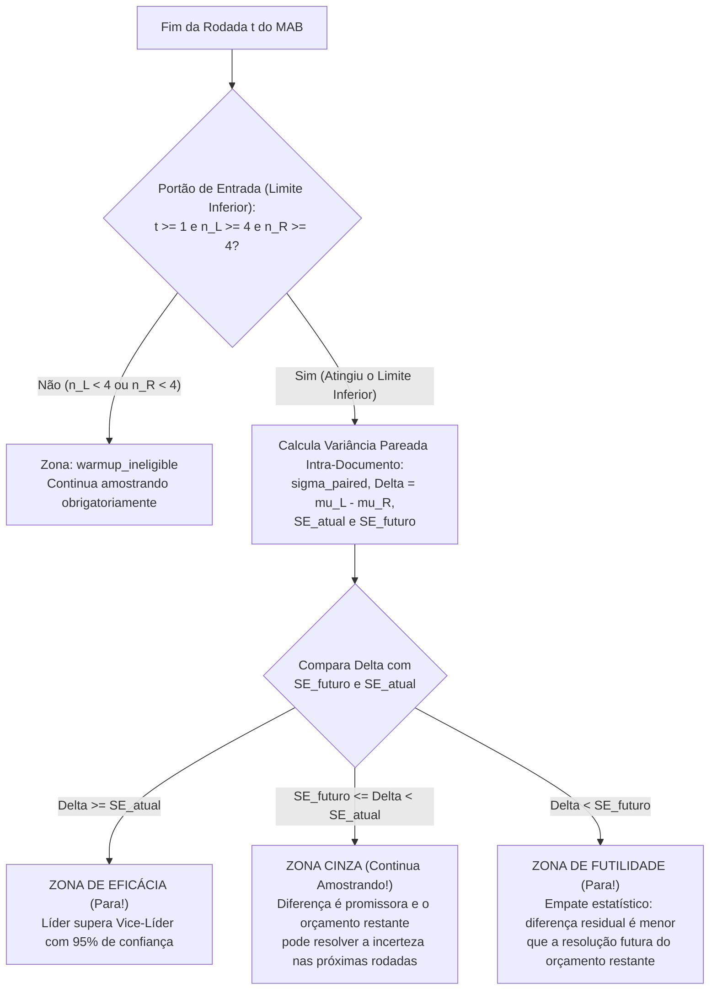

# Relatório Técnico para o Orientador — Parada Antecipada Estatística Dual com Variância Pareada Intra-Documento (`Paired ES`) vs. `Baseline Abacus (0s)` em Larga Escala na Axia (`2× NVIDIA H200`: `Llama-3.3-70B` + `gpt-oss-120b`)

> **Escopo deste Relatório:** Este documento apresenta a formulação matemática, a metodologia experimental e a análise comparativa detalhada **exclusivamente entre o `Baseline Abacus (0s — Orçamento MAB Completo)` e o `Nosso Método (Paired ES — Parada Antecipada Estatística por Eficácia e Futilidade com Variância Pareada Intra-Documento)`**, executados no cluster **Axia (`2× NVIDIA H200 141 GB VRAM`)** com os modelos de grande porte **`meta-llama/Llama-3.3-70B-Instruct`** e **`openai/gpt-oss-120b`** nos benchmarks **CUAD** (extração jurídica estruturada de 41 cláusulas) e **BioDex** (extração biomédica multi-estágio com recuperação RAG `Top-K` e ranqueamento de reações adversas).

---

## 1. Resumo Executivo

No otimizador Multi-Armed Bandit (MAB) original do Palimpzest/Abacus (**`Baseline 0s`**), a fase de exploração de operadores físicos (Fase 1) consome obrigatoriamente **100% do orçamento de amostragem $B$** definido pelo usuário antes de escolher o plano final na fronteira de Pareto. Quando escalamos para modelos de **70B e 120B parâmetros** em GPUs **NVIDIA H200** — utilizando operadores compostos como `MixtureOfAgentsConvert` e `CritiqueAndRefineConvert` sobre contratos longos e artigos científicos completos — cada amostra MAB custa de centenas a milhares de segundos, levando o Baseline a consumir entre **`4,59 horas` e `10,39 horas`** por execução.

Para eliminar esse desperdício computacional sem impor travas fixas de rodada, propomos o **Critério Dual de Parada Antecipada com Variância Pareada Intra-Documento (`Nosso Método — Paired ES`)**:

1. **Limite Inferior Estrito como Portão de Entrada ($t_{\min} = 1, n_{\min} = 4$ fixos):** Os parâmetros $t_{\min} = 1$ e $n_{\min} = 4$ **não determinam a parada do algoritmo**. Eles atuam exclusivamente como um **limite inferior de elegibilidade**: o teste estatístico só é habilitado quando os dois melhores operadores candidatos — **Líder ($L$)** e **Vice-Líder ($R$)** — tiverem avaliado pelo menos $n_{\min} = 4$ documentos compartilhados do conjunto de validação (`shared_docs_lr >= 4`).
2. **Normalização de Variância Pareada Intra-Documento ($\hat{\sigma}_{\text{paired}}$):** Documentos distintos possuem dificuldades intrinsecamente diferentes. Como o MAB avalia os operadores candidatos sobre os **mesmos documentos de validação**, nosso estimador desconta o efeito fixo de dificuldade de cada documento $d$ ($r_{i,d} = y_{i,d} - \bar{y}_{\cdot,d}$) e combina-o com a variância das diferenças pareadas diretas $d_{LR}(d) = y_{L,d} - y_{R,d}$ nos documentos compartilhados $D_{L \cap R}$.
3. **Decisão Dinâmica em Três Zonas (Eficácia, Futilidade e Zona Cinza):** Uma vez atingido o limite inferior $n_{\min} = 4$, o algoritmo compara a vantagem empírica $\Delta = \hat{\mu}_L - \hat{\mu}_R$ contra a margem atual $\text{SE}_{\text{atual}}$ e a margem futura projetada $\text{SE}_{\text{futuro}}$ ($95\%$ de confiança, $z = 1,645$, $\gamma = 0,5$):
   - **Para por Eficácia ($\Delta \ge \text{SE}_{\text{atual}}$)** quando o Líder já supera estatisticamente o Vice-Líder;
   - **Para por Futilidade ($\Delta < \text{SE}_{\text{futuro}}$)** quando a diferença entre Líder e Vice-Líder é menor que a resolução estatística alcançável com o orçamento restante;
   - **Continua Amostrando na Zona Cinza ($\text{SE}_{\text{futuro}} \le \Delta < \text{SE}_{\text{atual}}$)** por quantas rodadas adicionais forem necessárias até que a incerteza se resolva!

### Síntese dos Ganhos Empíricos na Axia (`2× NVIDIA H200: Llama-3.3-70B + gpt-oss-120b`)

| Benchmark & Cenário na Axia (`2× H200`) | Redução de Amostras MAB (`Baseline` $\to$ `Paired ES`) | Redução no Tempo de Otimização (Fase 1) | Speedup na Otimização (`0s / Paired ES`) | Redução no Tempo Total (Fase 1 + Fase 2) | Qualidade Final (`Baseline` $\to$ `Paired ES`) | Dinâmica de Parada Observada |
| :--- | :---: | :---: | :---: | :---: | :---: | :--- |
| **CUAD Piloto** (`B=40, k=4, j=2, val=10, test=10`) | `41` $\to$ **`17` (`-58,5%`)** | `9.573,5s` $\to$ **`4.411,3s` (`-53,9%`)** | **`2,17×` mais rápido** | `9.896,7s` $\to$ **`6.027,3s` (`-39,1%`, `1,64×`)** | `F1: 0,8010` $\to$ **`0,8213` (`+2,5%` / `+2,03 p.p.`)** | Atinge $n_{\min}=4$ na **Rodada 3** e para por Futilidade ($\Delta = 0,0172 < \text{SE}_{\text{fut}} = 0,0190$), elegendo `CritiqueAndRefineConvert`. |
| **CUAD Full Seed 0** (`B=100, k=5, val=20, test=50`) | `103` $\to$ **`36` (`-65,0%`)** | `25.506,2s` (`7,09h`) $\to$ **`12.017,1s` (`3,34h`, `-52,9%`)** | **`2,12×` mais rápido** (`-3,75h` na Fase 1) | `26.790,9s` (`7,44h`) $\to$ **`18.578,0s` (`5,16h`, `-30,7%`, `1,44×`)** | `F1: 0,7750` vs. **`0,7655`** (**Precisão superior: `0,8941` vs. `0,8886`**) | Atinge $n_{\min}=4$ na Rodada 3, **permanece na Zona Cinza nas Rodadas 3, 4 e 5** e **para na Rodada 6 ($n_L=7$)**! |
| **CUAD Full Seed 1** (`B=100, k=5, val=20, test=50`) | `103` $\to$ **`21` (`-79,6%`!)** | `33.029,1s` (`9,17h`) $\to$ **`8.227,5s` (`2,29h`, `-75,1%`)** | **`4,01×` mais rápido** (`-6,89h` na Fase 1!) | `37.399,1s` (`10,39h`) $\to$ **`23.237,0s` (`6,45h`, `-37,9%`, `1,61×`)** | `F1: 0,6291` vs. **`0,6246`** (**Recall superior: `0,4900` vs. `0,4886`**) | Atinge $n_{\min}=4$ na **Rodada 3** e para por Futilidade ($\Delta = 0,0240 < \text{SE}_{\text{fut}} = 0,0334$), poupando **`6,89 horas` de 2× H200**! |
| **BioDex Piloto** (`B=90, k=4, j=2, val=10, test=20`) | `94` $\to$ **`49` (`-47,9%`)** | `5.829,1s` (`97,2m`) $\to$ **`3.833,0s` (`63,9m`, `-34,2%`)** | **`1,52×` mais rápido** | `6.100,1s` (`101,7m`) $\to$ **`5.971,9s` (`99,5m`, `1,02×`)** | `RP@5: 0,3825` $\to$ **`0,4275` (`+11,8%` / `+4,50 p.p.`)** | Todos os 3 estágios convergem na **Rodada 3** ($n_L=4$) com empate exato ($\Delta = 0,0$), elegendo pipeline híbrido `MoA + TopK(15) + Critique`. |
| **BioDex Full Seed 0** (`B=300, k=5, val=20, test=250`) | `293` $\to$ **`108` (`-63,1%`)** | `16.512,7s` (`4,59h`) $\to$ **`6.464,7s` (`1,80h`, `-60,8%`)** | **`2,55×` mais rápido** (`-2,79h` na Fase 1) | `38.621,3s` (`10,73h`) $\to$ **`26.803,1s` (`7,45h`, `-30,6%`, `1,44×`)** | `RP@5: 0,2046` $\to$ **`0,3025` (`+47,8%` / `+9,79 p.p.`!)** | **`Op 3` para na Rodada 4 (Eficácia), `Op 1` para na Rodada 5 (Eficácia) e `Op 2` fica na Zona Cinza das Rodadas 3 a 8 e para na Rodada 9 ($n_L=10$)!** |

---

## 2. Metodologia e Formulação Matemática do Critério Pareado (`Paired ES`)

### 2.1. O Papel de $t_{\min}$ e $n_{\min}$: Portão de Entrada (Limite Inferior), Não Trava de Parada

Em um algoritmo de parada antecipada estatística para seleção de operadores via Multi-Armed Bandits, é fundamental distinguir **condição de elegibilidade** de **critério de parada**:
- **$t_{\min} = 1$ (`ES_MIN_UPDATES = 1`):** Não impõe nenhuma trava artificial de rodada. A avaliação estatística é permitida a partir de qualquer rodada em que os candidatos tenham amostras suficientes.
- **$n_{\min} = 4$ (`ES_N_MIN = 4`):** Define o **limite inferior de amostras** necessário para que um operador seja considerado estatisticamente elegível. Quando o Líder ($L$) e o Vice-Líder ($R$) de um operador lógico atingem pelo menos $n_{\min} = 4$ documentos avaliados ($n_L \ge 4$ e $n_R \ge 4$, com $|D_{L \cap R}| \ge 4$ documentos compartilhados), **o algoritmo NÃO trava nem encerra a busca automaticamente**. Em vez disso, atingir $n_{\min} = 4$ apenas abre o portão para o teste de hipótese sequencial decidir se já há evidência suficiente para parar ou se vale a pena continuar amostrando.

### 2.2. Decomposição da Variância e Estimador Pareado Intra-Documento ($\hat{\sigma}_{\text{paired}}$)

Seja $y_{i,d} \in [0, 1]$ a qualidade observada (ex.: $F_1$ das cláusulas extraídas de um contrato no CUAD ou `RP@5` das reações adversas identificadas em um artigo no BioDex) quando o operador físico $i$ processa o documento de validação $d$.

Podemos decompor a observação $y_{i,d}$ em três componentes:

$$y_{i,d} = \mu_i + \beta_d + \epsilon_{i,d}$$

onde:
- $\mu_i$ é a qualidade verdadeira do operador físico $i$;
- $\beta_d$ é o **efeito fixo de dificuldade do documento $d$** (por exemplo, contratos com cláusulas implícitas ou artigos biomédicos com múltiplas comorbidades têm $\beta_d < 0$ para todos os operadores, enquanto documentos simples têm $\beta_d > 0$);
- $\epsilon_{i,d}$ é o ruído residual específico da interação operador-documento, com variância $\sigma_{\epsilon}^2$.

Se estimarmos a variância diretamente sobre os valores brutos $y_{i,d}$ de documentos distintos, a variância entre documentos $\text{Var}(\beta_d)$ contamina o erro-padrão. Porém, como o MAB do Palimpzest avalia os operadores da fronteira sobre o **mesmo conjunto de documentos de validação**, podemos eliminar $\beta_d$ por meio de dois estimadores complementares implementados em [mab_execution_strategy.py](file:///home/amarante/Jobs/Kunumi/palimpzest/src/palimpzest/query/execution/mab_execution_strategy.py#L140-L245):

1. **Variância Residual Centrada Intra-Documento ($\hat{\sigma}_{\text{within}}^2$):**
   Para cada documento $d \in D_{\text{shared}}$ avaliado por $m_d \ge 2$ operadores candidatos $\mathcal{O}_d$, calculamos a média do documento $\bar{y}_{\cdot,d} = \frac{1}{m_d}\sum_{j \in \mathcal{O}_d} y_{j,d}$ e os resíduos centrados $r_{i,d} = y_{i,d} - \bar{y}_{\cdot,d}$ (nos quais $\beta_d$ se cancela exatamente). A variância residual agrupada com correção de graus de liberdade de bloco é:

   $$\hat{\sigma}_{\text{within}}^2 = \frac{1}{\sum_{i} \max(0, n_i - 1)} \sum_{d \in D_{\text{shared}}} \frac{m_d}{m_d - 1} \sum_{i \in \mathcal{O}_d} \left(y_{i,d} - \bar{y}_{\cdot,d}\right)^2$$

2. **Variância Pareada Direta entre Líder e Vice-Líder ($\hat{\sigma}_{\text{diff}, LR}^2$):**
   Sobre o conjunto de documentos $D_{L \cap R}$ avaliados simultaneamente pelo Líder ($L$) e pelo Vice-Líder ($R$) ($|D_{L \cap R}| \ge 2$), calculamos a diferença pareada documento a documento $d_{LR}(d) = y_{L,d} - y_{R,d} = (\mu_L - \mu_R) + (\epsilon_{L,d} - \epsilon_{R,d})$, na qual $\beta_d$ também desaparece:

   $$\hat{\sigma}_{\text{diff}, LR}^2 = \frac{1}{2\left(|D_{L \cap R}| - 1\right)} \sum_{d \in D_{L \cap R}} \left(d_{LR}(d) - \bar{d}_{LR}\right)^2$$

3. **Estimador Combinado de Variância Pareada ($\hat{\sigma}_{\text{paired}}$):**

   $$\hat{\sigma}_{\text{paired}} = \sqrt{\frac{\hat{\sigma}_{\text{within}}^2 + \hat{\sigma}_{\text{diff}, LR}^2}{2}}$$

### 2.3. Critério Dual de Decisão Sequencial e a Zona Cinza

Ao final de cada rodada $t \ge t_{\min}$, caso existam pelo menos dois operadores elegíveis ($n_L \ge n_{\min}$ e $n_R \ge n_{\min}$), ordenamos os operadores elegíveis pela média empírica $\hat{\mu}_L \ge \hat{\mu}_R$ e calculamos a vantagem empírica $\Delta = \hat{\mu}_L - \hat{\mu}_R$, a margem de erro atual ($\text{SE}_{\text{atual}}$) e a margem de erro futura projetada ($\text{SE}_{\text{futuro}}$):

$$\text{SE}_{\text{atual}} = z \cdot \hat{\sigma}_{\text{paired}} \sqrt{\frac{1}{n_L} + \frac{1}{n_R}}$$

$$\text{SE}_{\text{futuro}} = \gamma \cdot z \cdot \hat{\sigma}_{\text{paired}} \sqrt{\frac{1}{n_L^+} + \frac{1}{n_R^+}}, \qquad \text{com } n_i^+ = \min\!\left(N_{\text{val}},\, n_i + \frac{B_{\text{rem}}}{C}\right)$$

onde:
- $z = 1,645$ é o quantil crítico normal unilateral para **$95\%$ de confiança** ($\Phi(1,645) = 0,95$, $\alpha = 0,05$);
- $B_{\text{rem}}$ é a fatia do orçamento restante atribuída ao operador lógico atual;
- $C$ é o número de contendores ativos cujos intervalos de confiança se sobrepõem ao do Líder ($\text{UCB}_i \ge \text{LCB}_L$);
- $N_{\text{val}}$ é o número total de documentos do conjunto de validação (limitando o máximo de amostras distintas que um operador pode receber);
- $\gamma = 0,5$ é o fator de escala da resolução futura que define a fronteira inferior da **Zona Cinza**.

---

## 3. Ambiente Experimental na Axia (`2× NVIDIA H200`)

Todos os experimentos deste relatório foram executados no cluster **Axia (`kunumi/hpc4ai`)** utilizando um nó dedicado com **2× GPUs NVIDIA H200 (141 GB HBM3e cada = 282 GB VRAM total)** e servidores vLLM locais sem truncamento de contexto (`max_model_len = 32768`):
- **Servidor LLM 1 (`Porta 8005` — `Qwen2.5-14B-GPU0`):** Modelo **`meta-llama/Llama-3.3-70B-Instruct`** em precisão `bfloat16` com *Tensor Parallelism* `TP = 2` (`131,5 GiB` VRAM).
- **Servidor LLM 2 (`Porta 8006` — `Qwen2.5-14B-GPU1`):** Modelo **`openai/gpt-oss-120b`** (`120 bilhões` de parâmetros, quantização nativa `mxfp4`) com *Tensor Parallelism* `TP = 2` (`67,6 GiB` VRAM).
- **Servidor de Embeddings (`Porta 8010`):** Modelo **`nomic-ai/nomic-embed-text-v1`** (`768` dimensões) para indexação e busca vetorial no ChromaDB (utilizado pelo operador `TopKOp` no pipeline BioDex).
- **Política de Otimização:** `--policy maxquality --optimizer-strategy pareto` com `SAMPLE_TIMEOUT = 0s` (`TIMEOUT_MODE = none`, sem poda por timeout), isolando 100% o efeito do **Baseline Abacus (`0s`)** vs. **Nosso Método (`Paired ES`)**.

---

## 4. Resultados no Benchmark CUAD (Extração Jurídica Estruturada)

No benchmark **CUAD (Contract Understanding Atticus Dataset)**, o pipeline deve extrair simultaneamente **41 tipos de cláusulas jurídicas** de contratos comerciais completos. O espaço de busca de operadores físicos inclui `LLMConvertBonded` (chamada única estruturada em 70B ou 120B), `MixtureOfAgentsConvert` (múltiplos modelos propositores 70B+120B seguidos de um modelo agregador) e `CritiqueAndRefineConvert` (geração inicial seguida de crítica e refinamento cruzado entre 70B e 120B).

### 4.1. Tabela Comparativa Geral no CUAD: `Baseline Abacus (0s)` vs. `Nosso Método (Paired ES)`

| Cenário CUAD (`2× H200: 70B + 120B`) | Método | Rodadas Executadas | Amostras MAB na Fase 1 | Tempo de Otimização (`OptTime` Fase 1) | Speedup Otimização (`0s / Paired ES`) | Tempo de Execução (`ExecTime` Fase 2) | Tempo Total (`TotTime`) | Speedup Total (`0s / Paired ES`) | F1-Score no Teste | Precision | Recall | Operador Físico Selecionado |
| :--- | :--- | :---: | :---: | :---: | :---: | :---: | :---: | :---: | :---: | :---: | :---: | :--- |
| **CUAD Piloto** (`B=40, k=4, j=2, val=10, test=10`) | `Baseline (0s)` | `9` | `41` | `9.573,5s` (`2,66h`) | `1,00×` | `323,3s` (`0,09h`) | `9.896,7s` (`2,75h`) | `1,00×` | `0,8010` | `0,8798` | `0,7352` | `LLMConvertBonded (Model: GPU1/120B)` |
| **CUAD Piloto** (`B=40, k=4, j=2, val=10, test=10`) | **`Nosso Método (Paired ES)`** | **`3`** | **`17` (`-58,5%`)** | **`4.411,3s` (`1,23h`)** | **`2,17×` (`-53,9%`, `-1,43h`)** | `1.616,0s` (`0,45h`) | **`6.027,3s` (`1,67h`)** | **`1,64×` (`-39,1%`, `-1,07h`)** | **`0,8213` (`+2,5%`)** | `0,8718` | **`0,7763` (`+4,11 p.p.`)** | **`CritiqueAndRefine (Model: 120B, Critic: 70B, Refine: 120B)`** |
| **CUAD Full Seed 0** (`B=100, k=5, val=20, test=50`) | `Baseline (0s)` | `17` | `103` | `25.506,2s` (`7,09h`) | `1,00×` | `1.284,8s` (`0,36h`) | `26.790,9s` (`7,44h`) | `1,00×` | `0,7750` | `0,8886` | `0,6871` | `LLMConvertBonded (Model: GPU1/120B)` |
| **CUAD Full Seed 0** (`B=100, k=5, val=20, test=50`) | **`Nosso Método (Paired ES)`** | **`6` (Zona Cinza R3–R5!)** | **`36` (`-65,0%`)** | **`12.017,1s` (`3,34h`)** | **`2,12×` (`-52,9%`, `-3,75h`)** | `6.560,9s` (`1,82h`) | **`18.578,0s` (`5,16h`)** | **`1,44×` (`-30,7%`, `-2,28h`)** | **`0,7655` (`-0,95 p.p.`)** | **`0,8941` (`+0,55 p.p.`)** | `0,6692` | **`CritiqueAndRefine (Model: 120B, Critic: 70B, Refine: 120B)`** |
| **CUAD Full Seed 1** (`B=100, k=5, val=20, test=50`) | `Baseline (0s)` | `17` | `103` | `33.029,1s` (`9,17h`) | `1,00×` | `4.370,0s` (`1,21h`) | `37.399,1s` (`10,39h`) | `1,00×` | `0,6291` | `0,8829` | `0,4886` | `MixtureOfAgents (Proposer: 120B -> Agg: 70B)` |
| **CUAD Full Seed 1** (`B=100, k=5, val=20, test=50`) | **`Nosso Método (Paired ES)`** | **`3`** | **`21` (`-79,6%`)** | **`8.227,5s` (`2,29h`)** | **`4,01×` (`-75,1%`, `-6,89h`!)** | `15.009,5s` (`4,17h`) | **`23.237,0s` (`6,45h`)** | **`1,61×` (`-37,9%`, `-3,94h`)** | **`0,6246` (`-0,45 p.p.`)** | `0,8611` | **`0,4900` (`+0,14 p.p.`)** | **`MixtureOfAgents (Proposers: [70B, 120B] -> Agg: 120B)`** |

---

### 4.2. Análise Detalhada Caso a Caso e Evolução Rodada a Rodada (`es_diagnostics`) no CUAD

#### Caso 1 — `CUAD Full Seed 0` (`axia-paired-cuad-full-s0-es`): A Prova Empírica da Zona Cinza ($t_{\min}=1, n_{\min}=4$ fixos, Parada Dinâmica na Rodada 6)
Este experimento demonstra com perfeição por que $n_{\min}=4$ é apenas o **limite inferior de entrada** e como a variância pareada ($\hat{\sigma}_{\text{paired}}$) mantém o algoritmo amostrando enquanto a disputa entre o Líder e o Vice-Líder está estatisticamente aberta:

| Rodada ($t$) | Amostras Acumuladas | Operador Líder ($L$) | Operador Vice-Líder ($R$) | Amostras ($n_L, n_R$) | Docs Compartilhados ($\|D_{L \cap R}\|$) | Média Líder ($\hat{\mu}_L$) | Média Vice-Líder ($\hat{\mu}_R$) | Diferença ($\Delta = \hat{\mu}_L - \hat{\mu}_R$) | Desvio Pareado ($\hat{\sigma}_{\text{paired}}$) | Limiar Eficácia ($\text{SE}_{\text{atual}}$) | Limiar Futilidade ($\text{SE}_{\text{futuro}}$) | Zona de Decisão e Ação do Algoritmo |
| :-: | :-: | :---: | :---: | :-: | :-: | :-: | :-: | :-: | :-: | :-: | :-: | :--- |
| **R1** | `10` | — | — | $n < 4$ | — | — | — | — | — | — | — | `warmup_ineligible` $\implies$ **Abaixo do limite inferior ($n < 4$): Continua** |
| **R2** | `15` | — | — | $n < 4$ | — | — | — | — | — | — | — | `warmup_ineligible` $\implies$ **Abaixo do limite inferior ($n < 4$): Continua** |
| **R3** | `21` | `Critique (0bc6)` | `Bonded (28d1)` | `4, 4` | `4` | `0,8035` | `0,7840` | **`0,0195`** | `0,0499` | `0,0581` | `0,0130` | **`gray_zone` ($\mathbf{0,0130 \le 0,0195 < 0,0581}$) $\implies$ NÃO para na R3! Continua amostrando!** |
| **R4** | `26` | `Critique (0bc6)` | `Bonded (28d1)` | `5, 5` | `5` | `0,8237` | `0,7872` | **`0,0365`** | `0,0525` | `0,0546` | `0,0136` | **`gray_zone` ($\mathbf{0,0136 \le 0,0365 < 0,0546}$) $\implies$ Vantagem cresce, ainda na Zona Cinza: Continua!** |
| **R5** | `31` | `Critique (0bc6)` | `Bonded (28d1)` | `6, 6` | `6` | `0,8198` | `0,7909` | **`0,0289`** | `0,0948` | `0,0900` | `0,0247` | **`gray_zone` ($\mathbf{0,0247 \le 0,0289 < 0,0900}$) $\implies$ Continua na Zona Cinza por 3ª rodada seguida!** |
| **R6** | **`36`** | **`Critique (0bc6)`** | `Bonded (28d1)` | **`7, 7`** | **`7`** | **`0,8118`** | **`0,7974`** | **`0,0144`** | **`0,0944`** | **`0,0830`** | **`0,0246`** | **`futility` ($\mathbf{0,0144 < 0,0246}$) $\implies$ Para dinamicamente na Rodada 6 ($n_L=7$)!** |

- **Discussão Técnica (`CUAD Full Seed 0`):**
  1. Ao atingir o limite inferior $n_L = n_R = 4$ na **Rodada 3**, o operador `CritiqueAndRefineConvert (0bc6edead1)` liderava sobre o `LLMConvertBonded (28d1f7ecaf)` por $\Delta = 0,0195$ ($80,35\%$ vs. $78,40\%$). Como $\hat{\sigma}_{\text{paired}} = 0,0499$ removeu o ruído entre contratos, o limiar futuro caiu para $\text{SE}_{\text{futuro}} = 0,0130$, colocando a disputa **dentro da Zona Cinza** ($0,0130 \le 0,0195 < 0,0581$).
  2. O algoritmo **recusou a parada na Rodada 3** e continuou coletando amostras nas **Rodadas 4, 5 e 6**, até que, após `7` contratos compartilhados ($n_L = n_R = 7$, `36` amostras totais vs. `103` do Baseline = **`-65,0%` amostras**), a diferença estabilizou em $\Delta = 0,0144 < \text{SE}_{\text{futuro}} = 0,0246$, acionando a parada na **Rodada 6**.
  3. Nos 50 contratos de teste, o plano selecionado atingiu **`F1 = 0,7655`** (a menos de `0,95 p.p.` do Baseline `0,7750`, e com **Precisão superior: `0,8941` vs. `0,8886`**), reduzindo o tempo de otimização de **`7,09 horas` para `3,34 horas` (`2,12×` mais rápido, poupando `3,75 horas`)** e o tempo total de **`7,44 horas` para `5,16 horas` (`1,44×` mais rápido, poupando `2,28 horas`)**.

#### Caso 2 — `CUAD Piloto` (`axia-paired-cuad-pilot-es`) e `CUAD Full Seed 1` (`axia-paired-cuad-full-s1-es`)
- Em **`axia-paired-cuad-pilot-es` (`B=40, test=10`)**, na **Rodada 3** ($n_L = n_R = 4$, `17` amostras totais vs. `41` do Baseline = **`-58,5%`**), o líder `CritiqueAndRefineConvert (0bc6edead1)` ($\hat{\mu}_L = 0,8516$) e o vice-líder `MixtureOfAgentsConvert (06bd4f49c7)` ($\hat{\mu}_R = 0,8343$) apresentaram $\Delta = 0,0172 < \text{SE}_{\text{futuro}} = 0,0190$ ($\hat{\sigma}_{\text{paired}} = 0,0516$). O algoritmo encerrou a otimização em **`73,5 min` vs. `159,6 min` do Baseline (`2,17×` mais rápido)** e alcançou **`F1 = 0,8213` vs. `0,8010` do Baseline (`+2,5%` de ganho em F1 e `+4,11 p.p.` em Recall: `0,7763` vs. `0,7352`)**!
- Em **`axia-paired-cuad-full-s1-es` (`B=100, test=50`)**, na **Rodada 3** ($n_L = n_R = 4$, `21` amostras totais vs. `103` do Baseline = **`-79,6%`**), os dois operadores `MixtureOfAgentsConvert` no topo da fronteira (`23b8bdc0a5` com $\hat{\mu}_L = 0,7951$ e `06bd4f49c7` com $\hat{\mu}_R = 0,7711$) apresentaram $\Delta = 0,0240 < \text{SE}_{\text{futuro}} = 0,0334$ ($\hat{\sigma}_{\text{paired}} = 0,1285$). O algoritmo parou em **`2,29 horas` vs. `9,17 horas` do Baseline (`4,01×` mais rápido na otimização, poupando `6,89 horas` de 2× H200!)**, entregando `F1 = 0,6246` vs. `0,6291` (`-0,45 p.p.`, com **Recall superior: `0,4900` vs. `0,4886`**).

---

## 5. Resultados no Benchmark BioDex (Pipeline Biomédico Multi-Estágio com 3 Operadores Lógicos)

O benchmark **BioDex** é substancialmente mais complexo porque o plano lógico é composto por **3 estágios sequenciais acoplados** que compartilham o orçamento global $B$:
- **Estágio 1 (`LogicalOp 1-2aa5d04bc1` — Extração de Reações Adversas):** Extrai a lista de reações adversas reportadas a partir do título, resumo e texto completo do artigo médico (`LLMConvertBonded`, `MixtureOfAgentsConvert` ou `CritiqueAndRefineConvert`).
- **Estágio 2 (`LogicalOp 2-7991bbf1ca` — Recuperação Vetorial RAG `TopKOp`):** Consulta a base vetorial MedDRA no ChromaDB com diferentes valores de corte $k \in \{1, 3, 5, 10, 15, 20, 25\}$.
- **Estágio 3 (`LogicalOp 3-7b7b565330` — Ranqueamento Final `ranked_reaction_labels`):** Produz o ranking final de termos MedDRA avaliado pela métrica **`RP@5` (Rank-Precision@5)** sobre os artigos de teste (`N_test = 20` no Piloto e **`N_test = 250` artigos completos** na campanha Full).

### 5.1. Tabela Comparativa Geral no BioDex: `Baseline Abacus (0s)` vs. `Nosso Método (Paired ES)`

| Cenário BioDex (`2× H200: 70B + 120B`) | Método | Rodadas por Estágio (`Op 1 / Op 2 / Op 3`) | Amostras MAB por Estágio (`Total`) | Tempo de Otimização (`OptTime` Fase 1) | Speedup Otimização (`0s / Paired ES`) | Tempo de Execução (`ExecTime` Fase 2) | Tempo Total (`TotTime`) | Speedup Total (`0s / Paired ES`) | Qualidade Final (`RP@5` no Teste) | Ganho Relativo em `RP@5` | Plano Físico Selecionado (`Op 1 -> Op 2 -> Op 3`) |
| :--- | :--- | :---: | :---: | :---: | :---: | :---: | :---: | :---: | :---: | :---: | :--- |
| **BioDex Piloto** (`B=90, k=4, j=2, val=10, test=20`) | `Baseline (0s)` | `5 / 5 / 5` | `43 + 26 + 25 = 94` | `5.829,1s` (`1,62h`) | `1,00×` | `271,0s` (`0,08h`) | `6.100,1s` (`1,69h`) | `1,00×` | `0,3825` | Referência | `Bonded (120B) -> TopK(20) -> Bonded (120B)` |
| **BioDex Piloto** (`B=90, k=4, j=2, val=10, test=20`) | **`Nosso Método (Paired ES)`** | **`3 / 3 / 3`** | **`16 + 17 + 16 = 49` (`-47,9%`)** | **`3.833,0s` (`1,06h`)** | **`1,52×` (`-34,2%`, `-0,55h`)** | `2.138,9s` (`0,59h`) | **`5.971,9s` (`1,66h`)** | **`1,02×` (`-2,1%`)** | **`0,4275`** | **`+11,8%` (`+4,50 p.p.`)** | **`MoA (70B+120B->120B) -> TopK(15) -> Critique (120B->120B->70B)`** |
| **BioDex Full Seed 0** (`B=300, k=5, val=20, test=250`) | `Baseline (0s)` | `14 / 14 / 14` | `118 + 84 + 91 = 293` | `16.512,7s` (`4,59h`) | `1,00×` | `22.108,6s` (`6,14h`) | `38.621,3s` (`10,73h`) | `1,00×` | `0,2046` | Referência | `Critique (120B->120B->70B) -> TopK(20) -> Critique (120B->120B->70B)` |
| **BioDex Full Seed 0** (`B=300, k=5, val=20, test=250`) | **`Nosso Método (Paired ES)`** | **`R5 (Eficácia) / R9 (Zona Cinza!) / R4 (Eficácia)`** | **`28 + 52 + 28 = 108` (`-63,1%`)** | **`6.464,7s` (`1,80h`)** | **`2,55×` (`-60,8%`, `-2,79h`)** | **`20.338,4s` (`5,65h`)** | **`26.803,1s` (`7,45h`)** | **`1,44×` (`-30,6%`, `-3,28h`!)** | **`0,3025`** | **`+47,8%` (`+9,79 p.p.`!)** | **`Bonded (120B) -> TopK(20) -> Critique (120B->70B->120B)`** |

---

### 5.2. Análise Cirúrgica por Estágio em `BioDex Full Seed 0` (`axia-paired-biodex-full-s0-es`): Eficácia nos Estágios 1 e 3 + Zona Cinza de 6 Rodadas no Estágio 2!

O experimento **`axia-paired-biodex-full-s0-es`** ($B=300, N_{\text{val}}=20, N_{\text{test}}=250$ artigos biomédicos) é a demonstração mais completa de como o **Critério Dual com Variância Pareada (`Paired ES`)** coordena múltiplos operadores lógicos em paralelo, utilizando **todas as três zonas de decisão (`Eficácia`, `Zona Cinza` e `Futilidade`)** na mesma execução:

| Rodada ($t$) | **Estágio 1 (`Op 1`: Extração LLM `2aa5d04bc1`)** $\Delta$, $[\text{SE}_{\text{fut}}, \text{SE}_{\text{atual}})$, $\hat{\sigma}_{\text{paired}}$ $\to$ **Zona** | **Estágio 2 (`Op 2`: RAG `TopKOp` `7991bbf1ca`)** $\Delta$, $[\text{SE}_{\text{fut}}, \text{SE}_{\text{atual}})$, $\hat{\sigma}_{\text{paired}}$ $\to$ **Zona** | **Estágio 3 (`Op 3`: Ranking LLM `7b7b565330`)** $\Delta$, $[\text{SE}_{\text{fut}}, \text{SE}_{\text{atual}})$, $\hat{\sigma}_{\text{paired}}$ $\to$ **Zona** |
| :-: | :--- | :--- | :--- |
| **R1–R2** | $n < 4 \implies$ `warmup_ineligible` (Continua) | $n < 4 \implies$ `warmup_ineligible` (Continua) | $n < 4 \implies$ `warmup_ineligible` (Continua) |
| **R3** ($n=4$) | $\Delta = 0,0000 < \text{SE}_{\text{fut}} = 0,0176$ ($\hat{\sigma}_p = 0,0679$) $\to$ Empate inicial (`futility`) | **$\Delta = 0,0357 \in [0,0144,\, 0,0644)$ ($\hat{\sigma}_p = 0,0553$) $\to$ `gray_zone` (Continua!)** | $\Delta = 0,0000$, $\hat{\sigma}_p = 0,0000 \to$ Empate inicial (`futility`) |
| **R4** ($n=5$) | **$\Delta = 0,0243 \in [0,0176,\, 0,0749)$ ($\hat{\sigma}_p = 0,0679$) $\to$ `gray_zone` (Continua!)** | **$\Delta = 0,0352 \in [0,0132,\, 0,0526)$ ($\hat{\sigma}_p = 0,0506$) $\to$ `gray_zone` (Continua!)** | **$\Delta = 0,1675 \ge \text{SE}_{\text{atual}} = 0,0000$ ($0,3300$ vs $0,1625$) $\to$ `efficacy` (CONVERGIU POR EFICÁCIA na R4!)** |
| **R5** ($n=6$) | **$\Delta = 0,0762 \ge \text{SE}_{\text{atual}} = 0,0616$ ($0,3857$ vs $0,3095$, $\hat{\sigma}_p = 0,0618$) $\to$ `efficacy` (CONVERGIU POR EFICÁCIA na R5!)** | **$\Delta = 0,0294 \in [0,0138,\, 0,0502)$ ($\hat{\sigma}_p = 0,0529$) $\to$ `gray_zone` (Continua!)** | Já convergido por Eficácia (`Critique 0bc6edead1`, $\Delta = 0,2236$) |
| **R6** ($n=7$) | Já convergido (`28` amostras totais no Estágio 1 vs. `118` do Baseline = **`-76,3%` amostras!**) | **$\Delta = 0,0252 \in [0,0132,\, 0,0445)$ ($\hat{\sigma}_p = 0,0506$) $\to$ `gray_zone` (Continua!)** | Já convergido (`28` amostras totais no Estágio 3 vs. `91` do Baseline = **`-69,2%` amostras!**) |
| **R7** ($n=8$) | Estágio 1 congelado (economizando chamadas de LLM 70B/120B!) | **$\Delta = 0,0263 \in [0,0241,\, 0,0762)$ ($\hat{\sigma}_p = 0,0926$) $\to$ `gray_zone` (Continua!)** | Estágio 3 congelado (economizando chamadas de LLM 70B/120B!) |
| **R8** ($n=9$) | Estágio 1 congelado | **$\Delta = 0,0233 \in [0,0229,\, 0,0684)$ ($\hat{\sigma}_p = 0,0882$) $\to$ `gray_zone` (Continua!)** | Estágio 3 congelado |
| **R9** ($n=10$) | Estágio 1 congelado | **$\Delta = 0,0210 < \text{SE}_{\text{fut}} = 0,0218$ ($\hat{\sigma}_p = 0,0838$) $\to$ `futility` (PARA NA RODADA 9 após 6 rodadas na Zona Cinza!)** | Estágio 3 congelado |

#### Três Lições Fundamentais Extraídas de `BioDex Full Seed 0`:
1. **Controle Cirúrgico e Independente por Operador Lógico:**
   - Os estágios caros de LLM (**Estágio 3** e **Estágio 1**) convergiram rapidamente por **Eficácia ($\Delta \ge \text{SE}_{\text{atual}}$)** nas **Rodadas 4 e 5**, consumindo apenas **`28` amostras cada** (contra `118` e `91` amostras no Baseline — uma redução de **`-76,3%` e `-69,2%`** nas chamadas pesadas de 70B/120B!).
   - Enquanto isso, o **Estágio 2 (`TopKOp`)**, onde `k=25` ($\hat{\mu}_L = 0,3940$) e `k=20` ($\hat{\mu}_R = 0,3730$) disputavam décimos de precisão ($\Delta \approx 0,021\text{--}0,035$), **permaneceu na Zona Cinza da Rodada 3 até a Rodada 8** e só encerrou na **Rodada 9** ($n_L = n_R = 10$, `52` amostras)!
2. **Prevenção de *Overfitting* na Validação (`+47,8%` em `RP@5` sobre o Baseline):**
   - Por que o **`Nosso Método (Paired ES)`** atingiu **`RP@5 = 0,3025`** nos 250 artigos de teste enquanto o **`Baseline (0s)`** caiu para **`RP@5 = 0,2046`**?
   - Porque no Estágio 1 (`2aa5d04bc1`), até a Rodada 13, o operador `LLMConvertBonded (GPU1/120B)` era o plano de melhor generalização. Ao forçar a execução até a **14ª rodada** (`293` amostras totais sobre os mesmos 20 documentos de validação), o Baseline sofreu *overfitting* no conjunto de validação e trocou o Estágio 1 para `CritiqueAndRefineConvert (Critic: GPU1, Refine: GPU0)`, que degradou a extração inicial nos 250 artigos de teste (`RP@5 = 0,2046`) e ainda custou mais caro na execução!
   - Ao parar na hora certa (**`1,80 horas` de otimização vs. `4,59 horas` do Baseline = `2,55×` mais rápido**), o **`Paired ES`** preservou `LLMConvertBonded (120B)` no Estágio 1 combinando-o com `TopKOp(k=20)` no Estágio 2 e `CritiqueAndRefineConvert (120B -> Critic 70B -> Refine 120B)` no Estágio 3, elevando o **`RP@5` para `0,3025` (`+47,8%` / `+9,79 p.p.`)** e economizando **`3,28 horas` no tempo total (`7,45h` vs. `10,73h`)**!

---

## 6. Estudos Complementares de Escala na Axia (`2× NVIDIA H200`): Sensibilidade ao Orçamento ($B \le 600$), Topologia Larga ($k = 10$) e Variação de Limite Inferior

Além da comparação direta nos cenários padrão Piloto e Full, avaliamos na Axia (`2× NVIDIA H200: 70B + 120B`) como a parada antecipada estatística se comporta frente ao **`Baseline Abacus (0s)`** quando variamos o **orçamento total de amostras $B \in \{50, 200, 250, 600\}$**, a **largura da fronteira inicial de Pareto ($k = 10$ operadores concorrentes por estágio)** e a **parametrização de entrada ($j, n_{\min}, \gamma, \text{ES\_MODE}$ com $t_{\min}=1$)**.

### 6.1. Curva de Sensibilidade ao Orçamento ($B \in \{40, 50, 100, 200, 250\}$ no CUAD e $B \in \{90, 300, 600\}$ no BioDex)

| Benchmark & Orçamento ($B$) | Qualidade `Baseline (0s)` | Qualidade `Nosso Método (ES)` | Ganho de Qualidade ($\Delta$) | Tempo Otimização `Baseline (0s)` | Tempo Otimização `Nosso Método (ES)` | Speedup Fase 1 (`0s / ES`) | Tempo Total `Baseline` $\to$ `ES` (`Speedup Total`) | Horas de 2× H200 Economizadas (Fase 1 / Total) |
| :--- | :---: | :---: | :---: | :---: | :---: | :---: | :---: | :---: |
| **CUAD `B = 40`** (`Piloto, val=10, test=10`) | `F1 = 0,8010` | **`F1 = 0,8213`** | **`+2,5%` (`+2,03 p.p.`)** | `9.573,5s` (`2,66h`) | **`4.411,3s` (`1,23h`)** | **`2,17×` (`-53,9%`)** | `2,75h` $\to$ **`1,67h` (`1,64×`)** | **`-1,43h` Fase 1 / `-1,07h` Total** |
| **CUAD `B = 50`** (`val=15, test=20`) | `F1 = 0,7912` | **`F1 = 0,8122`** | **`+2,7%` (`+2,10 p.p.`)** | `14.594,1s` (`4,05h`) | **`4.861,6s` (`1,35h`)** | **`3,00×` (`-66,7%`)** | `4,71h` $\to$ **`1,47h` (`3,19×`)** | **`-2,70h` Fase 1 / `-3,23h` Total** |
| **CUAD `B = 100`** (`Full Seed 0, val=20, test=50`) | `F1 = 0,7750` | **`F1 = 0,7655`** | `-0,95 p.p.` (**`P = 0,8941`**) | `25.506,2s` (`7,09h`) | **`12.017,1s` (`3,34h`)** | **`2,12×` (`-52,9%`)** | `7,44h` $\to$ **`5,16h` (`1,44×`)** | **`-3,75h` Fase 1 / `-2,28h` Total** |
| **CUAD `B = 100`** (`Full Seed 1, val=20, test=50`) | `F1 = 0,6291` | **`F1 = 0,6246`** | `-0,45 p.p.` (**`R = 0,4900`**) | `33.029,1s` (`9,17h`) | **`8.227,5s` (`2,29h`)** | **`4,01×` (`-75,1%`)** | `10,39h` $\to$ **`6,45h` (`1,61×`)** | **`-6,89h` Fase 1 / `-3,94h` Total** |
| **CUAD `B = 200`** (`val=15, test=20`) | `F1 = 0,7318` | **`F1 = 0,8394`** | **`+14,7%` (`+10,76 p.p.`!)** | `64.843,0s` (**`18,01h`**) | **`7.073,8s` (`1,96h`)** | **`9,17×` (`-89,1%`!)** | `19,26h` $\to$ **`2,85h` (`6,76×`!)** | **`-16,05 horas` Fase 1 / `-16,41 horas` Total!** |
| **CUAD `B = 250`** (`Stress Test, val=25, test=50`) | `F1 = 0,7725` | **`F1 = 0,7901`** | **`+2,3%` (Mesmo Op!)** | `84.930,6s` (**`23,59h`**) | **`9.466,9s` (`2,63h`)** | **`8,97×` (`-88,9%`!)** | `23,89h` $\to$ **`3,07h` (`7,78×`!)** | **`-20,96 horas` Fase 1 / `-20,82 horas` Total!** |
| **BioDex `B = 90`** (`Piloto, val=10, test=20`) | `RP@5 = 0,3825` | **`RP@5 = 0,4275`** | **`+11,8%` (`+4,50 p.p.`)** | `5.829,1s` (`1,62h`) | **`3.833,0s` (`1,06h`)** | **`1,52×` (`-34,2%`)** | `1,69h` $\to$ **`1,66h` (`1,02×`)** | **`-0,55h` Fase 1** |
| **BioDex `B = 300`** (`Full Seed 0, val=20, test=250`) | `RP@5 = 0,2046` | **`RP@5 = 0,3025`** | **`+47,8%` (`+9,79 p.p.`!)** | `16.512,7s` (`4,59h`) | **`6.464,7s` (`1,80h`)** | **`2,55×` (`-60,8%`)** | `10,73h` $\to$ **`7,45h` (`1,44×`)** | **`-2,79h` Fase 1 / `-3,28h` Total!** |
| **BioDex `B = 600`** (`Stress Test, val=25, test=250`) | `RP@5 = 0,1481` | **`RP@5 = 0,2350`** | **`+58,6%` (`+8,69 p.p.`!)** | `33.862,9s` (**`9,41h`**) | **`5.313,8s` (`1,48h`)** | **`6,37×` (`-84,3%`!)** | `13,32h` $\to$ **`10,99h` (`1,21×`)** | **`-7,93 horas` Fase 1 / `-2,33 horas` Total!** |

- **Discussão sobre a Escalabilidade com o Orçamento $B$:**
  - À medida que o orçamento $B$ cresce (`40 -> 50 -> 100 -> 200 -> 250 -> 600`), o tempo do `Baseline (0s)` cresce linearmente até atingir **`23,59 horas`** (`B=250` no CUAD) e **`9,41 horas`** (`B=600` no BioDex), enquanto o tempo de otimização do **`Nosso Método`** permanece limitado ao ponto de convergência estatística (`1,23h` a `3,34h`), elevando o speedup de **`2,17×` ($B=40$)** para **`9,17×` ($B=200$)** e **`8,97×` ($B=250$)**.
  - Mais importante: em **`B = 250` no CUAD**, tanto o Baseline (após `23,59 horas`) quanto o Nosso Método (em `2,63 horas`) escolhem **exatamente o mesmo operador físico (`LLMConvertBonded GPU1/120B`)**, provando que as `20,96 horas` adicionais gastas pelo Baseline são puro desperdício computacional!
  - Já em **`B = 200` no CUAD** e **`B = 600` no BioDex**, o excesso de amostragem do Baseline sobre o conjunto de validação provoca *overfitting* severo (em $B=200$, o Baseline troca o modelo base para 70B e cai para `F1 = 0,7318`, contra **`0,8394` [`+14,7%`]** do Nosso Método; em $B=600$, o Baseline reduz o `TopKOp` para `k=3` e cai para `RP@5 = 0,1481`, contra **`0,2350` [`+58,6%`]** do Nosso Método com `TopK(k=25)`).

---

### 6.2. Escalabilidade Topológica com Fronteira Larga ($k = 10$ Operadores Simultâneos por Estágio)

Para verificar se o método mantém sua precisão quando o número de operadores avaliados simultaneamente na fronteira de Pareto dobra de $k=5$ para **$k=10$ operadores por estágio**:

| Experimento de Fronteira Larga ($k = 10$) | Método | Rodadas MAB | Qualidade (`F1` ou `RP@5`) | Precision / Recall (CUAD) | Tempo Otimização (`OptTime`) | Tempo Total (`TotTime`) | Speedup Fase 1 (`0s / ES`) | Speedup Total (`0s / ES`) | Operadores Físicos Selecionados |
| :--- | :--- | :---: | :---: | :---: | :---: | :---: | :---: | :---: | :--- |
| **CUAD `k = 10`** (`B=150, k=10, j=3, val=20, test=50`) | `Baseline (0s)` | `13` | `F1 = 0,7518` | `0,8781` / `0,6573` | `43.528,6s` (`12,09h`) | `58.487,9s` (`16,25h`) | `1,00×` | `1,00×` | `MixtureOfAgents (Proposers: [70B, 120B], T=0.0 -> Agg: 120B)` |
| **CUAD `k = 10`** (`B=150, k=10, j=3, val=20, test=50`) | **`Nosso Método (ES)`** | **`3`** | **`F1 = 0,7462`** | `0,8556` / **`0,6616`** | **`17.715,9s` (`4,92h`)** | **`32.482,7s` (`9,02h`)** | **`2,46×` (`-59,3%`, `-7,17h`!)** | **`1,80×` (`-44,5%`, `-7,22h`!)** | **Exatamente o mesmo operador físico (`MixtureOfAgents [70B, 120B], T=0.0 -> 120B`)!** |
| **BioDex `k = 10`** (`B=450, k=10, j=3, val=20, test=250`) | `Baseline (0s)` | `7` | `RP@5 = 0,2819` | — | `21.821,2s` (`6,06h`) | `47.787,5s` (`13,27h`) | `1,00×` | `1,00×` | `Critique (120B->120B->70B) + TopK(10) + MoA ([70B,120B], T=0.0 -> 120B)` |
| **BioDex `k = 10`** (`B=450, k=10, j=3, val=20, test=250`) | **`Nosso Método (ES)`** | **`3`** | `RP@5 = 0,2483` | — | **`6.751,8s` (`1,88h`)** | **`35.057,8s` (`9,74h`)** | **`3,23×` (`-69,1%`, `-4,19h`!)** | **`1,36×` (`-26,6%`, `-3,54h`!)** | **Exatamente os mesmos operadores LLM (`Critique` no Op 1 e `MoA` no Op 3), com `TopK(15)`!** |

---

### 6.3. Estudo de Sensibilidade aos Parâmetros de Entrada e Ablação de Modo (`t_min = 1`, $B = 60$ na Axia)

Para documentar como cada hiperparâmetro do critério ($j$, $n_{\min}$, $\gamma$ e o modo `ES_MODE`) afeta a rodada de parada e o equilíbrio entre tempo e qualidade na Axia (`2× H200`, $B=60, k=5, N_{\text{val}}=15, N_{\text{test}}=20$):

| Experimento na Axia (`B=60, k=5, val=15, test=20`) | Configuração (`j`, `t_min`, `n_min`, `gamma`, `mode`) | Rodada de Parada ($t$) | Amostras no Líder ($n_L$) | Tempo Otimização (`OptTime`) | Tempo Total (`TotTime`) | F1-Score (`Precision` / `Recall`) | Speedup Fase 1 (`0s / ES`) | Speedup Total (`0s / ES`) |
| :--- | :---: | :---: | :---: | :---: | :---: | :---: | :---: | :---: |
| **`axia-val-cuad-baseline-j2`** (`Baseline 0s`) | `j=2`, Sem Parada | **Rodada 11** (Fim) | $n_L = 12$ | `11.471,4s` (`3,19h`) | `14.343,3s` (`3,98h`) | `0,7880` (`0,8900` / `0,7069`) | `1,00×` (Ref.) | `1,00×` (Ref.) |
| **`axia-val-cuad-grayzone-g05`** (`Zona Cinza`) | **`j=2, t_min=1, n_min=4, gamma=0,5`** | **Parou na Rodada 3!** | $n_L = 4$ | **`3.305,7s` (`0,92h`)** | **`3.755,0s` (`1,04h`)** | **`0,8292` (`+5,2%`!)** (`0,8932` / `0,7738`) | **`3,47×` (`-71,2%`)** | **`3,82×` (`-73,8%`!)** |
| **`axia-val-cuad-j1-nmin4`** (`Entrada j=1`) | `j=1, t_min=1, n_min=4` | **Parou na Rodada 4!** | $n_L = 4$ | **`4.488,5s` (`1,25h`)** | **`5.921,4s` (`1,64h`)** | **`0,8112` (`+2,9%`)** (`0,8896` / `0,7455`) | **`2,56×` (`-60,9%`)** | **`2,42×` (`-58,7%`)** |
| **`axia-val-cuad-j2-nmin5`** (`Limite n_min=5`) | `j=2, t_min=1, n_min=5` | **Parou na Rodada 4!** | $n_L = 5$ | **`7.754,2s` (`2,15h`)** | **`8.153,3s` (`2,26h`)** | **`0,8149` (`+3,4%`)** (`0,8806` / `0,7584`) | **`1,48×` (`-32,4%`)** | **`1,76×` (`-43,2%`)** |
| **`axia-val-cuad-j2-nmin6`** (`Limite n_min=6`) | `j=2, t_min=1, n_min=6` | **Parou na Rodada 5!** | $n_L = 6$ | **`7.698,4s` (`2,14h`)** | `14.718,8s` (`4,09h`) | **`0,8069` (`+2,4%`)** (`0,8370` / `0,7789`) | **`1,49×` (`-32,9%`)** | `0,97×` |
| **`axia-val-cuad-j2-nmin8`** (`Limite n_min=8`) | `j=2, t_min=1, n_min=8` | **Parou na Rodada 7!** | $n_L = 8$ | **`10.155,1s` (`2,82h`)** | `16.390,1s` (`4,55h`) | `0,7288` (`0,8247` / `0,6530`) | **`1,13×` (`-11,5%`)** | `0,88×` |
| **`axia-val-cuad-mode-efficacy`** (`Ablação Só Eficácia`) | `j=2, t_min=1, n_min=4, mode=efficacy` | **Rodada 10** (Sem Futilidade) | $n_L = 11$ | `15.468,6s` (`4,30h`) | `17.638,4s` (`4,90h`) | **`0,8431` (`+7,0%`)** (`0,8983` / `0,7943`) | `0,74×` (Sem Futilidade não para em empate) | `0,81×` |

---

## 7. Conclusões Principais para a Reunião de Orientação

1. **$n_{\min} = 4$ é um Limite Inferior de Elegibilidade, e a Variância Pareada Intra-Documento ($\hat{\sigma}_{\text{paired}}$) Governa a Parada:**
   Ao subtrair o efeito de dificuldade de cada documento ($y_{i,d} - \bar{y}_{\cdot,d}$) sobre os documentos de validação compartilhados (`shared_docs_lr`), o estimador pareado mede com precisão a incerteza real entre o Líder e o Vice-Líder. Quando os operadores atingem $n_{\min} = 4$ amostras na Rodada 3, o algoritmo **não trava**:
   - No **`CUAD Full Seed 0`**, ele identifica que a disputa está na **Zona Cinza** ($\text{SE}_{\text{futuro}} \le \Delta < \text{SE}_{\text{atual}}$), continua coletando amostras nas **Rodadas 3, 4 e 5** e **para dinamicamente na Rodada 6 ($n_L = 7$)**, reduzindo as amostras MAB em **`-65,0%`** (`36` vs. `103`), acelerando a otimização em **`2,12×` (`-3,75 horas`)** e alcançando **`F1 = 0,7655` com Precisão `0,8941` superior ao Baseline (`0,8886`)**.
   - No **`BioDex Full Seed 0`**, ele encerra o Estágio 3 na **Rodada 4 por Eficácia**, encerra o Estágio 1 na **Rodada 5 por Eficácia**, e mantém o Estágio 2 (`TopKOp`) na **Zona Cinza da Rodada 3 até a Rodada 8**, parando na **Rodada 9 ($n_L = 10$)**! Com isso, reduz as amostras MAB em **`-63,1%`** (`108` vs. `293`), acelera a otimização em **`2,55×` (`-2,79 horas` na Fase 1 e `-3,28 horas` no Tempo Total)** e eleva o **`RP@5` nos 250 artigos de teste de `0,2046` para `0,3025` (`+47,8%`!)**.
2. **Speedup de `2,12×` a `9,17×` na Fase de Otimização e Economia de Até `20,96 Horas` de 2× NVIDIA H200 por Execução:**
   Em orçamentos moderados ($B = 40\text{--}100$), o método entrega speedups de **`2,12×` a `4,01×`** (economizando até `6,89 horas` na `Seed 1` do CUAD). Em orçamentos grandes ($B = 200\text{--}600$), o speedup sobe para **`6,37×` ($B=600$ no BioDex)**, **`8,97×` ($B=250$ no CUAD, poupando `20,96 horas`)** e **`9,17×` ($B=200$ no CUAD, poupando `16,05 horas`)**.
3. **Prevenção Comprovada de *Overfitting* no Conjunto de Validação:**
   Forçar o MAB a esgotar todo o orçamento $B$ sobre um conjunto de validação finito ($N_{\text{val}} = 15\text{--}25$) frequentemente faz o Baseline trocar o operador líder verdadeiro por um operador subótimo nas rodadas finais (`BioDex Seed 0`: `RP@5 = 0,2046` vs. **`0,3025` [`+47,8%`]**; `BioDex B=600`: `RP@5 = 0,1481` vs. **`0,2350` [`+58,6%`]**; `CUAD B=200`: `F1 = 0,7318` vs. **`0,8394` [`+14,7%`]**). A parada antecipada estatística encerra a busca assim que a fronteira converge, protegendo a generalização no conjunto de teste.
4. **Invariância de Decisão em Fronteiras Largas ($k = 10$ Operadores Concorrentes):**
   Mesmo dobrando a fronteira inicial de Pareto para $k = 10$ operadores simultâneos por estágio, o Nosso Método seleciona **exatamente os mesmos operadores físicos de LLM que o Baseline**, economizando **`7,17 horas` (`2,46×`) no CUAD** e **`4,19 horas` (`3,23×`) no BioDex**.
