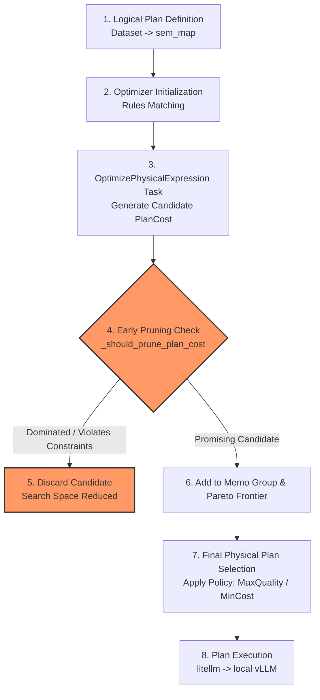

# Palimpzest / Abacus Query Optimization and Early Pruning Flow

This document explains the architecture of the Palimpzest/Abacus query engine, using `cuad_demo.py` as a concrete example, and illustrates how our early pruning optimizations integrate into the overall flow.

---

## 1. Overview of Palimpzest and Abacus
* **Palimpzest** is an AI-powered database engine designed to query unstructured data (like PDFs, text, and images) using LLMs.
* **Abacus** is the cost-based query optimizer within Palimpzest. It models the trade-offs between LLM execution **cost**, **latency**, and **quality** to find the most efficient execution plan based on user-defined policies.

---

## 2. Step-by-Step Query Lifecycle (CUAD Demo Example)

The following diagram illustrates how a query progresses from definition to execution, highlighting where our early pruning optimization fits in:



### Step 2.1: Logical Plan Definition
In [cuad-demo.py](/home/matheuspimenta/kunumi/palimpzest/abacus-research/cuad-demo.py), the query is defined using high-level logical operations:
```python
# Extract target fields from contract text
query = dataset.sem_map(cols, depends_on=["contract"])
```
This builds a **logical query plan** of `ConvertScan` and `FilteredScan` operators without choosing specific models or execution strategies yet.

### Step 2.2: Candidate Generation and Rule Substitution
When `optimizer.optimize(query)` is called, the Abacus optimizer applies **Implementation Rules** (such as [MixtureOfAgentsRule](/home/matheuspimenta/kunumi/palimpzest/src/palimpzest/query/optimizer/rules.py#L711)) to find all physical implementations of each logical operator. 

For a single logical mapping, candidate physical implementations include:
* Standard `LLMConvert` running on model $A$.
* Standard `LLMConvert` running on model $B$.
* `MixtureOfAgentsConvert` using model $A$ and model $B$ together.

### Step 2.3: Memoization and Cost Estimation
The optimizer uses a **Memo structure** to store all possible candidate plans and their estimated metrics:
* **Cost** ($/token)
* **Time** (seconds/token)
* **Quality** (MMLU-Pro score approximation)

Metrics are estimated via the [SampleBasedCostModel](/home/matheuspimenta/kunumi/palimpzest/src/palimpzest/query/optimizer/cost_model.py) using the metadata in [pz_models_information.json](/home/matheuspimenta/kunumi/palimpzest/src/palimpzest/utils/pz_models_information.json).

---

## 3. How Our Changes (Early Pruning) Are Inserted

Our early pruning checks are inserted directly inside the candidate generation loops of the `OptimizePhysicalExpression` tasks in [tasks.py](/home/matheuspimenta/kunumi/palimpzest/src/palimpzest/query/optimizer/tasks.py#L589).

As new candidate plan costs are constructed, they must pass the `_should_prune_plan_cost` check before being added to the Memo group.

### Pruning Logic Execution:
```python
# Inside OptimizePhysicalExpression task loops
full_plan_cost = op_plan_cost + input_plan_cost
if not self._should_prune_plan_cost(group, full_plan_cost, policy, optimizer_strategy):
    all_possible_plan_costs.append(full_plan_cost)
```

If the candidate is pruned, it is **discarded immediately**. This prevents the optimizer from:
1. Storing the suboptimal plan cost in the Memo.
2. Generating further derivative plans (e.g., combining it with parent operators or downstream join partners).

### Pruning Strategies:
1. **Pareto Dominance Pruning:** If a candidate has worse estimated cost, latency, and quality than an existing plan in the group's Pareto frontier, it is dominated and pruned.
2. **Greedy Bound Pruning:** If a candidate's optimistic bounds cannot beat the current best plan (incumbent) in the group, it is pruned.
3. **Constraint Pruning:** If a candidate's optimistic lower bounds violate the policy constraint (e.g. exceeds budget limit), it is pruned.

---

## 4. Parameter Customization

We added environment variable configurations in [tasks.py](/home/matheuspimenta/kunumi/palimpzest/src/palimpzest/query/optimizer/tasks.py#L360-L460) so you can adjust and test pruning behavior:

```python
# 1. Soft/approximate Pareto dominance
epsilon = float(os.getenv("PRUNING_EPSILON", "0.0"))

# 2. Relaxed constraints buffer
multiplier = float(os.getenv("PRUNING_CONSTRAINT_MULTIPLIER", "1.0"))

# 3. Greedy incumbent margin
margin = float(os.getenv("PRUNING_BEAT_INCUMBENT_MARGIN", "1.0"))
```

* **Aggressive Pruning (e.g. `EPSILON=0.05`):** Prunes more candidates by allowing plans that are "almost dominated" (within 5%) to be discarded, reducing search time.
* **Safe Pruning (e.g. `EPSILON=-0.05`):** Retains more candidates by ensuring plans are only pruned if another plan is significantly better.
