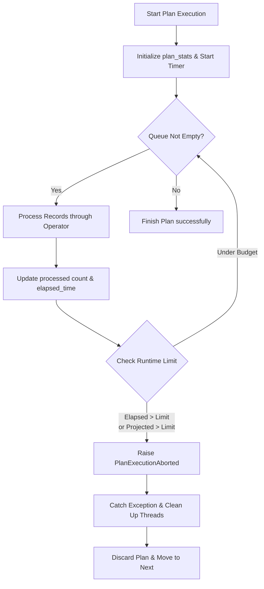

# Design Proposal: Runtime Execution Pruning (Fail-Fast Execution)

This document proposes a new optimization direction for the Palimpzest/Abacus engine: **Runtime Execution Pruning**. While early pruning in the optimizer successfully reduces the static compilation search space, **Runtime Pruning** introduces a dynamic "fail-fast" execution strategy to abort plans that are underperforming during execution.

---

## 1. Core Motivation

In a Pareto-optimal cost/latency search space, the engine often evaluates multiple physical plans (e.g., during Sentinel sampling or sequential execution of frontier candidates). 

If we have already executed a plan that completed in $T_{\text{limit}}$ seconds, we can use $T_{\text{limit}}$ as our active runtime budget. If a subsequent candidate plan:
1. Has already exceeded $T_{\text{limit}}$ during its execution, or
2. Is only halfway through its input queue but has already spent 90% of its budget (projected timeout),

we can **safely abort/prune its execution** on-the-fly. This prevents wasteful GPU utilization, saves API token costs, and speeds up query profiling.

---

## 2. Architecture and Flow

The following diagram illustrates how Runtime Pruning integrates into the physical plan execution loop:



### Key Components:
1. **`PlanExecutionAborted(Exception)`**: A custom exception raised when a plan is pruned at runtime.
2. **`runtime_limit` parameter**: Passed dynamically to the execution strategy's `execute_plan` method.
3. **Execution Loop Monitoring**: Interleaved checks inside the main execution queue loop.

---

## 3. Implementation Blueprint

### A. Define the Custom Exception
In `palimpzest/query/execution/execution_strategy.py`:
```python
class PlanExecutionAborted(Exception):
    """Raised when plan execution is aborted early because it exceeded its cost/time budget."""
    pass
```

### B. Add Monitoring to the Execution Strategy
In `palimpzest/query/execution/parallel_execution_strategy.py`:
```python
    def _execute_plan(
            self,
            plan: PhysicalPlan,
            input_queues: dict[str, dict[str, list]],
            future_queues: dict[str, list],
            plan_stats: PlanStats,
            runtime_limit: float = None,
            cost_limit: float = None,
        ) -> tuple[list[DataRecord], PlanStats]:
        
        output_records = []
        with ThreadPoolExecutor(max_workers=self.max_workers) as executor:
            final_op = plan.operator
            while self._any_queue_not_empty(input_queues) or self._any_queue_not_empty(future_queues):
                
                # Check for Timeout / Latency Pruning
                if runtime_limit is not None:
                    elapsed = plan_stats.elapsed_time() # or time.time() - plan_stats.start_time
                    if elapsed > runtime_limit:
                        raise PlanExecutionAborted(
                            f"Plan execution pruned. Elapsed time ({elapsed:.2f}s) exceeded limit ({runtime_limit:.2f}s)."
                        )
                
                # Check for Financial Cost (USD) Pruning
                if cost_limit is not None:
                    # Accumulate operator and validation costs in real-time
                    current_cost = plan_stats.sum_op_stats_field("total_op_cost") + plan_stats.sum_validation_stats_field("cost_per_record")
                    if current_cost > cost_limit:
                        raise PlanExecutionAborted(
                            f"Plan execution pruned. Accrued cost (${current_cost:.4f}) exceeded limit (${cost_limit:.4f})."
                        )
                
                # ... standard operator execution loops ...
```

### C. Catch and Handle the Abort in the Query Processor
In `palimpzest/query/processor/query_processor.py`:
```python
    def _execute_best_plan(self, dataset: Dataset, optimizer: Optimizer) -> tuple[list[DataRecord], list[PlanStats]]:
        physical_plans = optimizer.optimize(dataset)
        
        best_records = None
        best_stats = None
        runtime_limit = None
        cost_limit = None
        
        for plan in physical_plans:
            try:
                records, stats = self.execution_strategy.execute_plan(
                    plan, 
                    runtime_limit=runtime_limit, 
                    cost_limit=cost_limit
                )
                
                # Update limits dynamically if this plan is better (under policy)
                if best_stats is None or stats.total_plan_time < best_stats.total_plan_time:
                    best_records = records
                    best_stats = stats
                    
                    # Set the new time and cost limits based on the current best plan
                    runtime_limit = stats.total_plan_time
                    cost_limit = stats.total_plan_cost
                    
            except PlanExecutionAborted as e:
                logger.info(f"Safely skipped plan {plan.plan_id} due to runtime pruning: {e}")
                continue
                
        return best_records, [best_stats]
```

---

## 4. Expected Benefits
* **GPU & API Savings:** Prevents expensive LLM operations on plans that are already guaranteed to be slower or more expensive than our current best option.
* **Sentinel Acceleration:** Makes the sentinel sampling phase significantly faster by cutting off slow or costly candidate execution paths early.

