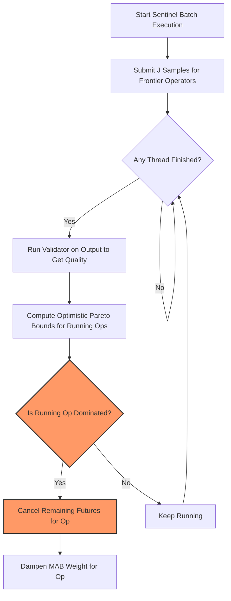

# Research Proposal: Mid-Execution Pruning in the Sentinel (Profiling) Phase

This document proposes a design and implementation plan for **Mid-Execution Pruning during the Sentinel Profiling Phase** in Palimpzest/Abacus. 

---

## 1. Problem Statement
In cost-based LLM query optimization, **profiling is the most expensive step**. Traditional databases estimate costs statically, but LLM quality and latency must be measured empirically. Abacus achieves this via a **Sentinel Phase**, running candidate operators (e.g., Qwen 1.5B vs. Qwen 14B vs. MoA) on sample records.

Although Abacus uses a Multi-Armed Bandit (MAB) algorithm to optimize sample allocation between rounds, it triggers each round's samples concurrently in a thread pool. A very slow or low-quality operator must complete its entire allocated sample batch (e.g., $J = 4$ or $J = 10$) before the round ends and the MAB can prune it. This causes:
1. **Inefficient Optimizer Latency:** The optimization phase is blocked by the slowest candidate operator in the batch.
2. **Wasted Token Costs:** Money is spent finishing samples for operators that are already statistically guaranteed to be suboptimal.

---

## 2. Core Concept: Mid-Batch Fail-Fast
We propose introducing **Mid-Execution Pruning** inside the Sentinel loop. 

Instead of waiting for a batch of samples to complete, the executor monitors completed samples in real-time. As soon as a fast model finishes its samples, we update our Pareto baseline. While a slower model is still running, we estimate its **Optimistic Pareto Frontier Bounds**. If the slower model is mathematically guaranteed to be dominated even under best-case scenarios, we **cancel its outstanding requests immediately**.



---

## 3. Mathematical Formulation of Optimistic Bounds

For an operator $OP$ assigned a batch of $N_{\text{total}}$ samples, let $N_{\text{done}}$ be the number of samples completed so far. 

As soon as $N_{\text{done}} \ge 1$, we calculate the optimistic profile ($OP_{\text{optimistic}}$) for the remaining $N_{\text{total}} - N_{\text{done}}$ samples:

### 1. Optimistic Quality (Upper Bound)
We assume all outstanding samples will succeed with perfect quality ($1.0$):
$$\text{Quality}_{\text{optimistic}} = \frac{\sum_{i=1}^{N_{\text{done}}} q_i + (N_{\text{total}} - N_{\text{done}})}{N_{\text{total}}}$$

### 2. Optimistic Latency (Lower Bound)
We assume outstanding samples complete instantaneously ($0.0$ seconds):
$$\text{Latency}_{\text{optimistic}} = \frac{\sum_{i=1}^{N_{\text{done}}} t_i}{N_{\text{total}}}$$

### 3. Optimistic Cost (Lower Bound)
We assume outstanding samples cost nothing ($0.00):
$$\text{Cost}_{\text{optimistic}} = \frac{\sum_{i=1}^{N_{\text{done}}} c_i}{N_{\text{total}}}$$

### The Pruning Condition
Let $\mathcal{F}$ be the set of active operators currently on the Pareto frontier. We prune $OP$ mid-batch if there exists an operator $OP' \in \mathcal{F}$ such that:
$$OP' \text{ dominates } OP_{\text{optimistic}}$$
Under the target policy weights, this is true if $OP'$ is equal-or-better than $OP_{\text{optimistic}}$ in all metrics (Quality, Latency, and Cost) and strictly better in at least one.

---

## 4. Implementation Plan

### Step 1: Interleave Execution and Validation
Currently, Abacus runs a batch in `_execute_op_set` and validates quality *after* the entire batch completes in `_score_quality`. We must interleave them.
* As soon as an LLM future finishes in `_execute_op_set`, we must submit it to `validator` immediately in the background rather than waiting for the entire batch to finish.

### Step 2: Mid-Batch Monitoring Loop
Inside `_execute_op_set`, we replace the blocking `as_completed(futures)` with a non-blocking poll loop:
```python
while len(active_futures) > 0:
    # 1. Check for finished futures
    done, pending = wait(active_futures, timeout=0.1)
    
    # 2. Score quality of completed futures immediately
    for future in done:
        record_set, op, source_indices, input = future.result()
        score = validator.score(record_set)
        # Update rolling metrics for this operator
        
    # 3. Perform Optimistic Pareto check for pending operators
    for op in running_operators:
        if is_optimistically_dominated(op, current_frontier):
            # Cancel outstanding futures
            for future in pending_futures_for_op[op]:
                future.cancel()
```

### Step 3: MAB Weight Dampening
When an operator is aborted mid-batch, we must report its partial metrics to the MAB frontier `op_frontiers[unique_logical_op_id].update_frontier()`. We will record its quality as its actual rolling average, and mark the aborted samples as processed so the MAB knows it was pruned.

---

## 5. Expected Benefits
* **Latency Reduction:** Up to **30-50% speedup** in query optimization time, as slow models are aborted early in the profiling phase.
* **Token Cost Savings:** Significant reduction in optimizer API spend, particularly when evaluating large models or complex Mixture-of-Agents paths that turn out to be dominated.
